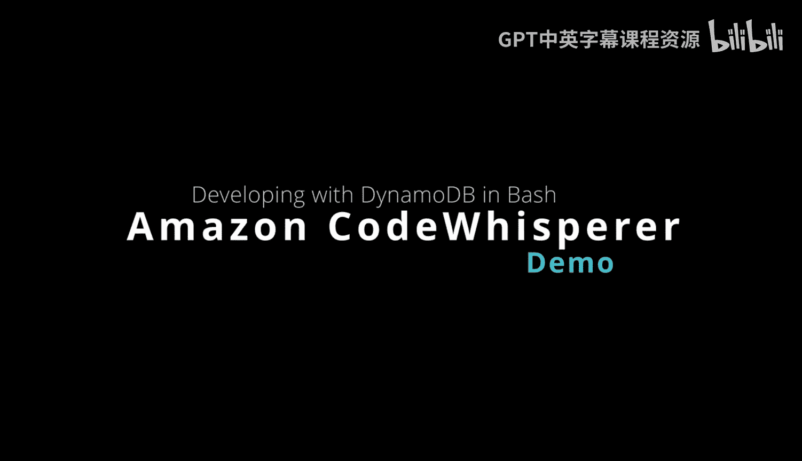
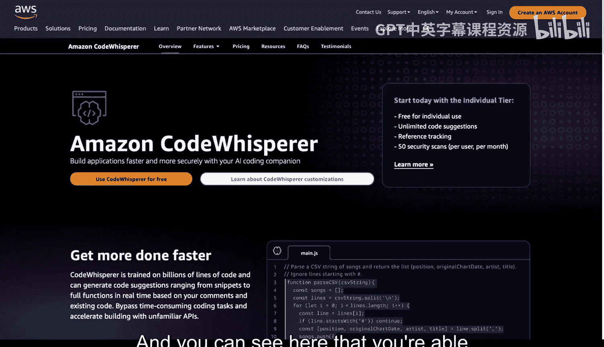
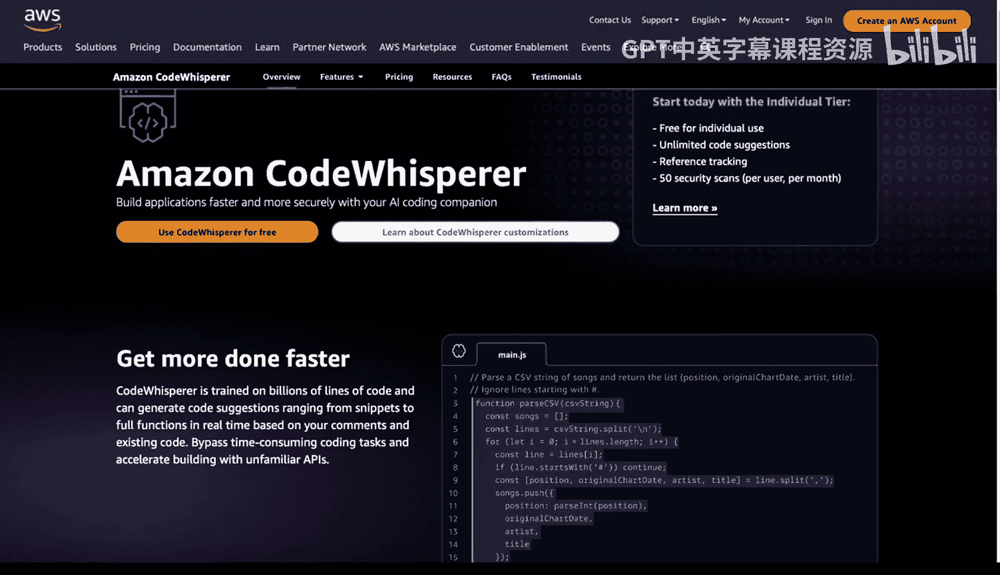
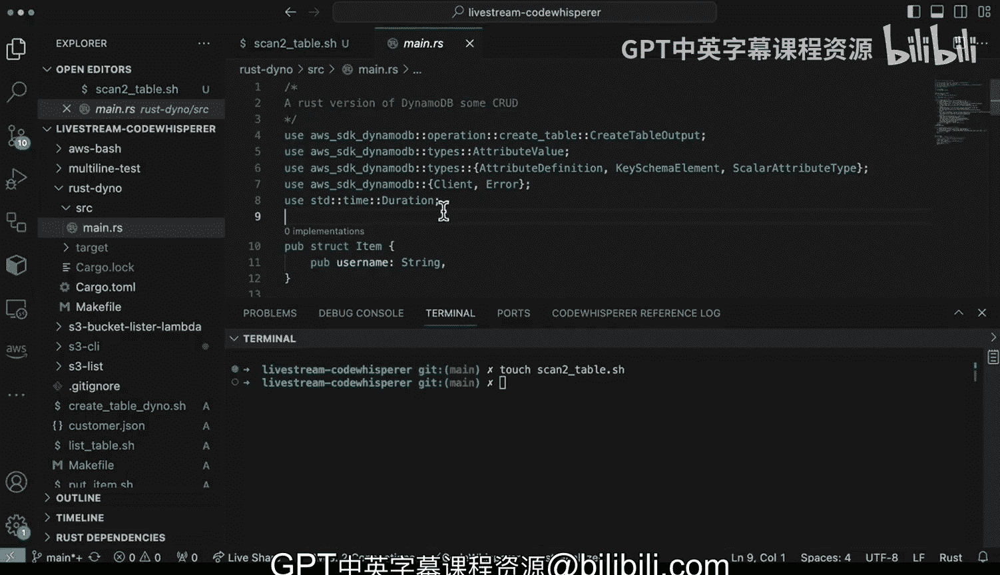

# 大型语言模型实践（高级数据工程、AWS、Databricks和本地LLM）：P56：利用AWS CodeWhisperer进行Dynamo开发 🚀

在本节课中，我们将要学习如何利用AWS CodeWhisperer这一强大的AI编程助手来提升DynamoDB的开发效率。我们将了解其核心功能、安装配置方法，并通过一个具体的Bash脚本编写示例，展示它如何在实际开发中提供智能代码建议。

## 概述

Amazon CodeWhisperer是一个能够显著提升DynamoDB编程技能的工具。它提供无限的代码建议，完全免费，并且基于数十亿行代码进行训练，特别针对AWS工作流进行了优化。它是一个能极大提高生产力的优秀工具，支持包括Python、Rust、Bash在内的多种编程语言。

## 安装与配置

上一节我们介绍了CodeWhisperer的核心优势，本节中我们来看看如何在开发环境中启动并使用它。

在Visual Studio Code环境中，CodeWhisperer集成在AWS Toolkit扩展中。将鼠标悬停在扩展上，可以看到它提供了对CodeWhisperer、Code Catalyst以及Lambda、S3等服务的支持。

其便捷之处在于，我们可以直接在开发环境中启用它并进行各种设置。进入扩展设置，可以确认CodeWhisperer已安装，并查看关于如何使用它的建议。

如果需要确认其安装状态，可以在VS Code底部的状态栏查看。在AWS菜单中，可以找到CodeWhisperer的开关选项。将鼠标悬停其上，可以确认它已被选中。我们可以在此处停止或运行代码建议功能。

此外，CodeWhisperer还具备安全扫描功能，这有助于发现潜在的安全漏洞。另一个很酷的功能是代码溯源，它可以显示建议代码的来源，方便开发者参考和学习。

## 实践：使用CodeWhisperer编写Bash脚本

了解了基本配置后，我们通过一个具体的例子来看看如何在实际工作流中使用它。

以下是如何开始使用CodeWhisperer进行基于Bash的工作流开发。

首先，一个有趣的尝试是创建一个新的Bash脚本文件。我们可以先执行 `git pull` 获取最新代码，然后使用 `touch` 命令重新创建一个我之前已经构建过的系统脚本，我们将其命名为 `scan_table.sh`。

查看这个文件时，我首先要做的是添加Shebang行（`#!/bin/bash`）。神奇的是，CodeWhisperer已经预知了我的意图并帮助我自动补全了这行代码。

它甚至能帮助我编写文档注释。例如，如果我输入注释“此脚本将扫描名为‘customers’的表”，CodeWhisperer会立即给出关于后续操作的代码建议。

先编写文档注释的好处在于，CodeWhisperer能据此自动生成实现相应功能的正确命令。在这个例子中，它为我生成了执行扫描表操作的命令。

我认为，开始使用CodeWhisperer最简单的方式之一就是深入Bash脚本编写，让它帮助你完成代码补全等工作。对于初学者来说，这可能是性价比最高的入门方式：如果AWS上的某项服务支持命令行接口，你就可以在此编写一些小型的Bash脚本，并让CodeWhisperer为你自动补全。你可以看到，这在提升生产力方面是一个巨大的胜利。

当然，你也可以用它来构建其他语言的项目。例如，我这里有一些Rust项目，你显然可以在Rust语言中使用它，同样也适用于Python等。

## 核心功能与总结

本节课中我们一起学习了AWS CodeWhisperer在DynamoDB开发中的应用。

最重要的收获是，如果你正在构建AWS相关的代码，使用CodeWhisperer的自动补全功能将带来巨大的效率提升。它还具有许多独特的功能，包括**安全扫描**，以及**代码溯源**，后者可以显示代码片段的原始出处。

**核心优势公式可总结为：**
`开发效率提升 ≈ 智能补全 + 安全扫描 + 代码溯源`

通过本教程，你应该已经掌握了如何配置CodeWhisperer，并理解了如何利用其智能建议来加速Bash脚本及其他语言的开发流程，从而更高效地进行DynamoDB及相关AWS服务的开发工作。