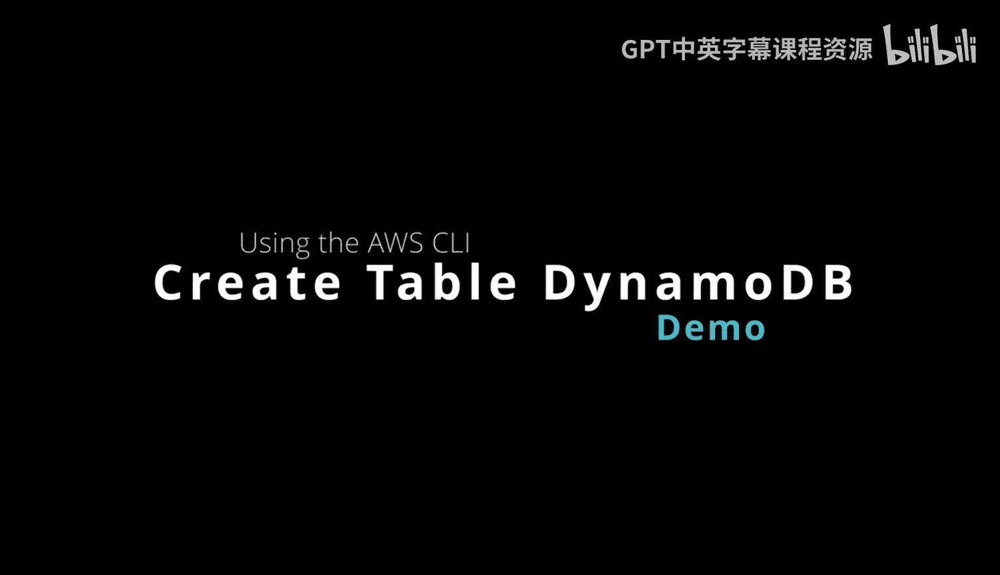
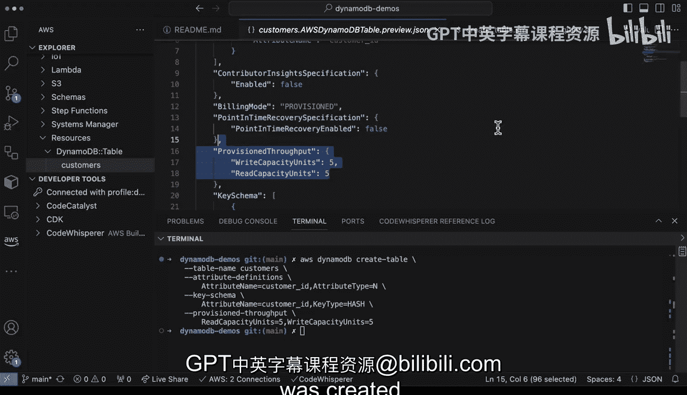

# 大型语言模型实践（高级数据工程、AWS、Databricks和本地LLM）：P57：57_04_06_使用CLI创建表



在本节课中，我们将学习如何使用AWS命令行界面（CLI）在DynamoDB中创建一个表。我们将通过一个具体的例子，演示创建名为“customers”的表的完整过程。

## 创建DynamoDB表的CLI命令

为了创建一个表，你可以使用AWS CLI的DynamoDB命令。以下是创建表所需的基本命令结构。

**命令结构**：
```bash
aws dynamodb create-table --table-name <表名> --attribute-definitions <属性定义> --key-schema <键模式> --provisioned-throughput <预置吞吐量>
```

## 命令详解与执行

上一节我们介绍了创建表的基本命令结构，本节中我们来看看如何填充具体参数并执行命令。

以下是创建“customers”表的具体命令示例：
```bash
aws dynamodb create-table --table-name customers --attribute-definitions AttributeName=customerID,AttributeType=S --key-schema AttributeName=customerID,KeyType=HASH --provisioned-throughput ReadCapacityUnits=5,WriteCapacityUnits=5
```

*   **`--table-name customers`**：指定要创建的表的名称。
*   **`--attribute-definitions AttributeName=customerID,AttributeType=S`**：定义表的主键属性。这里定义了一个名为“customerID”、类型为字符串（S）的属性。
*   **`--key-schema AttributeName=customerID,KeyType=HASH`**：指定键模式。这里将“customerID”属性定义为哈希（分区）键。
*   **`--provisioned-throughput ReadCapacityUnits=5,WriteCapacityUnits=5`**：设置表的预置读写容量单位。

将上述命令复制到终端并执行。如果成功，命令行将返回一个JSON响应，确认表已创建。

## 在AWS管理控制台中验证

执行CLI命令后，我们可以通过AWS管理控制台来验证表是否已成功创建。

打开AWS Toolkit或直接访问AWS管理控制台，导航到DynamoDB服务。在资源列表中，你现在应该能看到新创建的“customers”表。点击该表，可以查看其详细信息，确认其配置（如主键、吞吐量设置）与我们通过CLI命令指定的完全一致。



本节课中我们一起学习了如何使用AWS CLI在DynamoDB中创建表。我们详细讲解了`create-table`命令的结构和关键参数，并演示了从执行命令到在控制台验证结果的完整流程。掌握CLI操作是进行高效数据工程管理的重要技能。