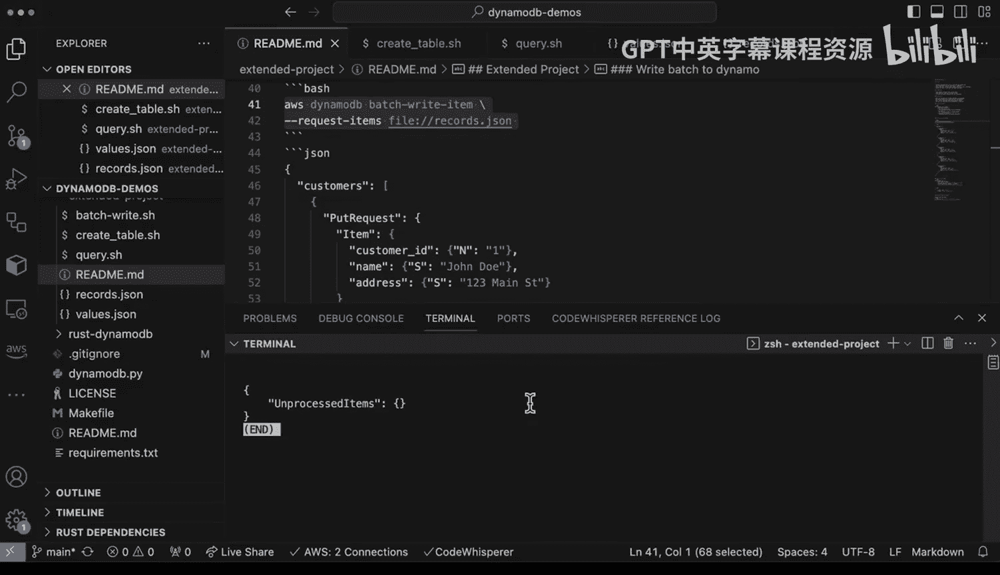
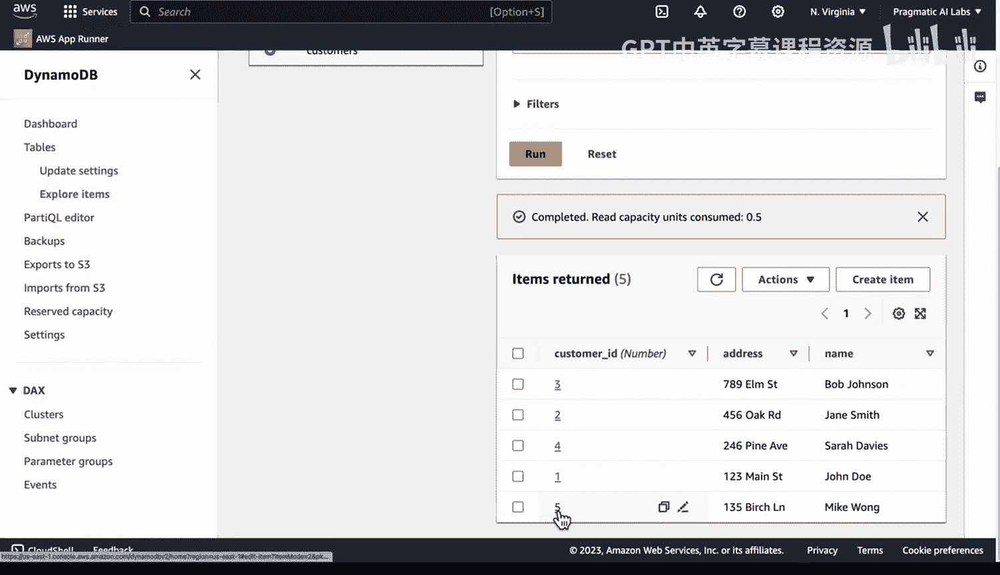

# 大型语言模型实践（高级数据工程、AWS、Databricks和本地LLM）：P58：批量记录填充表

在本节课中，我们将学习如何使用AWS DynamoDB的`batch-write-item`命令，通过一个JSON文件一次性向数据库表中填充多条记录。这种方法对于批量数据导入和更新操作非常高效。


## 概述

上一节我们介绍了DynamoDB的基本操作，本节中我们来看看如何执行批量写入操作。批量写入允许我们一次性添加或更新多个数据项，这比逐条写入要快得多。

## 批量写入操作详解

以下是执行批量写入的核心命令结构：

```bash
aws dynamodb batch-write-item --request-items file://your_file.json
```

在这个命令中，`--request-items`参数用于指定一个包含所有待写入记录的JSON文件。

## JSON文件结构

为了确保批量写入成功，我们需要准备一个结构正确的JSON文件。这种方式的优点在于，你可以轻松地对JSON进行格式校验，确保数据结构无误。

以下是JSON文件的一个示例结构：

```json
{
  "YourTableName": [
    {
      "PutRequest": {
        "Item": {
          "CustomerID": {"S": "C001"},
          "Address": {"S": "123 Main St"},
          "Name": {"S": "Alice"}
        }
      }
    },
    {
      "PutRequest": {
        "Item": {
          "CustomerID": {"S": "C002"},
          "Address": {"S": "456 Oak Ave"},
          "Name": {"S": "Bob"}
        }
      }
    }
  ]
}
```

## 执行批量写入

现在，让我们来实际运行这个操作。首先，从项目文档中复制相应的命令。

将命令粘贴到终端并执行：

```bash
aws dynamodb batch-write-item --request-items file://records.json
```

命令执行速度非常快。完成后，我们可以立即在DynamoDB控制台中查看结果。

## 验证结果



操作执行完毕后，我们前往AWS DynamoDB控制台进行验证。

在对应的数据表中，我们可以看到所有通过JSON文件导入的记录都已成功添加，包括`CustomerID`、`Address`和`Name`等字段。

## 总结



本节课中我们一起学习了如何使用AWS CLI的`batch-write-item`命令，通过一个结构化的JSON文件向DynamoDB表批量填充数据。这种方法不仅效率高，而且便于通过校验JSON结构来确保数据的准确性，是进行大规模数据初始化和更新的有效工具。