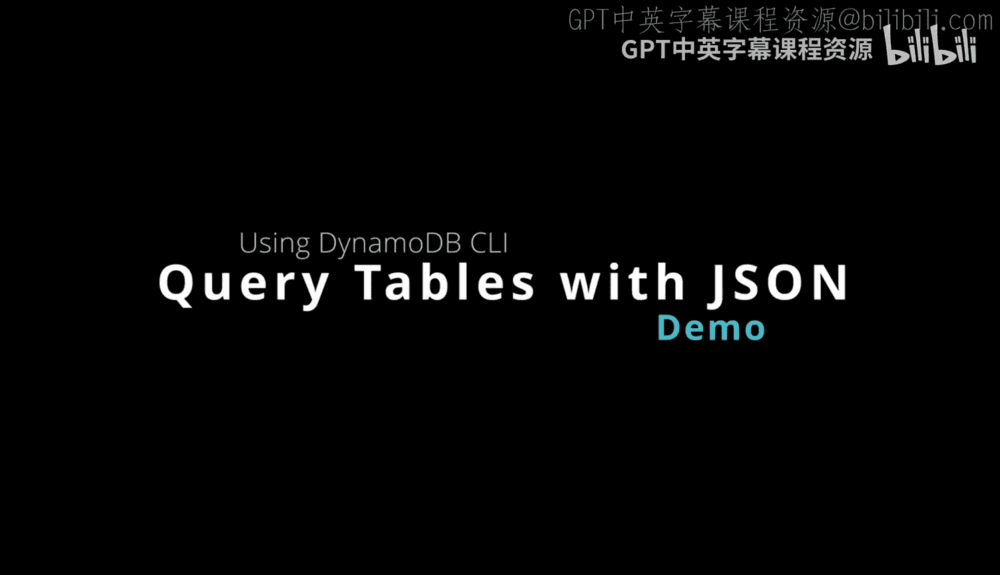
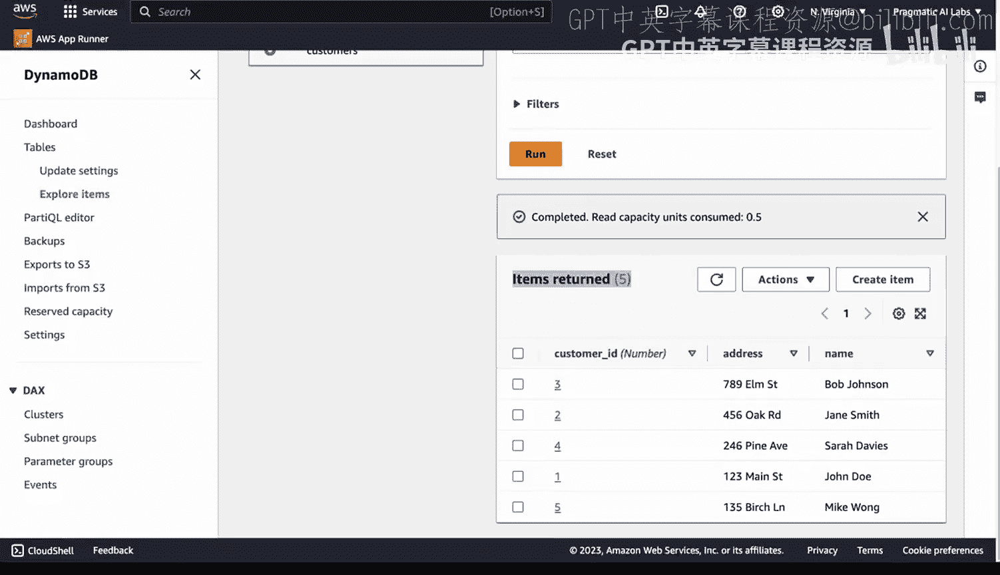
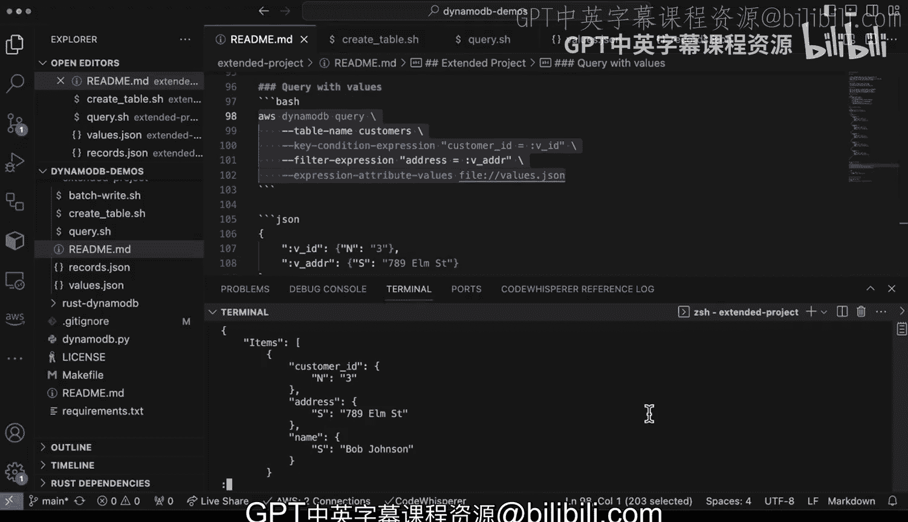

# 大型语言模型实践（高级数据工程、AWS、Databricks和本地LLM）：P59：查询表中的记录

在本节课中，我们将学习如何在AWS DynamoDB中执行查询操作，以根据特定条件检索表中的记录。我们将使用AWS CLI工具，通过定义查询表达式和参数来精确获取所需数据。

---

## 概述

DynamoDB是一个NoSQL数据库服务，允许我们存储和查询数据。本节将演示如何基于特定参数（如客户ID和地址）查询DynamoDB表中的记录。我们将使用一个预定义的JSON文件来传递查询参数，使查询过程可重复且易于管理。

---

## 查询DynamoDB表

上一节我们介绍了DynamoDB表的基本结构。本节中，我们来看看如何执行一个具体的查询操作。

在DynamoDB中，我们有一个名为`customers`的客户表。查看表内数据，可以看到其中包含了不同客户的详细信息，如地址和姓名。现在，我们将基于一组特定参数来查询这个表。

为了执行查询，我们需要返回到VS Code编辑器，并使用AWS DynamoDB的查询命令。

---

## 构建查询命令

以下是构建查询命令的关键步骤。我们将使用`aws dynamodb query`命令，并指定表名、查询条件表达式以及参数值。

首先，传入表名，即`customers`表。接着，定义查询表达式，本例中条件是客户ID等于某个特定值。同时，我们使用过滤表达式来匹配特定地址。最后，通过一个JSON文件传入表达式属性值。

这种方法的有趣之处在于，我们可以将参数值保存在一个文件中，命令执行时会自动替换这些占位符。例如，对于客户ID，它会查找值为`3`的记录；对于地址，则会匹配`789 Elm Street`。

---

## 执行查询

回到`readme`文件，可以看到它将把这个JSON文件传递给查询命令。现在，让我们执行这个命令。

执行成功后，我们能够精确检索到匹配查询条件的记录。这种方法的强大之处在于，你可以保存这个JSON文件，它代表了一种特定类型的查询，可以匹配你正在进行的某项操作。这使得将确切的查询需求以代码形式保存并纳入版本控制变得非常直接。

例如，这可以作为一个数据工程系统的基础，比如用于仪表板或某些机器学习应用。

---

## 总结

本节课中，我们一起学习了如何在DynamoDB中执行条件查询。我们使用了AWS CLI，通过定义查询表达式和借助JSON文件传递参数值，精确地检索了表中的记录。这种方法不仅使查询过程清晰可重复，还为构建更复杂的数据处理流程（如仪表板或机器学习应用的数据管道）奠定了基础。