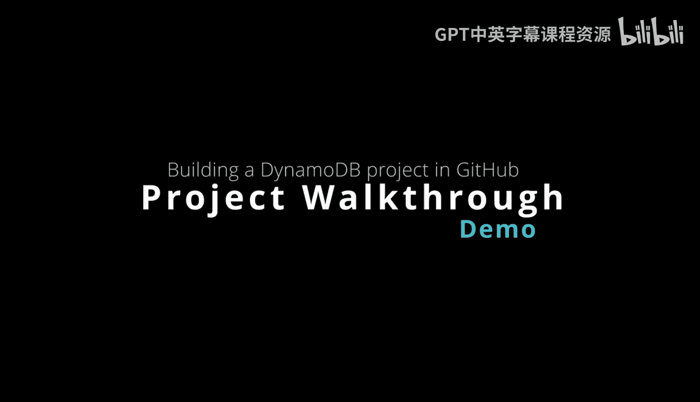
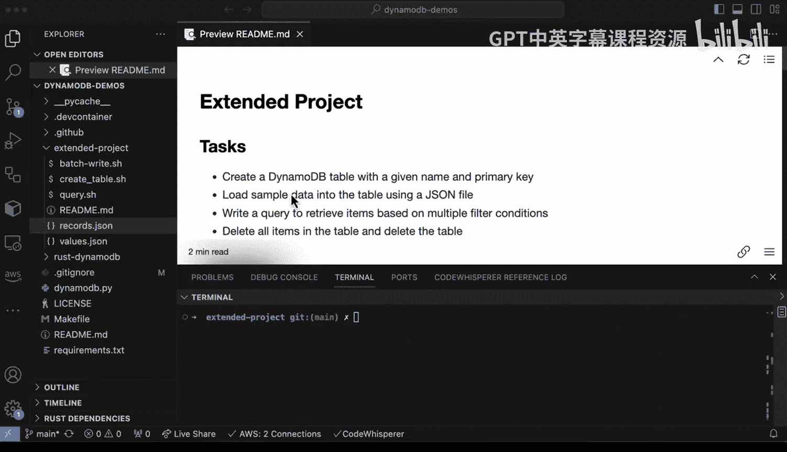
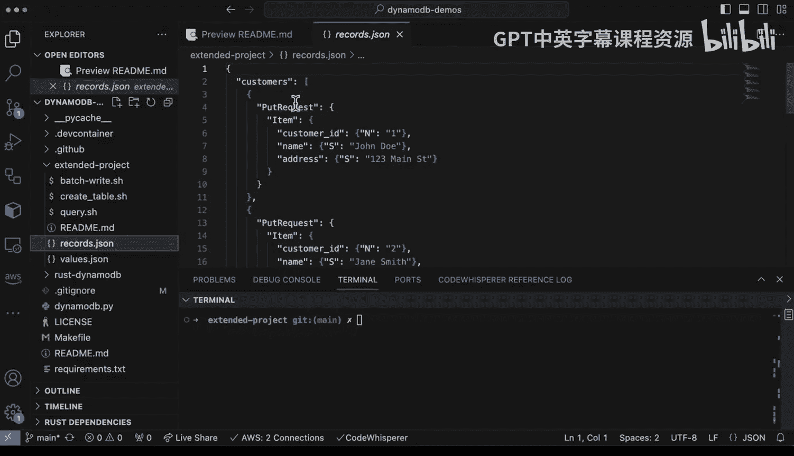
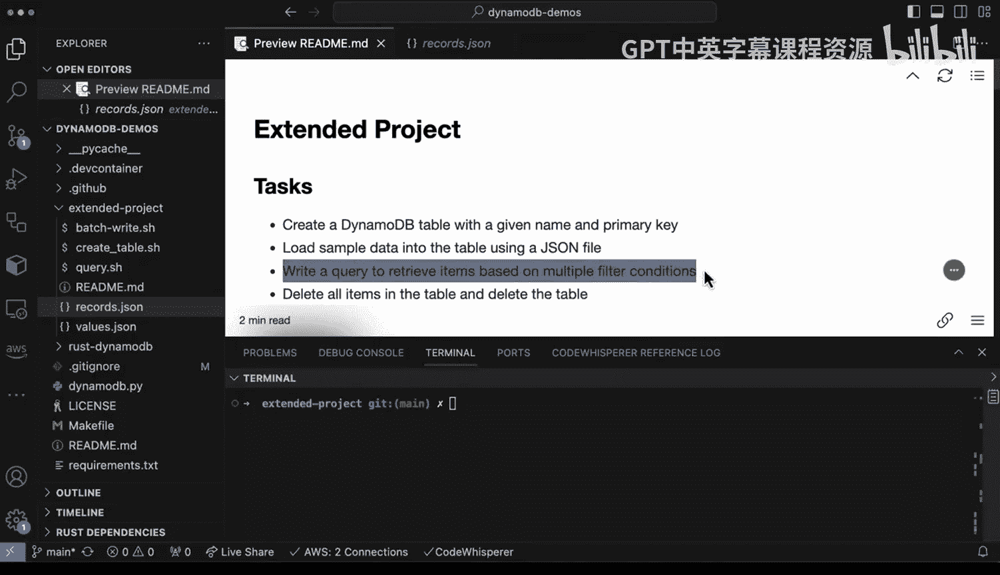
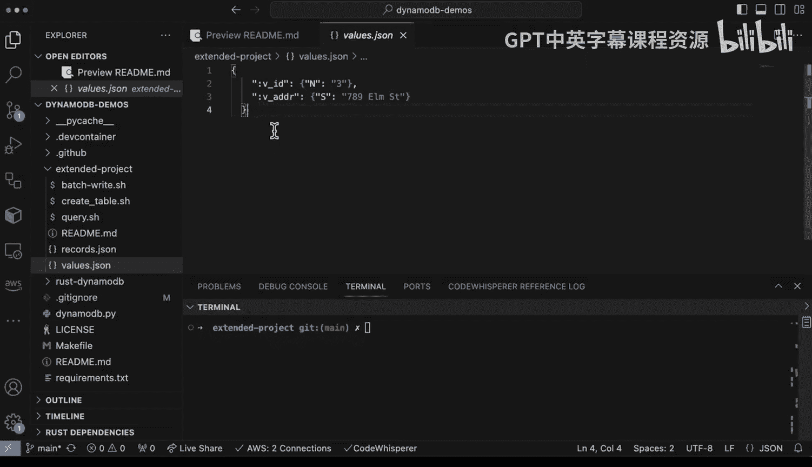
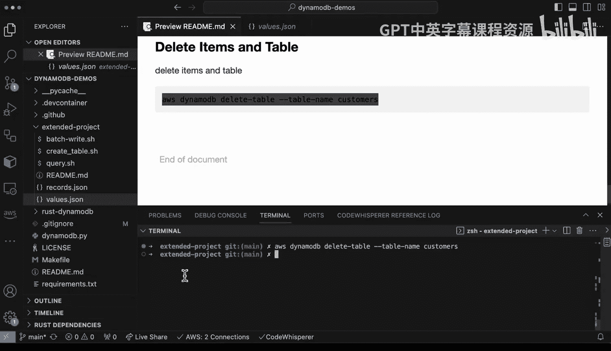

# 大型语言模型实践（高级数据工程、AWS、Databricks和本地LLM）：P60：项目演练 🧪



在本节课中，我们将学习一个关于Amazon DynamoDB的实践项目。该项目旨在通过一系列具体任务，帮助你掌握DynamoDB的核心操作，包括创建表、加载数据、执行查询以及清理资源。完成基础任务后，我们还将探讨如何扩展项目，并思考NoSQL数据库的设计与使用。

## 项目任务概述

以下是本项目需要完成的核心任务列表。我们将逐一讲解每个步骤。

1.  **创建DynamoDB表**：使用给定的名称和主键创建一个DynamoDB表。
2.  **加载样本数据**：使用一个相邻的JSON文件将样本数据加载到表中。
3.  **执行条件查询**：编写查询，基于多个过滤条件检索表中的项目。
4.  **清理资源**：删除表中的所有项目，并最终删除该表。

## 任务详解

上一节我们介绍了项目的整体目标，本节中我们来看看每个任务的具体内容和操作方法。

### 任务一：创建DynamoDB表

首先，我们需要创建一个DynamoDB表。这可以通过AWS管理控制台或AWS CLI/ SDK完成。核心是定义表名和主键（分区键，或分区键加排序键）。

例如，使用AWS CLI创建表的命令结构如下：
```bash
aws dynamodb create-table \
    --table-name YourTableName \
    --attribute-definitions AttributeName=id,AttributeType=S \
    --key-schema AttributeName=id,KeyType=HASH \
    --billing-mode PAY_PER_REQUEST
```

### 任务二：加载样本数据

创建表之后，下一步是将样本数据加载到表中。项目中提供了一个JSON文件（`records.json`），其中包含了要插入的数据记录。

以下是使用Python Boto3 SDK执行批量写入操作的示例代码：
```python
import boto3
import json

dynamodb = boto3.resource('dynamodb')
table = dynamodb.Table('YourTableName')





with open('records.json') as f:
    records = json.load(f)





with table.batch_writer() as batch:
    for item in records:
        batch.put_item(Item=item)
```

### 任务三：执行条件查询

数据加载完成后，我们可以执行查询操作。DynamoDB允许使用**KeyConditionExpression**和**FilterExpression**来精确检索数据。

例如，查询`status`为`"active"`且`category`为`"books"`的项目：
```python
response = table.query(
    KeyConditionExpression=Key('partition_key').eq('user123'),
    FilterExpression=Attr('status').eq('active') & Attr('category').eq('books')
)
items = response['Items']
```

### 任务四：清理资源

最后，为了管理成本和资源，我们需要清理本项目创建的所有资源。这包括清空表和删除表。

清空表中所有项目的代码：
```python
scan = table.scan()
with table.batch_writer() as batch:
    for item in scan['Items']:
        batch.delete_item(Key={'id': item['id']})
```
删除表的代码：
```python
table.delete()
```

## 挑战与扩展

完成上述基础任务后，项目还提出了进一步的挑战，旨在深化你对DynamoDB的理解。

以下是建议的扩展挑战任务：

1.  **添加全局二级索引（GSI）**：为表添加一个GSI，以支持对不同属性的高效查询。
2.  **更换数据源**：尝试从CSV文件而非JSON文件加载数据集。
3.  **尝试不同查询场景**：设计并执行更复杂的查询或扫描（Scan）操作。

## 反思与总结

在本节课中，我们一起学习了DynamoDB的基本操作流程。通过这个项目，你应该对以下问题有了更深的体会：

*   NoSQL数据库（如DynamoDB）的优势是什么？
*   如何为快速查询高效地建模数据？
*   哪些因素决定了预置容量（Provisioned Capacity）的需求？
*   使用AWS CLI/SDK与使用管理控制台操作DynamoDB的体验有何不同？



总而言之，请逐步完成这个项目，尝试挑战任务，进行深度反思。这将帮助你构建一个出色的作品集项目，充分展示你对DynamoDB的掌握程度。