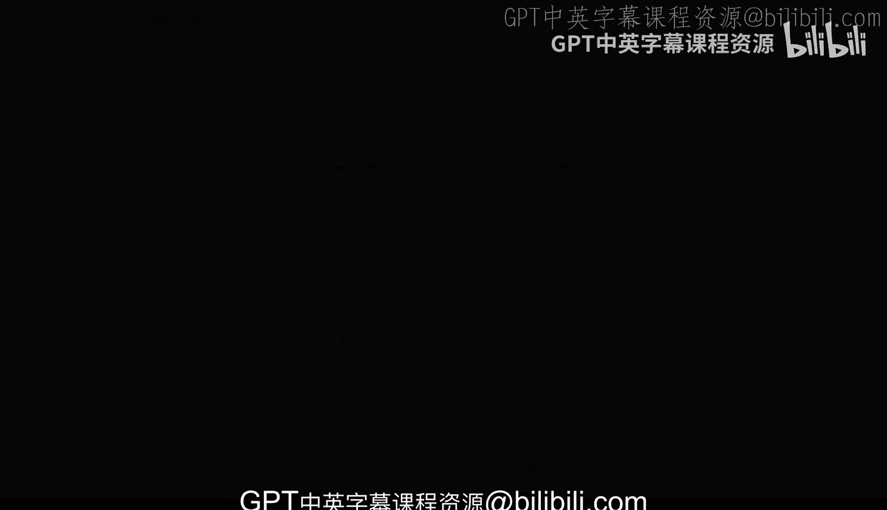
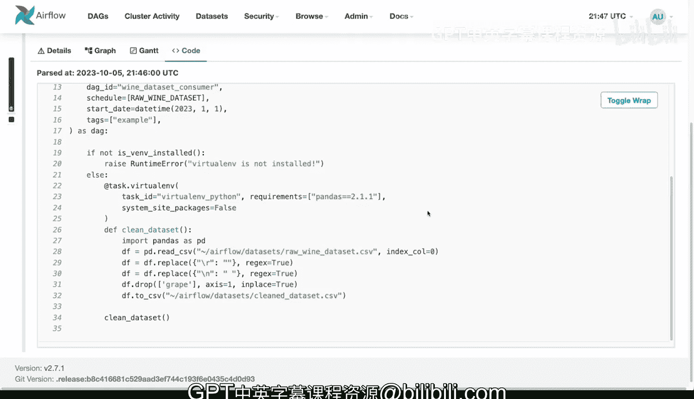

# 大型语言模型实践（高级数据工程、AWS、Databricks和本地LLM）：P62：管道需求概述 🚀

在本节课中，我们将学习如何构建一个更复杂的数据处理管道。我们将基于一个葡萄酒评分的CSV文件，创建能够执行多项任务、并将数据持久化到数据库的管道。

## 数据源与目标概述

我们之前已经见过这个葡萄酒评分的CSV文件。我们的目标是构建一个更复杂的任务集。我们将创建一个管道，执行多个不同的操作，并将从CSV中获取的特定信息持久化存储。CSV文件包含以下列：`name`（名称）、`country`（国家）、`region`（产区）、`variety`（品种）、`rating`（评分）和`notes`（品酒笔记）。

## 数据处理需求详解

根据我们想要实现的目标，我们只希望捕获 `name`（名称）、`country`（国家）、`region`（产区）、`variety`（品种）和`rating`（评分）这几列信息，并且我们不希望将 `notes`（品酒笔记）与这些信息放在同一个数据组中。

然而，我们仍然会保留 `notes` 列。这是因为假设本项目后续将使用这些笔记数据来训练一个机器学习模型。该机器学习模型的具体细节并不重要，但需求是必须单独捕获所有的 `notes` 数据。

为了实现这个目标，我们将把数据存入两个不同的表：`notes` 数据将进入一个表，而其他列的数据（`name`, `country`, `region`, `variety`, `rating`）将进入另一个表。我们将以这种方式对信息进行分组，并丢弃 `index`（索引）和 `grape`（葡萄）列，因为我们对这些不再感兴趣。

以上就是核心需求。

## 现有DAG结构回顾

现在，让我们快速回顾一下我们已有的DAG（有向无环图）结构。我们有一个 `dataset_get` 任务。如果你还记得，我们需要从GitHub仓库中获取数据。

在这个任务中，我们使用Apache Airflow的 `Dataset` 类定义了 `raw_wine_data`。这只是一个字符串标识符，用于指明我们要处理的对象。我们将安装pandas库，检索数据并将其保存到磁盘。这个任务相当直接，我们之前已经见过。一旦它完成，它将触发在代码第10行定义的 `raw_wine_dataset`。

## 消费者任务与未来改动

如果我们回到DAG并查看消费者（`consumer`）任务，这里将是我们要进行改动的地方。在消费者任务中，我们将依赖于 `raw_wine_dataset` 来执行一些更改。

我们将在这个DAG中执行数据处理：清洗数据，然后将其持久化到磁盘。此处的构想是，我们将使用这个消费者任务在同一个数据库中创建两个表。

## 确保操作幂等性

我们将使这个操作具备**幂等性**。这意味着它可以运行多次并产生相同的结果。接下来我们将看到如何实现这一点。

## 任务扩展计划

目前我们只有一个任务（消费者任务）。为了完成我们的需求——将数据持久化到一个至少包含两个新表的数据库中，我们将创建至少两个额外的任务。

## 总结

本节课中，我们一起学习了构建一个复杂数据处理管道的需求。我们分析了源数据，明确了需要将品酒笔记与其他葡萄酒信息分开存储到不同数据库表的需求。我们还回顾了现有的Airflow DAG结构，并规划了通过增加新任务来实现数据分离和持久化的步骤，同时强调了确保操作幂等性的重要性。在接下来的课程中，我们将着手实现这些任务。