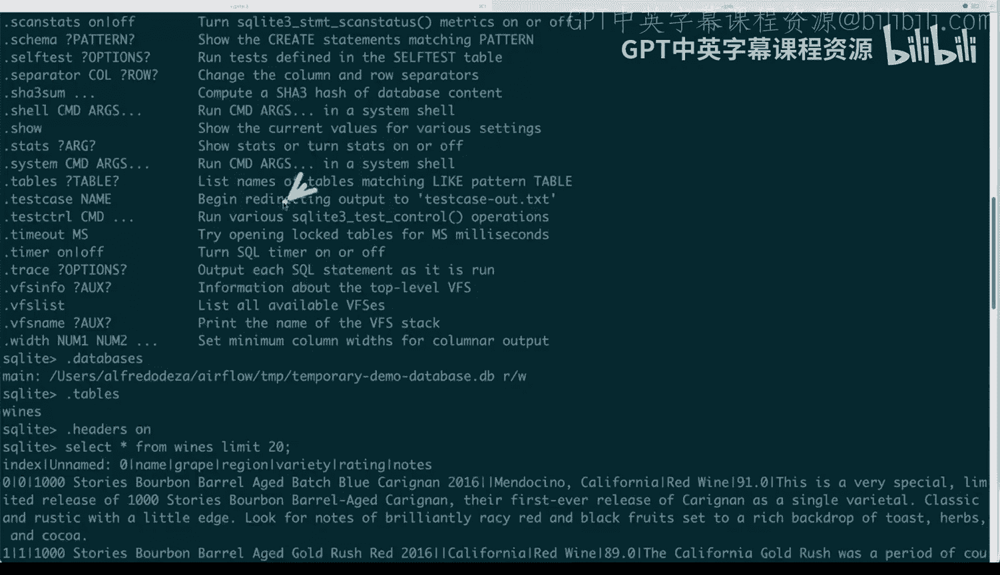

# 大型语言模型实践（高级数据工程、AWS、Databricks和本地LLM）：P63：将SQLAlchemy与Pandas结合使用 🛠️

在本节课中，我们将学习如何将Pandas与SQLAlchemy结合使用，以便将数据处理结果持久化存储到数据库中。我们将看到Pandas如何生成SQL语句，而SQLAlchemy如何作为桥梁，将这些语句发送到数据库并执行。

上一节我们介绍了数据处理的基本工具，本节中我们来看看如何将处理好的数据保存到数据库中。

## 概述

为了将我们学到的知识整合起来，我们需要了解如何让Pandas与SQLAlchemy协同工作。SQLAlchemy是一个库，它允许我们连接到各种不同的数据库后端。Pandas能够生成所需的SQL语句，而SQLAlchemy理解这些SQL，并知道如何将其发送到数据库并实现数据持久化。

## 环境准备


首先，我们需要设置一个虚拟环境并安装必要的库。我已经创建了一个名为`sqlite`的虚拟环境。我们将安装最新版本的SQLAlchemy和Pandas。

以下是安装步骤：
```bash
pip install sqlalchemy pandas
```

安装完成后，我们可以看到SQLAlchemy版本为2.0.1，Pandas版本为2.1.1。

## 连接数据库

现在，让我们看看如何让它们工作。我将打开Python交互式解释器，并导入所需的库。

```python
import pandas as pd
from sqlalchemy import create_engine
```

`create_engine`函数允许我为将要通信的数据库创建通信层。引擎由一个特定的连接字符串定义。

以下是创建引擎的命令：
```python
engine = create_engine('sqlite:///temporary_demo.db')
```

这个字符串配置了所有连接信息。`sqlite:///`部分告诉SQLAlchemy，我正在连接一个SQLite数据库。三个斜杠表示路径是相对的，这个相对路径将基于我当前所在的临时目录。

## 加载数据

现在我需要获取数据集。我将粘贴一个URL，以避免手动输入整个URL时出错。

```python
url = 'https://raw.githubusercontent.com/your-repo/wine-data.csv'
df = pd.read_csv(url)
```

现在，`df`变量中包含了葡萄酒数据。如果我查看数据框的前几行，就能看到所需的列。

## 保存数据到数据库

如果我想将所有数据保存到SQLite数据库，该怎么做呢？

以下是操作步骤：
```python
df.to_sql('wines', engine)
```

这个调用接受两个参数：一个是表名，另一个是引擎。这里发生的是：Pandas将生成SQL，把数据框`df`转换为实际的SQL语句。它会使用`wines`这个参数来创建一个名为`wines`的表。引擎则来自我们之前创建的`engine`对象，它定义了这是一个SQLite数据库及其路径。

SQLAlchemy具有连接各种不同类型后端的能力和灵活性，包括MySQL和PostgreSQL。在本演示中，为了简便，我们只使用SQLite。

执行后，响应是32780。这表示它写入了32780行数据。

## 验证数据

现在，让我退出Python解释器，并列出当前目录的文件。可以看到，现在有了一个`temporary_demo.db`数据库文件。

让我们调用SQLite并在这个数据库上执行命令，以查看其中的数据。

```bash
sqlite3 temporary_demo.db
```

为了更清晰地查看，让我们做一些设置。打开表头显示，然后执行一个查询。

```sql
.headers on
SELECT * FROM wines LIMIT 20;
```

运行这个查询后，我们将看到索引、`Unnamed: 0`、`name`、`grade`、`region`、`variety`、`ratings`和`notes`等列。这基本上就是我们CSV文件中的所有内容，现在它们已经存储在SQLite数据库中了。

## 总结



本节课中，我们一起学习了如何将Pandas与SQLAlchemy结合使用，将数据从CSV文件加载到Pandas数据框，然后持久化存储到SQLite数据库中。这是将数据移植到Apache Airflow等管道工具中的第一步，以便我们能够以流水线的方式生产数据。理解如何同时使用SQLAlchemy和Pandas，对于我们后续在管道实现中集成它们至关重要。