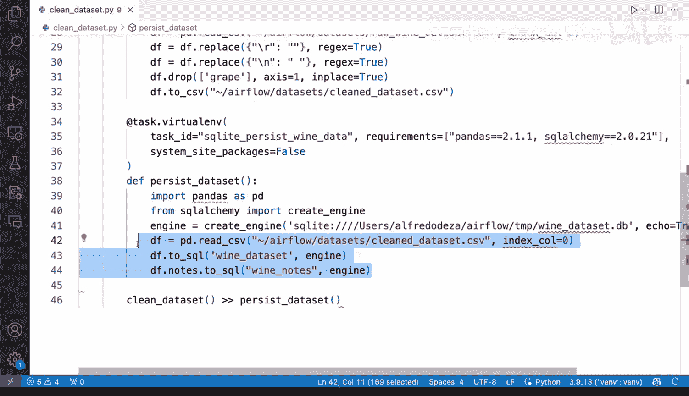
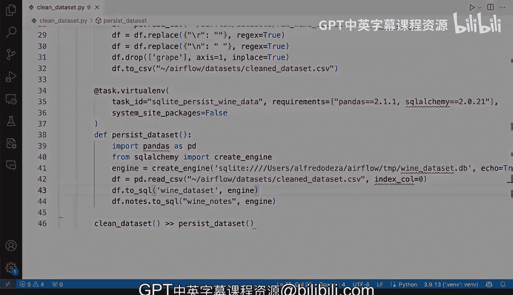

# 大型语言模型实践（高级数据工程、AWS、Databricks和本地LLM）：P64：在任务中持久化数据 📂

在本节课中，我们将学习如何在Airflow任务中实现数据的持久化存储。具体来说，我们将创建一个新的任务，将已清洗的数据集保存到SQLite数据库中，并建立任务间的依赖关系，确保数据清洗完成后才执行持久化操作。


---

上一节我们介绍了数据清洗任务，本节中我们来看看如何将清洗后的结果持久化保存。

我们将遵循清洗数据集任务中的模式，创建一个新的任务。首先，在代码中快速创建一个新任务。

以下是创建新任务的步骤：

1.  创建一个新行，定义任务。
2.  使用 `@task.virtualenv` 装饰器，并指定任务ID。
3.  为任务指定所需的Python库。

具体代码如下：
```python
@task.virtualenv(
    task_id="persist_sqlite",
    requirements=["pandas", "sqlalchemy==2.0.21"],
)
```
注意，这里使用的SQLAlchemy版本是2.0.21，而非1.4。

任务创建后，需要定义被装饰的函数。我们将其命名为 `persist_dataset`。

接下来，我们需要在函数内部编写导入语句和逻辑。关键点在于复用之前创建的 `clean_dataset` 作为数据源。

以下是函数实现的核心步骤：

1.  创建SQLite数据库引擎，指向一个绝对路径（例如 `/tmp/wine_data.db`），并设置 `echo=True` 以输出所有操作日志。
2.  通过读取 `clean_dataset` 创建一个Pandas DataFrame。
3.  使用DataFrame的 `to_sql` 方法，将主数据保存到名为 `wine_dataset` 的表中。
4.  同时，将DataFrame中的 `nodes` 列单独保存到另一个名为 `wine_nodes` 的表中。

为了实现任务间的顺序执行，我们需要建立依赖关系。我们希望 `clean_dataset` 任务先执行，然后才执行 `persist_dataset` 任务。

为此，我们使用位运算符 `>>` 来定义任务流：
```python
clean_dataset >> persist_dataset
```
这表示 `persist_dataset` 任务将等待 `clean_dataset` 任务完成后才会执行。

这样，我们就构建了一个完整的数据管道。它不仅完成了数据清洗，还能按照我们的要求将所有数据持久化，并将节点数据单独存储在一个表中。

---





本节课中我们一起学习了如何在Airflow中创建数据持久化任务。我们通过复用上游的清洗数据集，使用SQLAlchemy引擎将数据保存到SQLite数据库，并利用位运算符建立了清晰的任务依赖关系，从而构建了一个自动化、可重复的数据处理流程。