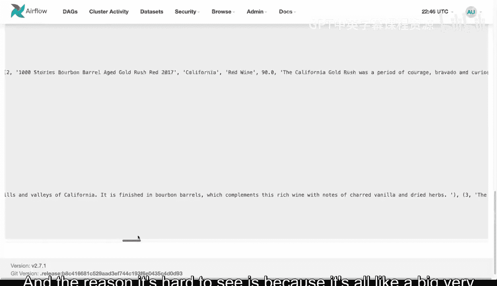
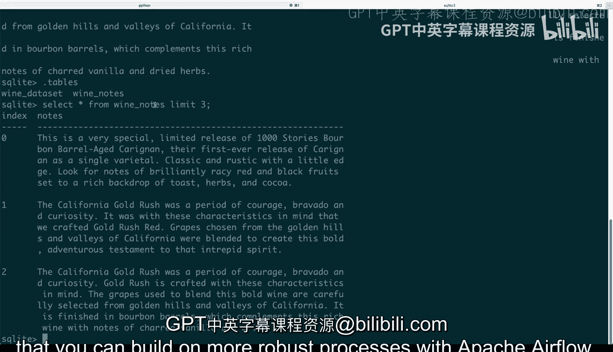

# 大型语言模型实践（高级数据工程、AWS、Databricks和本地LLM）：P65：结果审查 🧐

在本节课中，我们将学习如何审查和验证一个Apache Airflow数据管道的运行结果。我们将通过用户界面和终端两种方式，确认数据处理任务是否按预期执行，并成功将数据持久化到数据库中。

---

## 重置与启动任务

上一节我们完成了代码的修改，本节中我们来看看如何从头开始运行整个流程。首先，所有环境已重置，数据库也已清空，没有任何历史运行记录。

以下是启动流程的步骤：
1.  在Airflow用户界面中，找到并启用 `wine_dataset_get` 任务。
2.  触发该任务开始运行。


触发后，任务需要一些时间来完成。一旦完成，它将自动触发下游的 `data_consumer` 任务。

---

## 在UI中监控任务依赖

现在，让我们回到DAGs总览页面并滚动到底部。可以看到 `wine_dataset_get` 正在运行，并很快会变为完成状态。紧接着，`data_consumer` 任务被触发。

点击进入 `data_consumer` 的运行详情，可以看到其运行ID和当前状态。在任务关系图中，可以清晰地看到各个子任务的状态流转：`virtualenv_python` 已完成，`sqlite_perpoint_data` 正在运行。这个视图直观地展示了任务间的依赖关系。



---

## 审查SQL执行日志

为了深入验证数据处理的细节，我们可以查看任务日志。进入 `sqlite_perpoint_data` 任务的日志输出。

由于在代码中设置了 `echo=True`，SQLAlchemy会将生成的所有SQL语句打印到日志中。在日志里，我们可以看到：
*   数据库引擎被成功创建。
*   `wine_notes` 表被创建。
*   插入数据的SQL语句被执行，其中包含了完整的葡萄酒数据集和品酒笔记。


日志内容可能很长，因为所有数据都以长字符串的形式插入，但这证实了数据持久化过程确实发生了。

---

## 在终端中进行最终验证

最后，我们通过终端直接查询数据库，进行最终的结果验证。

首先，进入项目目录并启动SQLite3命令行工具，连接到我们的数据库文件：
```bash
sqlite3 wine_data_set.db
```
然后，启用列显示模式以便更好地查看结果：
```sql
.mode column
```
接下来，我们可以检查数据库中存在的表：
```sql
.tables
```
查询 `wine_data_set` 表的前三条记录，以确认主数据已存入：
```sql
SELECT * FROM wine_data_set LIMIT 3;
```
查询结果应包含索引、名称、产区、品种、评分和笔记等所有预期字段。

同样，我们可以查询 `wine_notes` 表来验证品酒笔记数据：
```sql
SELECT * FROM wine_notes LIMIT 3;
```
查询结果将显示每条笔记及其关联的索引。



---

## 总结与扩展

本节课中我们一起学习了如何完整地审查一个Apache Airflow管道的运行结果。我们从UI触发任务、监控依赖执行，到查看详细的SQL日志，最后在终端中直接验证数据库里的数据，完成了一个闭环的验证流程。


我们成功构建的这条管道满足了所有既定需求。本次演示使用的是SQLite嵌入式数据库，但Apache Airflow的强大之处在于其灵活性。你可以轻松地将连接配置更改为PostgreSQL或其他远程数据库，从而为构建更复杂、更健壮的数据处理流程奠定坚实基础。