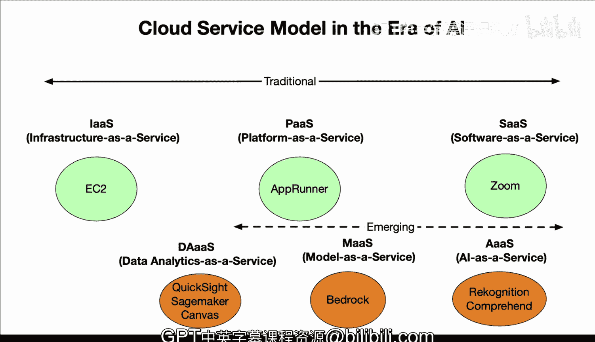

# 大型语言模型实践：P68：02_01_03：人工智能云服务模型 🏗️

在本节课中，我们将要学习云计算的基础服务模型，并探讨在人工智能时代这些模型发生了哪些演变。我们将从传统的三层模型开始，逐步深入到为AI量身定制的新型服务模式。

## 概述

云服务模型是理解云计算的基础框架。然而，在人工智能时代，这一模型已经发生了变化和扩展。我们将逐一剖析这些服务层级，并了解在构建AI应用时如何选择适合的服务。

## 基础设施即服务 (IaaS)

基础设施即服务是云计算中最基础的服务层级。它为用户提供了最底层的计算资源。

在AWS平台上，一个典型的例子是**EC2**。EC2是一种计算实例，是你在计算方面可以获得的最低级别服务。它提供了计算、存储、网络等基础构建模块。

以下是基础设施即服务的一些关键特征：
*   所有IaaS产品都能够按需使用。
*   它是更高级别服务的基础。

其他基础设施即服务还包括：
*   **S3** 对象存储服务。
*   **VPC** 虚拟私有云。

## 平台即服务 (PaaS)

上一节我们介绍了基础的计算资源，本节中我们来看看如何更高效地构建应用。平台即服务提供了一个更高级别的抽象，让开发者能专注于应用逻辑本身。

在AWS平台上，一个很好的例子是**AppRun**服务。你可以将一个函数或微服务放入云端运行。**AWS Lambda**也可以被视为一种平台即服务，它允许你部署一段逻辑代码。

这些服务让你能够专注于：
*   应用开发
*   测试
*   部署
*   安全性
*   监控

这意味着你关注的是业务逻辑，而非管理服务器，从而节省大量时间。

## 软件即服务 (SaaS)

平台即服务简化了开发，而软件即服务则提供了最完整的解决方案。软件即服务提供完全通过互联网运行的完整应用程序。

我认为许多人都熟悉这种模式，例如**Zoom**视频会议或各种邮件服务。整个应用在互联网上运行，你无需进行任何运维，只需开通服务并按使用付费。

## 人工智能时代的新兴模型

传统的三层模型为我们提供了基础，但在人工智能时代，出现了一些新兴的服务模型。让我们来看看其中一些是什么。

### 数据分析即服务

数据分析即服务提供了可扩展、安全的数据存储，以及数据摄取、转换和可视化等服务。

在AWS平台上，一个很好的例子是**QuickSight**。它允许你上传数据，并自动为你生成可视化图表。**SageMaker Canvas**也属于此类服务。

### 模型即服务

模型即服务是AI时代的一个重要发展。**Bedrock**就是一个很好的例子。

在这个服务中，你可以托管许多不同的模型，例如开源的**Mistral**，或者专有模型如**Claude**。所有这些模型都集中在这个服务中，你可以通过统一的API进行访问。

这样做的一个优势是，你无需为尝试的每个模型都构建自定义的API，而是有一个集中的位置来启动和使用这些服务。

### 人工智能即服务

人工智能即服务实际上已经存在相当长一段时间了。

一个很好的例子是**Rekognition**，它提供了开箱即用的计算机视觉功能，如图像标注和识别。我们还有用于自然语言处理的**Comprehend**。这些服务实际上是在大语言模型时代之前开发的，但这并不意味着它们不会继续发展。

此外，像**ChatGPT**和**Claude**这样的聊天机器人，我们也可以将它们视为人工智能即服务。因此，在人工智能时代的云计算中，思考你希望在哪一层级进行构建非常重要。

## 总结

本节课中我们一起学习了云服务模型的演变。从基础的**基础设施即服务**，到简化开发的**平台即服务**，再到开箱即用的**软件即服务**。在AI时代，我们看到了**数据分析即服务**、**模型即服务**和**人工智能即服务**等新兴模式的兴起。

例如，在最低层级，你可以使用**EC2**并配备GPU来自行管理一切；而在最顶层，你可以直接使用**聊天即服务**。但在某些情况下，数据治理、隐私问题或法律原因可能要求你在本地运行模型。因此，在AI时代，你必须根据具体需求、合规性和技术目标，来决定在哪个服务层级进行构建和部署。