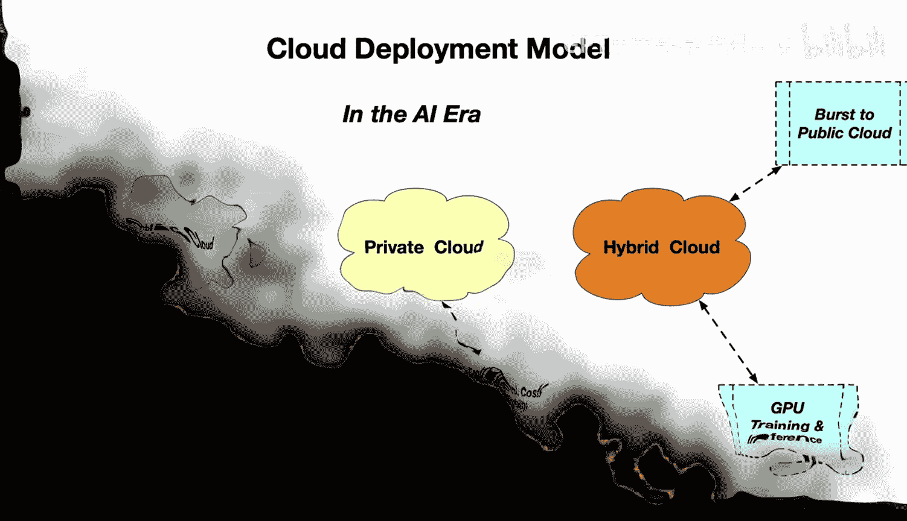

# 大型语言模型实践（高级数据工程、AWS、Databricks和本地LLM）：P69：03_01_04：人工智能云部署模型 ☁️🤖

在本节课中，我们将要学习人工智能时代的云部署模型。我们将探讨公有云、私有云和混合云这三种主要部署方式，分析它们各自的优势、劣势以及适用场景，帮助你理解如何为大型语言模型项目选择合适的部署策略。

---

## 云部署的主要模型

在人工智能时代，云部署引入了一些新的概念。首先，我们来谈谈主要的开发部署模型。

### 公有云 🌐

公有云是指通过公共互联网提供资源。以下是其主要特点：

**优势：**
*   **可扩展性**：资源可以根据需求弹性伸缩。
*   **灵活性**：能够快速获取和配置所需服务。
*   **按需付费定价**：仅为实际使用的资源付费。
*   **AI推理能力**：如果延迟允许，可以利用云服务商（如AWS）提供的众多服务进行AI推理。

**劣势：**
*   **技能要求**：需要具备有效使用云原生技术的专业技能。

### 私有云 🔒

私有云意味着资源在组织自己的数据中心内专供该组织使用。以下是其主要特点：

**优势：**
*   **安全控制**：对数据和基础设施拥有完全的控制权。
*   **低延迟**：例如，服务器可以紧邻部署，从而获得极低的网络延迟。

**劣势：**
*   **灵活性受限**：可能无法在需要时立即购买到硬件，因为所有设备都需要预先采购。
*   **潜在弹性牺牲**：可能无法像公有云那样，在第一天就实现全球部署或在多个数据中心之间灵活迁移。
*   **复杂性高**：需要雇佣专业人员来管理服务器、更换硬盘等数据中心运维工作。
*   **成本问题**：在某些场景下，私有云的成本可能更高。

### 混合云 ⚖️

混合云能够结合公有云和私有云的优势。以下是其主要特点：

**应用场景：**
*   可以在私有云上进行**AI训练**，以确保数据安全和低延迟。
*   可以在公有云上进行**AI推理**，以根据需求弹性扩展。
*   这种方式能够在**成本、性能和安全**之间取得平衡。

**其他适用情况：**
*   **数据治理**：由于监管要求，数据可能不被允许存放在公有云上。
*   **竞争优势保护**：为防止竞争对手通过云服务商获取数据。
*   **迁移策略**：从私有云向公有云迁移过程中的过渡方案。
*   **临时扩展**：在已有私有云的基础上，偶尔将负载扩展到公有云以满足峰值需求。

随着进入在本地运行大型语言模型的专业化时代，混合云可能会重新流行起来。许多组织在选择大型语言模型的应用场景时，至少应该考虑混合云方案。

---

本节课中，我们一起学习了人工智能时代的三种主要云部署模型：公有云、私有云和混合云。我们分析了每种模型的特点、优势、劣势以及典型应用场景。理解这些模型有助于你根据项目的具体需求（如安全性、成本、延迟和扩展性）做出明智的部署决策。