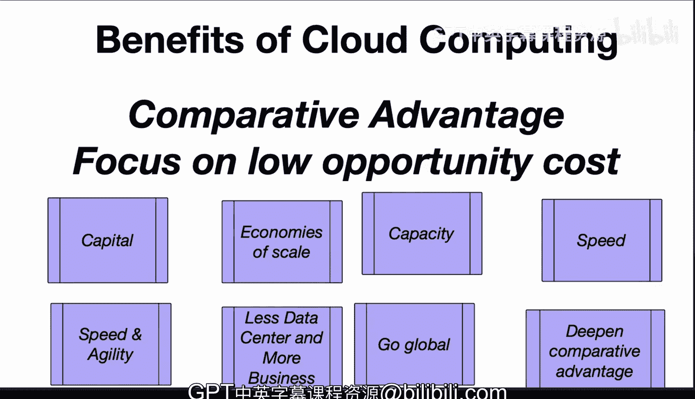

# 大型语言模型实践（高级数据工程、AWS、Databricks和本地LLM）：P70：04_01_05_云计算优势 ☁️

在本节课中，我们将要学习云计算的核心优势。我们将探讨比较优势原则如何驱动企业采用云服务，并详细解析云计算的各项关键益处，包括成本、速度、敏捷性以及专注业务等。

## 概述

云计算的优势根植于**比较优势**原则，这是驱动企业采用云服务的关键。其核心在于关注**最低的机会成本**，即为了专注于核心业务，你愿意放弃什么。这本质上是云计算的基本原则。

## 云计算的核心优势

上一节我们介绍了云计算的基本理念，本节中我们来看看其具体的优势体现在哪些方面。

### 1. 资本支出与可变支出 💰

首先，在资本方面，你将**资本性支出**转换为了**可变支出**。这意味着你无需一次性投入数百万美元购买大量服务器。你可以在需要时逐步增加容量，并且这种容量可以是动态的。你可以随时增加或减少资源。这很像使用公用事业公司（如水电）的服务。

### 2. 规模经济效益 📈

我们还能从**规模经济**中获益。因为云提供商批量采购资源，他们的成本更低，并能凭借规模优势将这些资源交付给用户。

### 3. 无需猜测容量 🔮

我们同样无需猜测容量需求。就像使用公用事业公司一样，你可以随时“关闭恒温器”。想象一下，如果你必须购买一堆木材，并精确猜测整个冬天需要多少木材。无论高估还是低估，你都会陷入难以解决的问题中。云计算避免了这种困境。

### 4. 速度与敏捷性 ⚡

速度是另一个优势。能够快速部署、快速行动非常重要。当我们把速度和敏捷性结合起来时，你就能真正快速转向、高速发展。这可能意味着你的业务效率有10倍甚至100倍的提升。

以下是速度与敏捷性的区别：
*   **速度**：意味着你可以快速行动，频繁部署。
*   **敏捷性**：意味着你可以完全更换基础设施，例如将键值数据库换成关系型数据库。你能进行这类变更，正是因为同时具备了速度和敏捷性。

### 5. 专注于业务，而非运维 🎯

云计算还让你能**减少对数据中心的关注，更多地聚焦于业务本身**。许多公司不想成为数据中心专家，也不想雇佣专门负责网络和服务器维护的员工。这是云计算带来的关键优势，而且在很多场景下，云提供商会比你做得更好。

### 6. 全球部署能力 🌍

你能够立即利用云提供商的**全球基础设施足迹**。这是云计算的一个巨大优势。

### 7. 深化比较优势 🚀

我们还能深化你已有的**比较优势**。假设你是某项特定技术的专家，你无需将时间花在不擅长的领域。你可以专注于真正能让你的业务取得成功的事情，或者专注于你工作中更高价值的方面。

## 总结

本节课中我们一起学习了云计算的多项核心优势。总的来说，利用比较优势、将你不希望成为专家的领域外包出去，并专注于那些机会成本低或能带来最高投资回报率的事情，具有非常重要的意义。这些优势共同构成了企业选择云计算服务的强大驱动力。