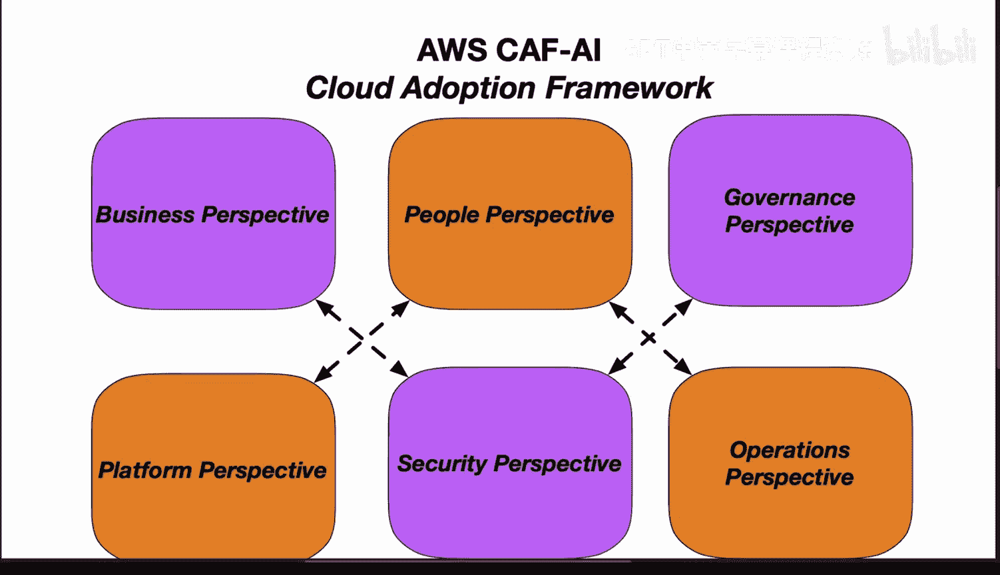

# 大型语言模型实践：P71：AWS人工智能云采用框架 🏗️

在本节课中，我们将学习AWS（亚马逊云科技）的云采用框架，并特别关注其在人工智能（AI）和机器学习（ML）领域的应用视角。我们将从业务、人员、治理、平台、安全和运维等多个维度，系统性地探讨企业在云上成功采用AI技术所需考虑的关键因素。

## 业务视角

上一节我们介绍了课程概述，本节中我们首先来看看企业采用AI时的业务视角。当一家公司考虑使用AI时，首先需要明确其AI战略。

以下是企业在制定AI战略时需要思考的几个核心问题：
*   **能否解锁新的业务价值？** 例如，组织中是否存在大量手动、重复性的工作，而AI可以协助完成，如自动生成特定文档或从历史数据中总结文档。
*   **如何管理数据驱动的、AI赋能的产品生命周期？**
*   **如何利用AI和ML进行预测性洞察和分析？**
*   **如何识别哪些AI项目能与所需的业务成果对齐？**
*   **如何利用AI和ML能力创新商业模式？**
*   **如何微调和定制基础模型？** 这是一个重要议题。你或许有一个表现不错的模型，但能否让它变得更好？

## 人员视角

在明确了业务战略后，接下来我们需要关注“人”的因素。从人员视角出发，企业需要构建支持AI成功落地的团队与文化。

以下是人员视角下的关键考量点：
*   如何构建团队的AI和ML知识素养与通用术语？
*   如何吸引、赋能和管理AI人才？
*   能否促进跨团队协作？
*   能否培育一种“AI/ML优先”的文化？

## 治理视角

除了人员和业务，有效的治理是确保AI项目合规、可控且高效的关键。接下来，我们将探讨治理视角。

以下是治理工作的核心内容：
*   优化和衡量AI与ML的云成本。
*   确保对数据资产和产品进行有效管理。
*   管理AI与ML相关的风险。
*   确保AI的负责任开发与使用。

## 平台视角

一个强大且灵活的技术平台是AI项目的基石。从平台视角看，企业需要构建能够支撑AI工作负载的基础设施。

以下是平台视角的关键任务：
*   为AI工作负载建立可扩展的架构。
*   将AI能力集成到应用程序中。
*   管理完整的机器学习生命周期。这里需要思考：你是在做无差异化的繁重工作，还是在利用云服务来简化流程？

## 安全视角

在AI时代，安全被赋予了新的内涵。从安全视角出发，我们需要特别关注AI模型本身可能带来的风险。

安全视角的核心任务包括：
*   识别并缓解AI模型的漏洞。例如，如果使用某种特定类型的开源模型，它可能会暴露出有缺陷的代码。你能否通过更严格的代码审查或选择更安全的编程语言来缓解此风险？

## 运维视角

最后，当AI系统上线后，持续的运维与监控至关重要。本节我们来看看运维视角。

运维视角主要关注以下两点：
*   如何管理和监控AI的性能？
*   如何识别并应对未预见到的AI行为？

---

本节课中，我们一起学习了AWS人工智能云采用框架的六个核心视角。当企业计划在云上采用AI技术时，需要综合考量**业务、人员、治理、平台、安全与运维**这六大方面。这些类别必须协同工作，才能确保企业在战略和执行层面都做出正确的决策，从而成功、负责任地部署和管理AI解决方案。