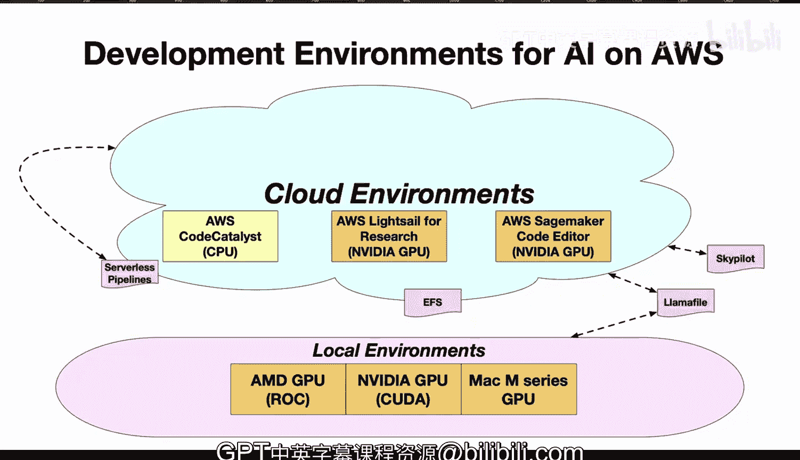

# 大型语言模型实践：P72：06_01_02：人工智能开发环境 🛠️

在本节课中，我们将要学习在AWS上进行人工智能开发时可用的多种开发环境选项。我们将探讨基于云的环境、新兴的GPU环境、本地开发选项以及跨云工具，帮助你根据项目需求选择最合适的开发平台。

## 基于云的开发环境 ☁️

上一节我们介绍了课程概述，本节中我们来看看几种主要的云开发环境。AWS提供了多种用于AI开发的云环境，它们各有特点。

首先，我们有**AWS Code Catalyst**。这是一个基于CPU的云端开发环境。Code Catalyst的有趣之处在于，你可以选择预配置了AWS选项的实例，例如Amazon Linux 2。所有工具都已就绪，并且它也能与本地IDE协同工作。例如，你可以从IntelliJ等IDE与之交互，连接到那个特定的云端环境。你甚至可以根据要解决的问题，拥有一整套专门的环境。

这在AI流水线中很有帮助，因为你可以构建，例如，使用Step Functions和Lambda的无服务器流水线。这可以成为一个快速开发解决方案的理想场所。

## 新兴的GPU云环境 ⚡

上一节我们讨论了基于CPU的云环境，本节中我们来看看功能更强大的GPU环境。现在，甚至出现了更有趣的新兴云环境，这些新环境嵌入了GPU。

其中之一是**AWS Lightsail for Research**。你可以访问NVIDIA GPU，也可以访问其他AWS功能，例如弹性文件系统（EFS）或EBS。这真正有趣的地方在于，这意味着许多人可以协作进行基于GPU的项目。例如，假设你在AWS Lightsail中运行LlamaFile，然后这个结果可能会进入一个EFS卷。假设你正在查看一堆文档，总结这些文档，然后将结果放入某个数据库，所有这些都可以在这个AWS Lightsail for Research环境中完成。

另一个新兴环境是**AWS SageMaker Code Editor**。它同样可以访问GPU资源，并且你可以在一个更传统的SDK类型环境中进行开发。使用Visual Studio Code，你实际上也可以开始开发代码。

这些环境非常有趣，因为你既能访问GPU，又能访问整个AWS云环境。从你仍然身处云端、拥有低延迟并同时能访问GPU这个意义上说，这确实很独特。

## 本地AI开发环境 💻

上一节我们介绍了云端GPU环境，本节中我们来看看本地开发选项。我们现在也开始看到一种集成，它同样为AI开发提供了本地环境。

以下是几种本地开发选项：
*   **AMD**：随着对使用AMD GPU运行本地大语言模型的支持越来越多。
*   **NVIDIA**：拥有CUDA驱动程序，你可以将其安装在Linux笔记本电脑上，进行本地大语言模型开发。
*   **Mac M系列**：包括M1、M2、M3系列以及未来的M4，所有这些都开始能够用于本地运行大语言模型。

一个很好的例子是来自Zilla的**LlamaFile**。你可以获取最新的模型，在Mac上运行，并使用所有那些M系列GPU，同时也能使用NVIDIA和AMD GPU。因此，你既可以在本地环境也可以在云环境中使用它。

过去情况并非如此，你未必拥有本地环境。本地环境有一些优势，这在AI领域改变了局面。当然，基于云的环境仍然有很多优点，因为它们直接位于AWS云内部，延迟低。但现在，本地环境也有很多值得青睐的地方。

## 跨云与批处理工具 🔄

上一节我们探讨了本地环境，本节中我们来看看一个能简化多云部署的工具。另一个我要讨论的工具是**SkyPilot**。它允许你在云中运行LLM和AI批处理作业，也允许你选择不同的云服务提供商。

例如，你可以放入一个YAML文件并运行`lx`命令，这允许你使用来自Perplexity的开源技术同时运行许多不同的模型。所有这些功能，在你使用这种云环境或本地环境混合进行开发时都是可用的。

## 总结 📝

本节课中我们一起学习了在AWS上进行AI开发时可用的多种环境。了解这些特性非常重要，以便为你手头的任务选择正确的工具。每种方法都有其优缺点，但在开始为云端AI进行开发之前，最好先了解你有哪些选择。