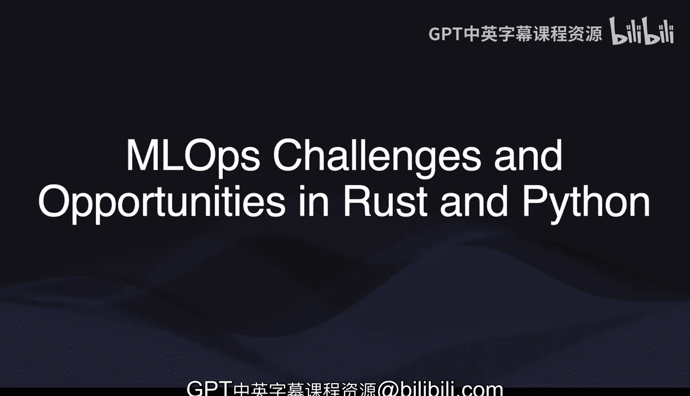
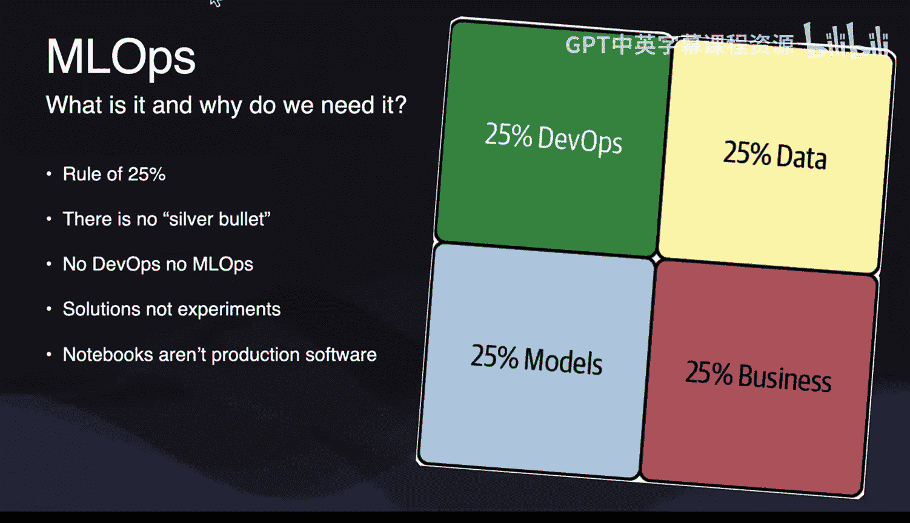
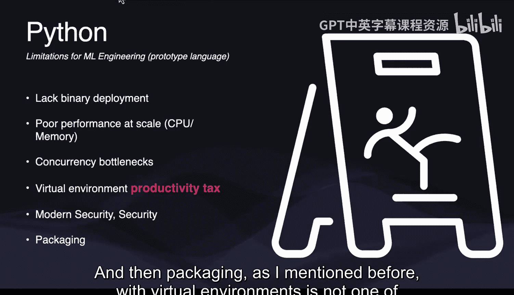
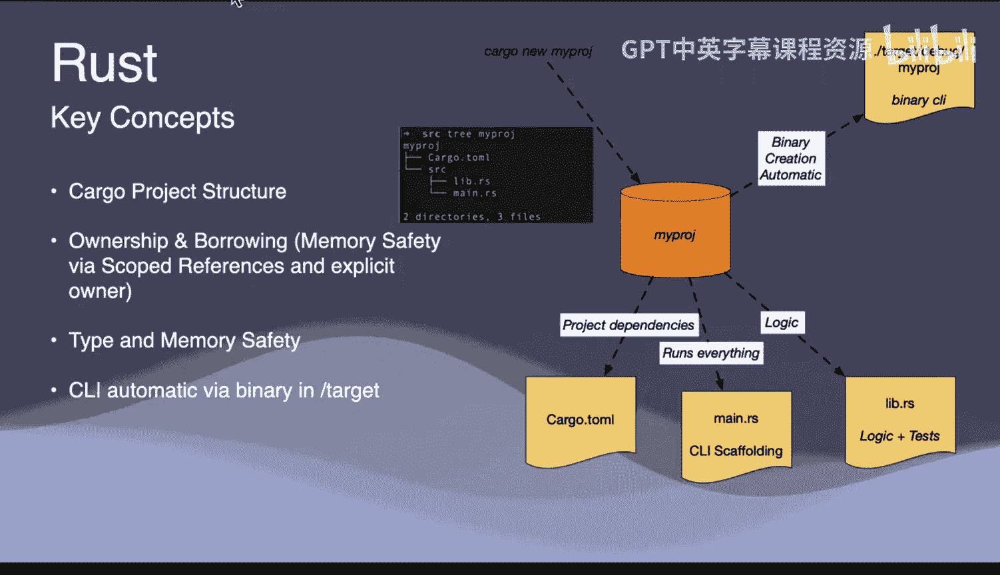
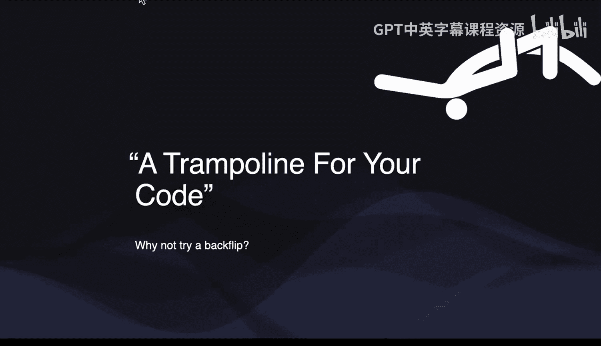

# 大型语言模型实践（高级数据工程、AWS、Databricks和本地LLM）：P73：07_01_03_Rust与Python中的MLOps挑战与机遇

在本节课中，我们将要学习MLOps（机器学习运维）的核心概念，并深入探讨在Python和Rust这两种编程语言中实施MLOps时所面临的挑战与机遇。我们将对比两者的特性，帮助你理解为何在某些场景下Rust可能成为更优的选择。

## 概述：什么是MLOps及其必要性

首先，我们来看MLOps的定义及其重要性。MLOps不仅仅是部署模型的一个开关，它是一个需要将问题分解为不同部分的系统性过程。

以下是构成MLOps基础的几个关键部分：

*   **DevOps是前提**：如果没有健全的DevOps实践，就无法实现MLOps。这包括持续集成、持续交付、基础设施即代码和微服务等迭代式最佳实践。这些是迈向MLOps的基石。
*   **数据操作是核心**：必须专注于数据操作，遵循数据工程的最佳实践，构建能够稳健处理批数据和流数据的强大数据管道。
*   **模型质量是关键**：对于机器学习，模型本身至关重要。必须确保模型适合你试图解决的问题，具有良好的准确性，能够限制偏见，并能以合乎道德的方式获取数据。这些都是模型层面必须关注的问题。
*   **解决实际业务问题是目标**：即使上述所有技术环节都正确无误，确保解决实际的业务问题也至关重要。如果盲目地将AI部署到生产环境而不明确目标，最终可能只是产生无用的“幻觉”，无法为企业带来价值。例如，一家保险公司希望分析历史数据并通过总结文档来获取关键洞察，这就是一个具体的业务用例，能为客户带来价值。
*   **警惕笔记本的局限性**：需要意识到，如果在笔记本环境中构建系统，几乎从一开始就采用了错误的方法。笔记本适用于尝试和验证想法，但在一个强调持续集成和测试的系统中，依赖这种非为测试而设计的、具有特殊性的工具，与MLOps的理念是相悖的。

上一节我们介绍了MLOps的基本构成，本节中我们来看看在具体技术栈选择上的考量，首先从广泛使用的Python开始。

## Python在MLOps工程中的挑战

Python在机器学习工程方面存在一些严重的局限性，因为它本质上是一种原型语言。

以下是Python在MLOps工程化中面临的主要挑战：

*   **缺乏二进制部署**：Python没有原生的二进制部署概念。而二进制部署非常强大，因为它将所有依赖打包成一个可执行文件，便于推送到生产环境，使得使用无服务器技术或进行推理变得简单。
*   **性能较差**：Python从未被设计为高性能语言。它擅长可读性和开发者友好性，但在CPU和内存性能方面表现不佳。
*   **并发瓶颈**：Python存在并发瓶颈。它没有真正的线程，即使未来引入了多线程，也可能因为缺乏编译器对并发安全性的检查而引发各种问题。
*   **虚拟环境带来的“生产力税”**：每次使用Python时，你都必须处理虚拟环境，这就像一种“生产力税”。虽然标准库非常强大，但一旦需要安装第三方包，就必须决定使用`venv`、`Conda`还是其他解决方案，而这些方案之间甚至可能存在冲突，导致生产力下降。
*   **安全与打包问题**：需要考虑现代安全和安全问题，以及普遍的安全性问题。此外，如前所述，Python在健壮的打包方面（例如处理环境依赖）并非其强项。

了解了Python的局限性后，我们来看看另一种语言——Rust，它为MLOps带来了哪些不同的优势。

## Rust为MLOps带来的机遇

Rust具备许多能弥补Python不足的优点。

以下是Rust在机器学习运维方面的主要优势：

*   **二进制部署**：二进制部署是使MLOps更高效的一个巨大优势。你只需将二进制文件部署到任何地方，例如容器、无服务器环境，甚至是用于推理的GPU（如在Llamafile中的应用场景中）。
*   **高性能**：Rust具有C语言级别的性能。
*   **强大的并发能力**：Rust拥有出色的、无瓶颈的并发能力，并且有像`rayon`这样非常健壮的库支持。编译器会保护你免受许多常见并发问题的影响。
*   **安全性设计**：Rust为安全性而设计。由于其内存模型和所有权模型，许多安全漏洞在Rust中根本不存在。
*   **优秀的MLOps生态库**：有非常适合MLOps、LLMOps和数据工程的优秀库，例如你可能听说过的`Polars`和`Candle`。

现在，让我们看看从Python转向Rust时需要了解的一些关键概念。

## Rust的核心概念与工作流

如果你从Python转向Rust，需要了解其工作方式有所不同。最大的区别在于Rust有一个工具为你处理一切。

以下是Rust工作流中的关键特点：

*   **一体化的Cargo工具**：`Cargo`是Rust的一大优势，本质上是你需要处理的唯一入口。所有操作都在基于树状结构的项目中进行，没有全局状态的概念（不像虚拟环境）。所有内容都集中在一个目录下，由`Cargo.toml`文件管理依赖，`src`目录存放库和主代码。
*   **所有权与借用**：在Rust语言中，所有权和借用机制是自动获得的。你必须显式声明变量是可变的还是不可变的，安全机制是默认内置的。
*   **内存安全与类型系统**：内存安全类型同样存在。在脚本语言中，类型可能对许多人来说是个大问题，你经常会发现单元测试基本上只是类型检查器。
*   **自动集成与快速反馈**：通过生成可在`target`目录中执行的二进制文件，实现了自动的持续集成。这对于MLOps来说是一个巨大的胜利，因为它提供了非常快速的反馈循环。

我们可以这样思考：在生成式AI的世界里，Rust可以成为你代码的“蹦床”。

## 利用生成式AI辅助Rust学习

一个好的比喻是：如果你想尝试后空翻但遇到困难，可以去蹦床上练习。如果你已经掌握了一些不错的技巧，蹦床可以帮助你达到新的水平，从而完成那个后空翻。

同样，尽管Rust有许多看起来令人不快的方面，其语法也比Python更难掌握（这很像吃蔬菜），但编译器对你的严格要求实际上对你有益。你可以依赖`Cargo`生态系统来解决许多问题，也可以借助生成式AI工具。因此，Rust并非一门纯粹难学的语言，它实际上也有很多好处，就像西兰花或抱子甘蓝一样。

特别是在生成式AI的世界里，你能获得更多的想法和建议。一门非常严格的语言（如Rust）与生成式AI工具（例如AWS CodeWhisperer）的结合，可以成为一个强大的组合。

## 总结

本节课中我们一起学习了MLOps的基本框架，并深入比较了Python和Rust在实现MLOps时的不同表现。我们了解到，Python虽然拥有丰富的库和易用性，但在性能、部署和工程化方面存在挑战。而Rust凭借其高性能、安全性、卓越的并发模型和便捷的二进制部署，为构建健壮、高效的MLOps系统提供了新的机遇。结合现代生成式AI工具的辅助，学习并应用Rust可以成为提升机器学习工程实践水平的有力跳板。