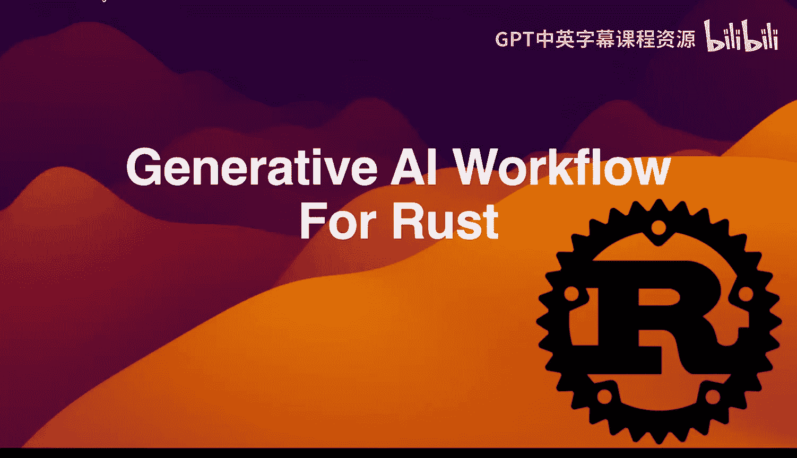
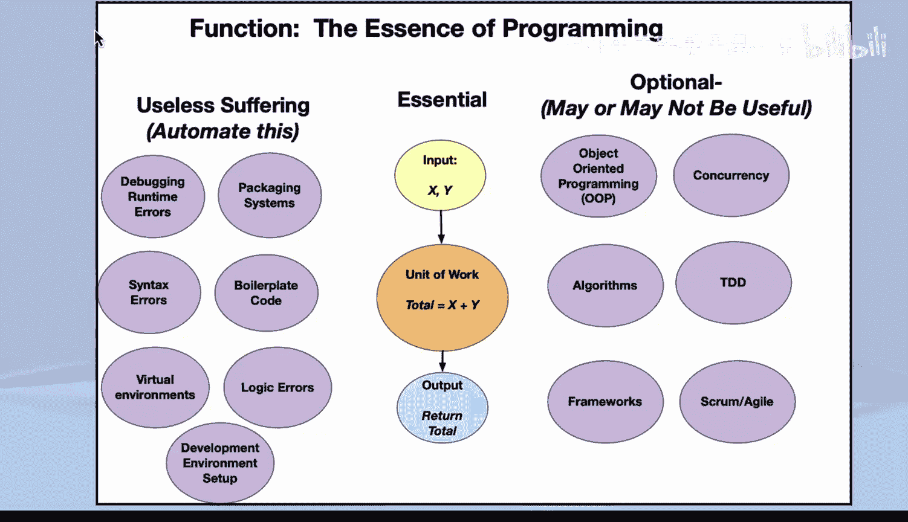
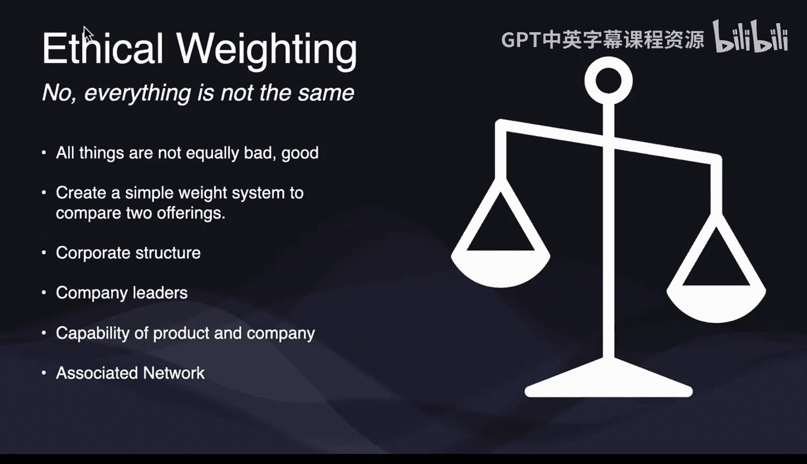
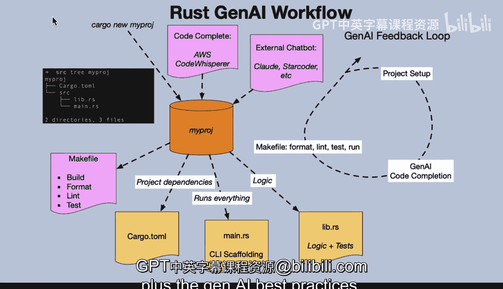

# 大型语言模型实践（高级数据工程、AWS、Databricks和本地LLM）：P74：08_01_04_Rust生成式AI工作流 🦀

在本节课中，我们将要学习如何为Rust编程语言构建一个结合了生成式AI工具的高效开发工作流。我们将探讨编程的本质，如何选择AI工具，并最终构建一个集成了代码补全、外部聊天机器人以及传统DevOps最佳实践的强大开发环境。

## 编程的本质与自动化

上一节我们介绍了课程概述，本节中我们来看看编程的核心是什么。Rust语言促使我们思考编程的本质。

编程中存在着许多“无用的痛苦”，这些是应该被自动化的部分。以下是“无用的痛苦”的例子：

*   **打包系统**：例如，选择使用PIP、Conda、虚拟环境还是其他工具。
*   **调试运行时错误和语法错误**。
*   **编写样板代码**。
*   **管理虚拟环境**。
*   **排查逻辑错误**。
*   **搭建开发环境**：有些地方需要花费一个月来搭建环境，而在基于云的开发环境时代，只需点击一个按钮就能获得完整环境。

所有这些都与编程本身无关，并且可能让新手感到困惑，因为他们觉得自己在浪费时间，却不知道这些与编程无关。

编程的本质是：**输入 -> 处理单元 -> 输出**。这就是编程的全部，除此之外只涉及逻辑本身。还有一些可选部分，可能有用也可能没用：

*   **面向对象编程**：在Python中，你完全可以进行数十年的函数式编程，而无需涉及面向对象。
*   **并发**：不一定是你需要立即采用的解决方案。
*   **复杂算法**：如果标准库已经提供了，就不需要自己实现。
*   **框架、Scrum、敏捷、测试驱动开发**等。

一旦开始思考我们真正关心什么，答案就是逻辑本身，以及用逻辑来解决问题。这就是编程的本质。

## 生成式AI工具的选择策略

理解了编程的核心后，当我们考虑使用生成式AI工具时，我们知道它们很有用，但也必须从众多工具中做出选择。

我们可以比较不同的工具，例如，一个工具可能侧重于客户信任，另一个侧重于生产效率。我们需要像使用天平一样权衡利弊。以下是一些需要考虑的因素：

*   **公司结构与领导者**。
*   **产品与公司的能力**。
*   **相关网络**。
*   **数据来源是否合乎道德**：数据是否包含随意拼凑的盗版数据集。

这就像选择“海豚友好”的金枪鱼还是普通金枪鱼。你会选择那些存在公认有害副作用的方案吗？对于生成式AI，你应该为所要解决的问题选择合乎道德的解决方案。

## Rust生成式AI工作流构建

现在，我们决定使用生成式AI这一伟大技术。让我们看看如何在Rust中实现。

Rust的工作流程与常规操作类似。以下是构建步骤：

1.  **初始化项目**：使用 `cargo new my_project` 命令。
2.  **项目结构**：你会得到一个包含 `Cargo.toml` 文件和 `src` 目录（内含 `lib.rs`、`main.rs` 等）的树形结构。
3.  **引入Makefile**：我喜欢使用Makefile来定义构建、格式化、链接和测试等任务。
4.  **核心文件**：
    *   `Cargo.toml`：管理项目依赖。
    *   `main.rs`：CLI（命令行界面）的脚手架代码。
    *   `lib.rs`：核心业务逻辑和测试代码。

此时，一个高效的工作流开始发挥作用：**使用代码补全工具**，例如支持多行Rust代码的AWS CodeWhisperer。这样，你就获得了一个融合DevOps最佳实践的反馈循环：

*   Makefile与Cargo的最佳实践。
*   CLI的脚手架代码。
*   一个能补充现有DevOps实践的优秀工具。

此外，我还建议**使用一个外部聊天机器人**，如Claude、Mixtral或其他开源模型。你可以向一个模型提问，再用另一个模型验证答案，实现一种“专家混合”的策略。你仍然需要遵循传统的DevOps最佳实践：

*   格式化代码。
*   检查代码风格。
*   测试代码。
*   运行代码。

事实上，通过格式化和检查代码，你会微调代码的外观。如果你将调整后的代码再次放入代码助手，它可能会给出略有不同的答案，或者你可以获得增强的反馈。因此，对于像Rust这样的语言，将DevOps最佳实践与生成式AI结合是相辅相成的。这是一种非常强大的技术，许多人在转向Rust时应该考虑，因为它能让你充分利用强大语言（Rust）、DevOps和生成式AI最佳实践之间的协同效应。

## 总结

本节课中我们一起学习了如何为Rust设计一个高效的生成式AI开发工作流。我们首先探讨了编程的本质是逻辑处理，并识别了应被自动化的“无用的痛苦”。接着，我们讨论了选择生成式AI工具时需要考虑的伦理和实用性因素。最后，我们详细构建了一个结合了`cargo`项目结构、Makefile、代码补全工具（如AWS CodeWhisperer）、外部聊天机器人以及格式化、检查、测试等传统DevOps最佳实践的完整工作流。这个工作流充分发挥了Rust语言、现代开发实践和人工智能辅助之间的协同作用，能显著提升开发效率与代码质量。