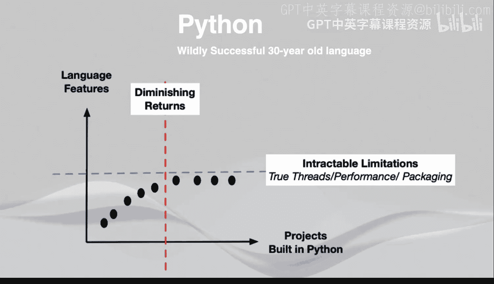
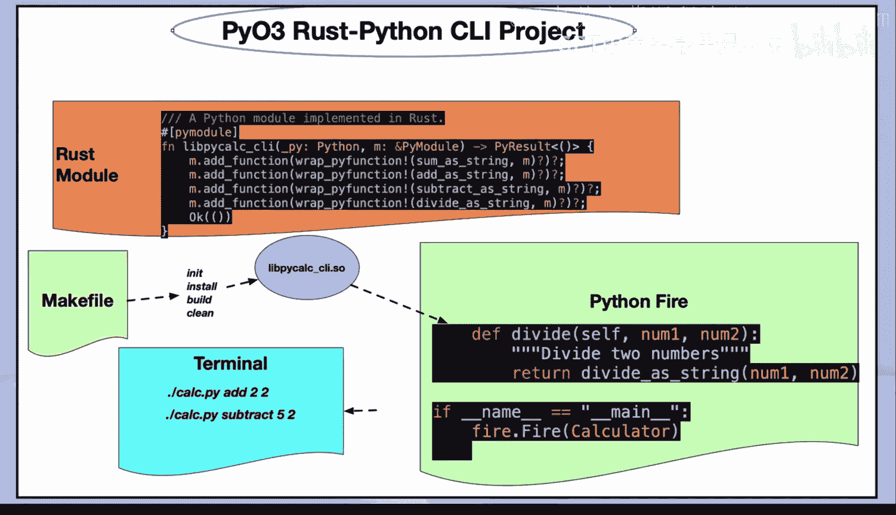
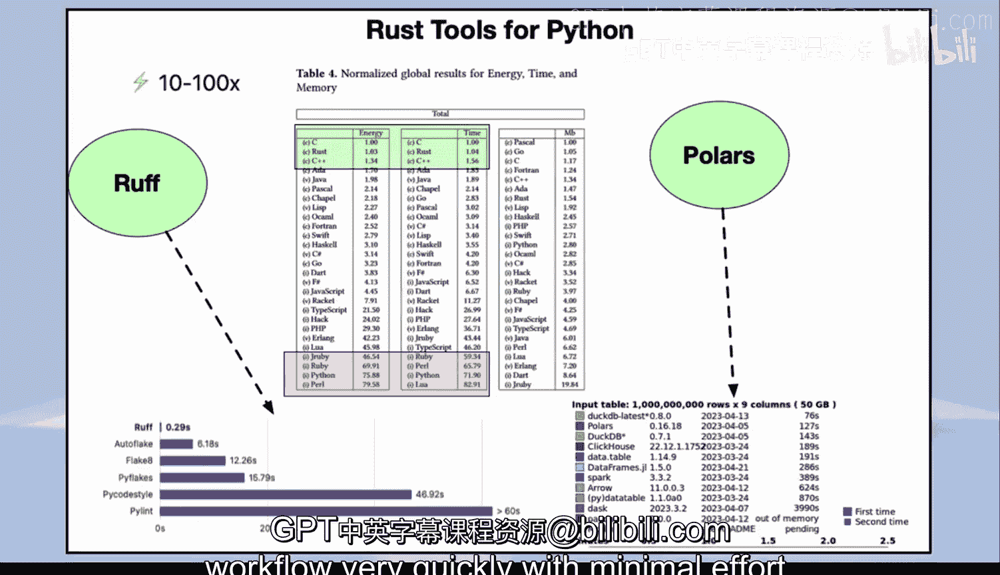

# 大型语言模型实践（高级数据工程、AWS、Databricks和本地LLM）：P75：09_01_05：Rust与生成式AI时代下的Python数据科学 🐍⚙️

在本节课中，我们将探讨在Rust和生成式AI兴起的背景下，Python数据科学的现状、挑战与未来策略。我们将分析Python的优势与局限，并探索如何结合Rust等新技术来构建更高效、更强大的数据科学工作流。

## Python的优势：黄金时代 🏆

上一节我们介绍了课程背景，本节中我们来看看Python语言在数据科学领域的核心优势。Python是全球最流行的编程语言，在多个方面表现出色。


以下是Python的主要优势：

*   **优秀的数据科学库**：Python拥有成熟且强大的数据科学库生态系统。
*   **卓越的原型开发能力**：Python语法简洁，能快速实现和验证想法。
*   **强大的深度学习库**：如TensorFlow和PyTorch，为AI研究与应用提供了坚实基础。
*   **出色的教学与文档**：Python代码易于阅读和理解，其丰富的文档有助于学习各种系统。

当Python运行在托管的Notebook环境（如Google Colab、优化后的Jupyter环境或Coursera的指导性实验）中时，其优势能得到最大发挥。因为这些环境已预先配置好所需的软件包，规避了Python包管理系统的弱点。

Python标准库也为原型开发提供了强大支持，它内置于大多数系统中，无需处理复杂的包依赖即可直接利用。

## 增长的瓶颈：是否已达顶峰？ 📈➡️📉

然而，指数增长遵循S型曲线。初期快速增长后，由于已达到能力上限，回报开始递减，增长趋于平缓。

这就引出一个问题：对于已经极其成功的Python语言，继续为其增加新特性（如类型注解、线程、新的包管理系统等）是否能带来显著价值？还是说，我们应该转向尝试新的工作流、新的语言和新的理念？

我们需要思考：Python的顶峰在何处？减少对纯Python和Jupyter的依赖会是什么样子？我们是否会看到更多基于Rust的工具出现？事实上，这种转变正在有机地发生，例如：
*   一些Python代码检查工具正被更快的Rust工具取代。
*   像Polars这样的Rust基础库在数据操作中提供了惊人性能。

我们可能正处在Python的“顶峰”时期。

## 混合策略：Python与Rust的强强联合 🤝



那么，如何利用这两个生态系统的优势呢？一个极具前景的策略是将Python与Rust混合使用。

对于拥有丰富Python经验的开发者，混合编程是一个绝佳的解决方案。一个非常有趣的模式是使用 **`PyO3`** 库。

**`PyO3`** 库允许你在Rust模块中编写计算密集型操作，并将其编译为Python可以调用的共享库（`.so` 或 `.pyd` 文件）。

以下是一个概念性示例，展示如何用Rust实现一个计算密集型函数，并通过PyO3暴露给Python：

```rust
// 在Rust中使用PyO3
use pyo3::prelude::*;

/// 用Rust实现的高性能加法函数
#[pyfunction]
fn fast_add(a: i64, b: i64) -> i64 {
    // 此处可包含复杂计算逻辑
    a + b
}

/// 将模块封装给Python
#[pymodule]
fn rust_calculator(_py: Python, m: &PyModule) -> PyResult<()> {
    m.add_function(wrap_pyfunction!(fast_add, m)?)?;
    Ok(())
}
```

编译后，在Python中即可调用：

```python
import rust_calculator
result = rust_calculator.fast_add(5, 3) # 结果为8
```


你可以创建一个高效的Makefile来管理初始化、安装、构建和清理流程。更进一步，可以结合像 **`Python Fire`** 这样的库，自动将代码模块转换为命令行工具。

对于需要与大量科研人员和原型开发者协作的场景，这种混合模式可能是最优解，它能兼顾Python的易用性与Rust的性能。

## 性能驱动：为何选择Rust？ ⚡

我们之所以看到众多用于Python的Rust工具涌现，根本原因在于性能的显著提升。

*   **极致的速度**：在某些场景下，Rust能带来**10倍到100倍甚至更高的性能提升**。例如在代码检查（Linting）方面，基于Rust的工具（如`ruff`）速度极快，使得其他工具相形见绌。
*   **数据处理性能**：像`Polars`这样的库提供了惊人的数据处理速度。
*   **无服务器（Serverless）成本效益**：在无服务器架构中，费用通常与内存使用量和执行时间挂钩。使用更高效、内存占用更低的Rust代码可以显著降低运营成本。

因此，出于对性能和经济性的追求，开发者们开始有机地混合使用Rust和Python。



## 总结与展望 🎯

本节课中我们一起学习了在Rust和生成式AI时代下，Python数据科学面临的机遇与挑战。

我们回顾了Python在数据科学库、原型开发和教学方面的核心优势，特别是在托管Notebook环境中的卓越体验。同时，我们也认识到其包管理系统的弱点以及语言可能面临增长平台期的挑战。

面对这些挑战，我们探讨了一个强大的策略：**混合Python与Rust**。通过使用`PyO3`等工具，我们可以在保留Python生态和开发效率的同时，引入Rust的极致性能来处理计算密集型任务，从而构建出更稳健、更高效的工作流。



在生成式AI对算力要求日益增长的今天，拥有这样一个性能优化策略，对于构建面向未来的、强大的数据科学和工程应用至关重要。