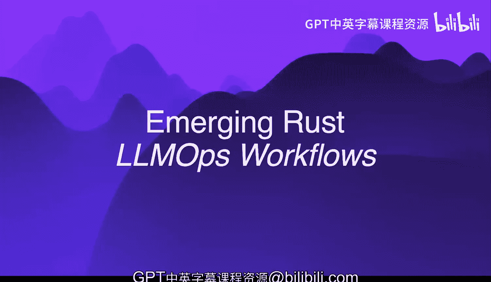
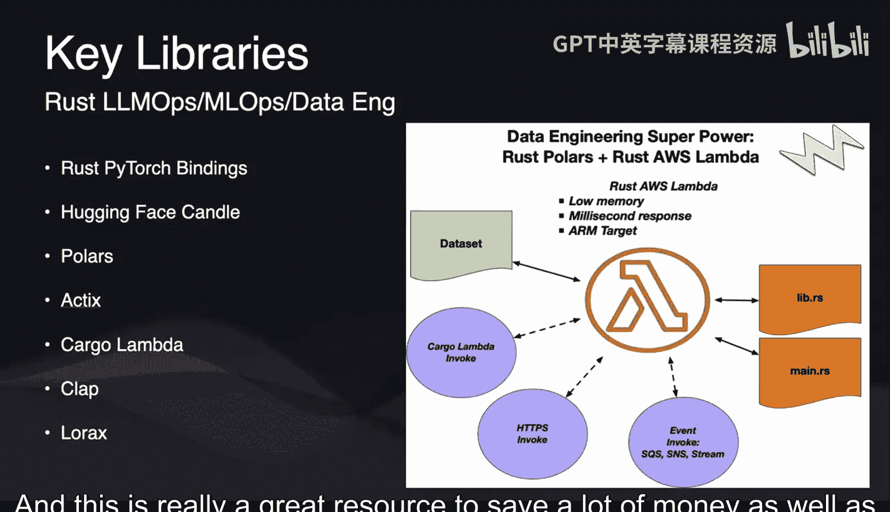
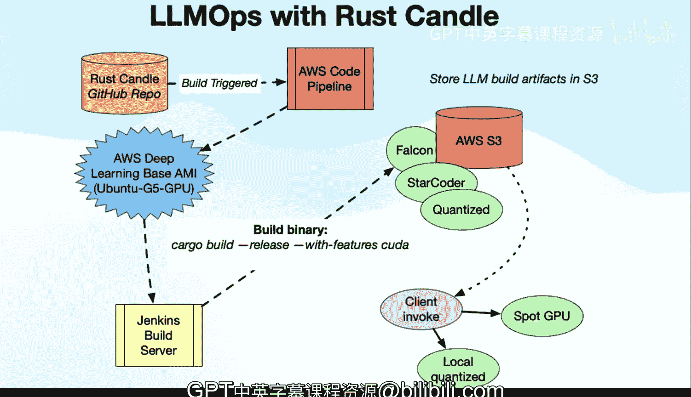

# 大型语言模型实践（高级数据工程、AWS、Databricks和本地LLM）：P76：10_01_06：新兴Rust-LLMOps工作流 🦀

在本节课中，我们将要学习一些新兴的、基于Rust编程语言的LLMOps工作流。Rust以其高性能、内存安全和出色的并发能力，正成为构建高效、可靠LLM应用的有力工具。

## 概述

本节将介绍一系列强大的Rust库和工具，它们构成了现代Rust-LLMOps工作流的基础。我们将探讨这些工具如何协同工作，以支持从模型推理到高性能数据处理的各个环节。

## 核心Rust库与工具

以下是构成Rust-LLMOps生态系统的几个关键库。

*   **Rust Torch Bindings**：这是一个围绕C++ PyTorch框架的绑定库。它赋予开发者在纯Rust环境中执行深度学习任务的能力。
*   **HuggingFace Candle**：该库允许你用Rust包装大型语言模型。它让你能充分利用Rust框架的优势来开发LLM应用。例如，你可以拉取最新的Mixtral模型库并运行它，或轻松运行其他新发布的模型。
*   **Polars**：这是一个高性能的数据框操作库，专为快速数据处理和分析而设计。
*   **Actix Web**：这是一个高性能的Web服务框架，被认为是全球最快的Web框架之一。
*   **Cargo Lambda**：此工具支持你将基于二进制的应用部署到AWS Lambda，实现低内存消耗和毫秒级响应。你可以选择ARM架构以节省成本。
*   **Clap**：这是一个用于编写命令行工具的库，帮助快速构建用户友好的CLI界面。
*   **Lx**：该工具允许你在云端构建AI工作负载，并获得极佳的性能。

所有这些Rust集成工具共同赋予了我们强大的能力。可以看到，在不同的应用场景下，它们能发挥巨大作用。例如，在构建数据工程流水线时，你可以将数据加载到Polars中处理，通过Cargo Lambda和HTTPS部署函数，并接入诸如SQS、SNS等消息流服务。

## 云端开发环境的优势

除了强大的库，云端开发工作站也为Rust-LLMOps带来了显著优势，并且这一领域正在快速发展。

使用个人笔记本电脑进行开发存在一些实际问题，包括环境非确定性、成本高昂，以及开发环境与最终部署环境不一致等。当然，使用高性能笔记本电脑也有优势，例如你可以将所有数据保存在本地，无需发送到云服务商。

但总体而言，云端开发工作站具备许多有趣的功能。它们通常配备GPU，并提供编码辅助工具（如与IntelliJ集成的AWS CodeWhisperer）。此外，还有具备GPU能力的AWS Lightsail实例、配备GPU的AWS SageMaker，以及Coab Notebooks等。

我们在这里看到，基于云端的开发环境优势非常明显，尤其对于Rust而言，它在启用了GPU的云端环境中运行得非常好。

## 一个推荐的Rust-LLMOps工作流

上一节我们介绍了工具和云端环境，本节中我们来看看一个具体的工作流。对于许多考虑为本地或自托管大型语言模型开发工作流的组织来说，我认为以下是一个非常优秀的实践方案。

这个工作流的核心是使用**Rust Candle**库。其流程如下：

1.  你触发一次构建。
2.  代码流水线会生成一个包含所有必要依赖的新镜像。
3.  该镜像随后发布一个经过优化的二进制文件，该文件能够利用GPU进行计算。
4.  你可以将任何大型语言模型以及微调后的模型加载到S3存储中。
5.  之后，你可以通过多种方式调用它：例如，在CPU客户端上使用本地量化版本；在无服务器应用中调用；使用Spot实例以节省成本；甚至将其安装到本地设备上。

这个基于Rust Candle的工作流是一个非常有趣且正在兴起的新模式。

## 总结

本节课中，我们一起学习了新兴的Rust-LLMOps工作流。由于Rust在性能、打包部署方面的卓越表现，以及其生态系统对大型语言模型非常友好，它确实为LLM应用开发提供了丰富的选择。从高性能推理（Candle）、数据处理（Polars）到高效部署（Cargo Lambda, Actix），Rust工具链为构建下一代可靠、高效的LLM系统奠定了坚实基础。