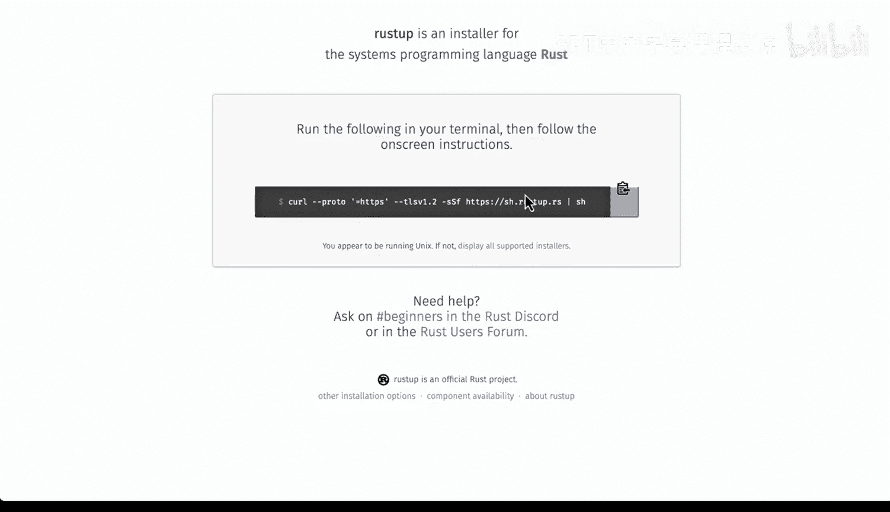
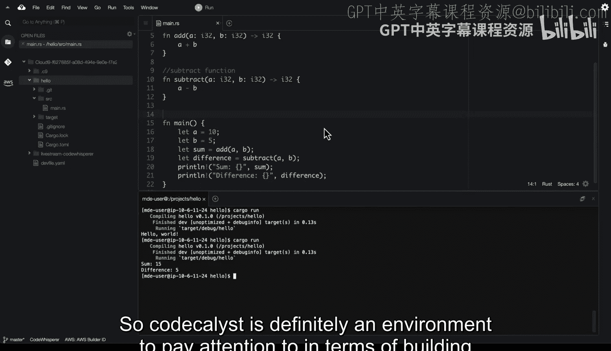

# 大型语言模型实践（高级数据工程、AWS、Databricks和本地LLM）：P77：11_01_07_Rust版CodeCatalyst入门 🚀


在本节课中，我们将要学习如何使用亚马逊的CodeCatalyst服务进行基于云的Rust开发。CodeCatalyst是AWS提供的一项较新的服务，它支持云端开发，并提供了一些功能强大的计算资源。我们将通过一个测试来了解其基本操作。

## 了解CodeCatalyst开发环境

上一节我们介绍了CodeCatalyst的基本概念，本节中我们来看看它的开发环境是如何工作的，以及你能用它做些什么。

这里有一个开发环境。在这个特定环境中，可以看到一个正在运行的实例。

以下是CodeCatalyst开发环境的一些核心功能：

*   你可以通过点击“创建开发环境”来在浏览器中启动一个开发环境。
*   这项功能非常出色，因为Cloud 9允许你拥有一个预配置好的AWS环境。
*   许多复杂的设置都会因为这个Cloud 9环境而消失，我们稍后会用到它。
*   你也可以使用Visual Studio Code或JetBrains IDE（如IntelliJ、GoLand、PyCharm等）。
*   这里有一些非常酷的集成功能。这些都是通过AWS Toolkit插件代理连接到CodeCatalyst环境的本地集成。

## 启动并访问开发环境

了解了环境的功能后，现在来看看如何实际访问它。

只需点击“打开”，这将打开一个新环境。让我们看看它是什么样子。可以看到它打开了这个环境。我已经打开了一个，所以不再重复操作。

## 在环境中安装Rust

环境准备就绪后，下一步就是安装开发工具。为了安装Rust，你只需复制这里的命令，然后粘贴到你的环境中。这就是安装Rust并继续安装过程所需做的全部。

一旦安装了Rust，开始开发就相当简单了。接下来，我们来谈谈这个特定Cloud 9环境的一些独特之处。



## 配置AWS与CodeWhisperer

首先需要注意的一点是，在左上角我们有AWS，注意我使用的是AWS Builder ID进行连接。这是一个你可以免费获取的ID，它不连接到你的AWS账户，并允许你向其他服务进行身份验证，例如CodeWhisperer。


CodeWhisperer是这里的代码补全工具，可以看到它当前正在运行。我们如何实际使用它来编写一些Rust代码呢？让我们一起来看看。

## 使用CodeCatalyst进行Rust开发实战

首先，我将输入 `cargo new` 命令来创建一个新项目。

```bash
cargo new hello
```

我们将输入“hello”来创建一个“Hello World”应用程序。在这里我们有一个主文件。一切准备就绪，我可以直接输入命令或进入hello项目目录。

```bash
cd hello
cargo run
```

运行成功，我们得到了一个“Hello World”。现在，如果我想做一个稍微复杂一点的程序，我们可以利用CodeWhisperer，实际上可以制作一个计算器。

我可以添加一个Rust注释来说明这是一个计算器脚本。

```rust
// calculator script
```

然后从这里，我们可以保存它。我可以说，第一件事我们可以做一个加法函数。

```rust
fn add(a: i32, b: i32) -> i32 {
    a + b
}
```

然后我将得到一些不错的代码补全。接着我们在这里做一个减法函数。

```rust
fn subtract(a: i32, b: i32) -> i32 {
    a - b
}
```

我们可以稍微调整一下。可以看到这里有一些合理的代码补全。

然后为了稍微调整一下，我将设置一些变量并进行计算。

```rust
fn main() {
    let a = 10;
    let b = 5;
    let sum = add(a, b);
    let difference = subtract(a, b);
    println!("Sum: {}", sum);
    println!("Difference: {}", difference);
}
```

这是一种直观的代码补全。如果我们输入 `cargo run`，就可以成功运行。这是旧版本的输出。注意我保存了它。如果我再次运行 `cargo run`，就会得到新版本计算出的和与差。

## 云端开发的优势与总结



从入门开始，你就会发现云端开发的许多优点。想象一下，你可以保存这些环境，安装特定的软件包，配置好一切。对于大型语言模型来说，这也可能是一个值得探索的方向，尤其是在构建无服务器管道的量化环境中。

因此，对于构建用于大型语言模型和机器学习运维的Rust应用来说，CodeCatalyst绝对是一个值得关注的环境，而且它非常容易上手。


**本节课中我们一起学习了**：如何使用亚马逊CodeCatalyst创建云端开发环境，在该环境中安装和配置Rust，并利用AWS Builder ID和CodeWhisperer工具来辅助编写和运行一个简单的Rust计算器程序，体验了云端开发的便捷性。