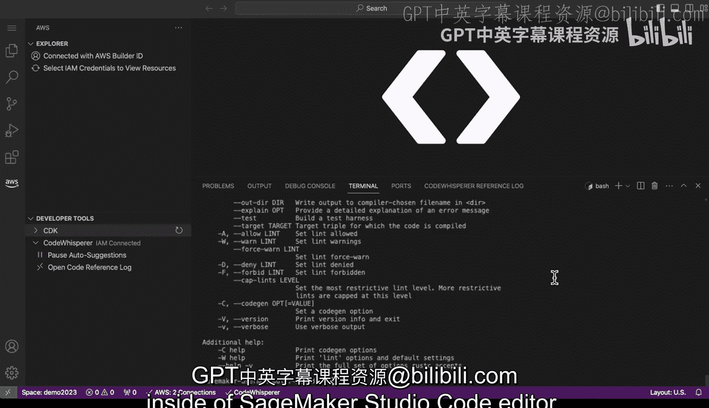

# 大型语言模型实践：P78：SageMaker Studio Code Editor入门 🚀


在本节课中，我们将学习如何开始使用AWS SageMaker Studio的Code Editor功能。这是一个基于浏览器的、功能完整的集成开发环境，特别适合进行机器学习和大型语言模型的开发工作。

## 认识SageMaker Studio环境

上一节我们介绍了课程背景，本节中我们来看看SageMaker Studio的核心界面。SageMaker Studio是一个用于处理机器学习和大型语言模型的成熟环境。


在界面左侧，可以看到多种功能选项。以下是可用的主要工具和服务：
*   启动Jupyter Lab
*   Studio Canvas
*   Code Editor
*   Studio Classic（旧版本）

此外，界面上方还有多个功能选项卡。以下是各个选项卡对应的功能：
*   Running Instances：运行实例
*   Data：数据管理
*   AutoML Experiments：自动机器学习实验
*   Jobs：任务管理
*   Pipelines：流水线
*   Models：模型管理
*   JumpStart Deployments：快速启动部署

这基本上构成了一个完整的MLOps（机器学习运维）流水线。

## 聚焦Code Editor功能

虽然功能丰富，但本节课我们重点演示的是Code Editor。这是一个非常新的功能，它内置了一个开源的Visual Studio Code编辑器。

你可以在浏览器内直接测试、调试和运行分析与机器学习代码。它可以使用Open VSX扩展注册表中的全部IDE扩展。

## 环境与身份识别

现在，让我们看看它的工作方式。请注意，这里有一个运行环境，你可以停止或启动它。

如果想回到已经打开的SageMaker Code Editor界面，我们需要确认自己身处的是Code Editor，而非一个普通的托管式VS Code环境。以下是两种识别方法：
1.  查看界面左上角的Logo。
2.  观察终端提示符中显示的“sageMaker”字样。

## 开发者工具集成

接下来，我们看看其他一些非常有趣的功能。如果你点击“AWS”菜单，可以在这里启用其他开发者工具。

这是一个重大的改变。因为许多传统的SageMaker工具都围绕Jupyter构建，而Jupyter对于构建应用程序并不十分友好。现在，有了这个开发者环境，你可以直接开始编写代码。

如果你有软件工程背景，就可以利用这一背景在SageMaker Studio Code Editor内部构建代码。

## 代码开发与版本控制

现在，让我们看看这里可以进行哪些操作。其中一个很酷的功能是，我们可以直接进行Git远程操作。

可以看到，我一直在试验一个大型语言模型库（例如Hugging Face的Candle）。如果我想进行一些开发或提交Pull Request等操作，都可以直接在这个环境中完成。

## GPU加速支持

另一个需要提及的强大功能是，它已经启用了GPU支持。这一点非常重要。

我们可以通过命令来验证。例如，输入以下命令：
```bash
nvidia-smi -l
```
这将弹出一个对话框，实时监控CUDA版本、驱动程序版本以及GPU使用情况。在这里，我们可以看到它使用的是Tesla T4显卡。

因此，我们完全有能力开始进行GPU编程。我们可以用Rust、Python或任何你希望使用的语言进行编程。

使用Rust等语言的一个显著优势是，你可以实现基于二进制的大型语言模型部署。这正是一种新兴的尖端技术。

## 总结

本节课中，我们一起学习了SageMaker Studio Code Editor的入门知识。我们了解到，它提供了一个集成的开发环境，并配备了完整的MLOps流水线。由于环境中已预装Rust，我们可以立即开始在SageMaker Studio Code Editor内为大型语言模型开发Rust代码。



