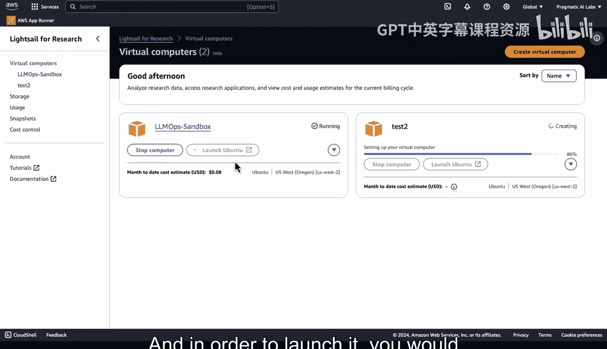
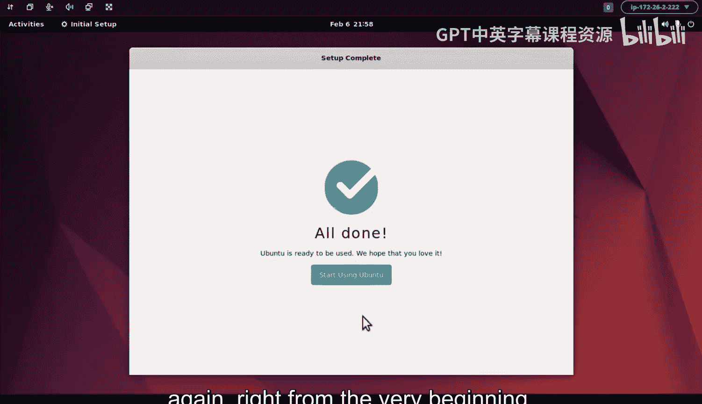
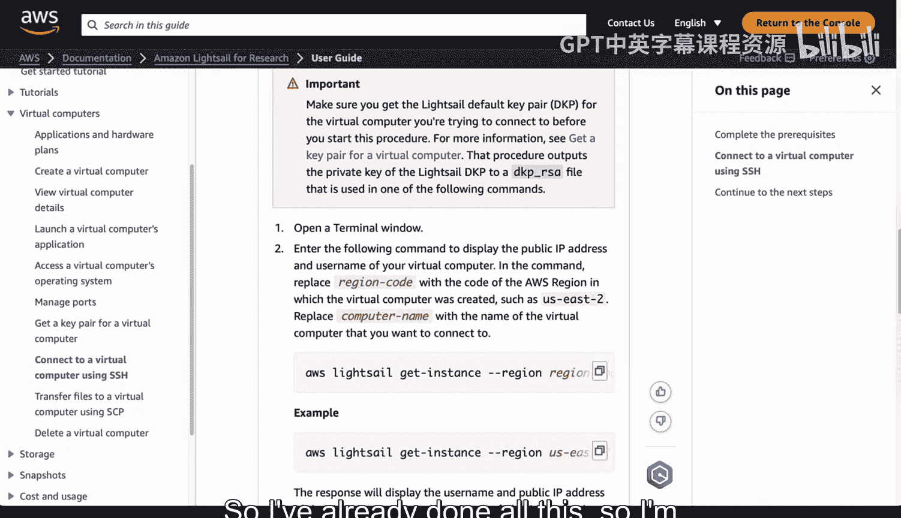
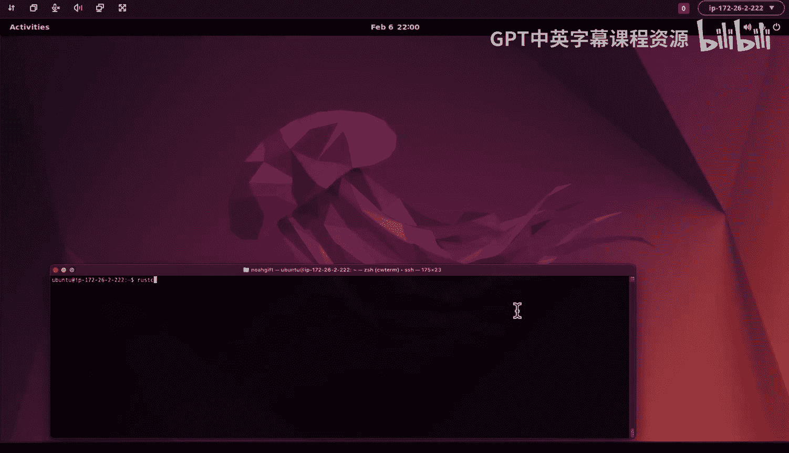
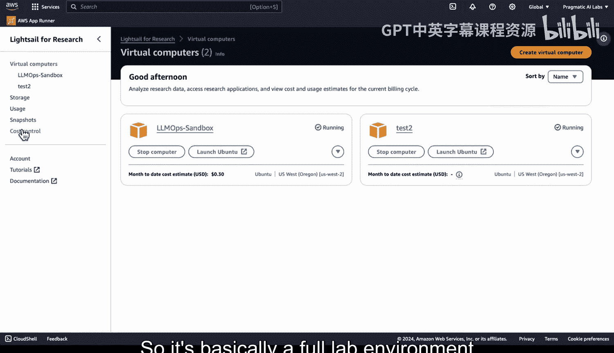

# 大型语言模型实践（高级数据工程、AWS、Databricks和本地LLM）：P79：研究型Lightsail入门 🚀

在本节课中，我们将要学习AWS的一项新服务——研究型Lightsail。这项服务允许我们启动性能强大的机器，用于大型语言模型开发、机器学习工作以及运行模拟等任务。我们将了解其基本功能、如何启动实例以及两种主要的访问方式。

## 服务概览与实例创建

上一节我们介绍了课程背景，本节中我们来看看研究型Lightsail的具体界面和创建过程。

AWS的研究型Lightsail服务提供了启动高性能计算资源的能力。在创建界面中，可以看到一些默认的配置选项。

以下是可选的预置环境：
*   **基础Ubuntu**：纯净的Ubuntu操作系统。
*   **Jupyter Lab**：集成的Jupyter Lab数据科学环境。
*   **SAB**：一个特定的应用环境。
*   **VScodium**：一个社区驱动的开源代码编辑器。
*   **我们的工作室**：一个定制的工作环境。

我们首先选择基础Ubuntu环境。请注意，在这里可以选择不同的实例规格，例如 `standard2X` 或 `standard4X`。这些规格定义了虚拟CPU（vCPU）的数量、强大的GPU配置、内存大小和存储空间。该服务采用按使用量付费的模式。

接下来，我们选择一个简单的配置，并将实例命名为 `test2`。点击创建虚拟机器后，系统将开始构建这个应用实例。实例运行后，会提供其他功能选项，例如关闭会话或删除虚拟机。

## 浏览器内直接访问

上一节我们完成了实例的创建，本节中我们来看看如何通过浏览器直接访问并进行开发。

界面上显示我已经有一个正在运行的名为 `LLM Ops Sandbox` 的实例。要启动访问，只需点击相应的按钮。从这里，我可以直接在浏览器内开始使用它。

这是一种非常便捷的开始开发的方式，因为从一开始，我无需进行任何复杂设置就能获得访问权限，并可以开始在上面安装我的编辑器。这样，我就拥有了一个位于云端的完整工作空间，它提供了许多我在桌面开发中习惯的功能。

## 通过SSH访问实例

除了浏览器访问，还有另一种访问方式，即通过SSH连接，这种方式同样强大但稍复杂一些。

以下是SSH连接的基本步骤：
1.  按照界面上的指引，为你的计算机获取密钥对。
2.  根据说明运行几个特定的命令。
3.  通过SSH协议连接到实例。

我已经完成了这些设置。现在，我打开一个终端，通过输入类似 `ssh -i [密钥路径] ubuntu@[实例IP]` 的命令连接到这台机器。连接成功后，我们可以验证环境。例如，我想检查是否安装了Rust，可以运行 `rustup` 命令。运行结果显示它已经安装。接着，我可以运行 `rustc` 命令来确认Rust编译器也已就绪。

这是一种在基于研究的环境中非常强大的开发方式。你既可以获得桌面环境，也可以使用终端，并且拥有高度的自定义能力。如果你身处大语言模型或MLOps领域，这项功能绝对值得关注。此外，该服务还提供快照、成本控制等功能。本质上，研究型Lightsail提供了一个功能齐全的云端实验室环境。

本节课中我们一起学习了AWS研究型Lightsail服务。我们了解了它作为高性能云端开发环境的核心价值，逐步完成了从选择配置、创建实例到通过浏览器和SSH两种方式访问实例的全过程。这是一个为大型语言模型和机器学习研究量身定制的便捷、强大的工具。