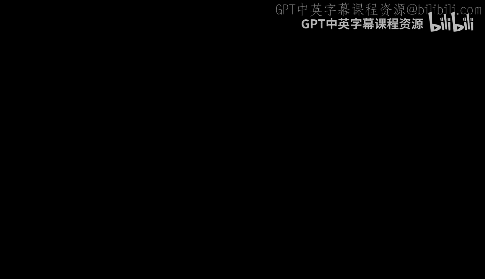
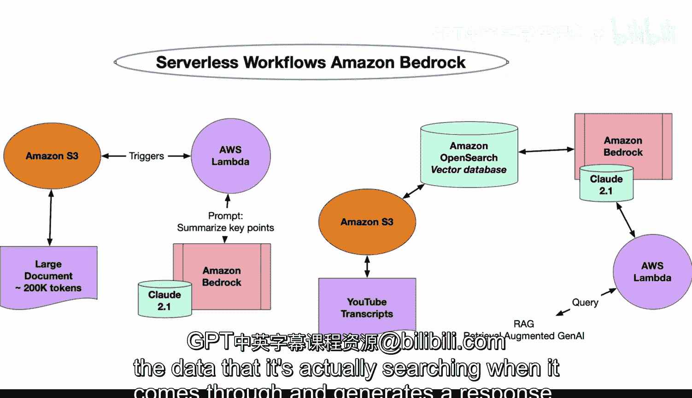

# 大型语言模型实践：P80：基于AWS Bedrock的无服务器架构图 🏗️

在本节课中，我们将探讨两种基于AWS Bedrock构建的生成式AI无服务器工作流。我们将了解如何利用AWS的无服务器服务（如S3、Lambda和OpenSearch）与Bedrock的大型语言模型（LLM）结合，实现文档处理和知识库问答等高级功能。

## 传统文档处理工作流 📄

上一节我们概述了课程内容，本节中我们来看看第一种基于AWS Bedrock的传统文档处理工作流。

该工作流适用于许多AWS Lambda应用程序，其核心流程如下：

以下是该工作流的关键步骤：
1.  **文档存储**：用户将文档（如PDF、TXT文件）上传至**Amazon S3**存储桶。
2.  **事件触发**：S3上传事件自动触发一个**AWS Lambda**函数。
3.  **调用LLM**：Lambda函数调用**AWS Bedrock**服务中的大型语言模型（例如**Claude 2.1**）。
4.  **文档处理**：Lambda将S3中的文档内容（最多可达20万令牌）发送给LLM，并执行指定任务，如**摘要生成**或**内容增强**。

**公式示例**：`Lambda(S3_Event) -> Invoke_Bedrock_LLM(Document, Prompt) -> Result`

这种架构的典型应用场景是自动化分析。例如，金融分析师可以自动读取美国证券交易委员会（SEC）的公司备案文件，通过提示词让LLM分析公司的盈利能力或识别关键条件的变化，从而获得统一、高效的分析报告。

## 检索增强生成（RAG）工作流 🔍

了解了传统的文档处理流程后，我们来看看另一种新兴且强大的模式——检索增强生成工作流。

这种工作流旨在为LLM提供外部知识源，使其生成基于特定领域知识的准确回答。以下是构建RAG工作流的主要环节：

以下是构建RAG系统的核心步骤：
1.  **数据准备**：收集原始文本数据（例如，某位教授的YouTube视频字幕文稿），并将其存入**Amazon S3**。
2.  **向量化存储**：使用嵌入模型将文本数据转换为向量，并存储到向量数据库（如**Amazon OpenSearch Serverless**）中。
3.  **查询与检索**：当用户提出问题时，系统将问题转换为向量，并在向量数据库中检索出最相关的文本片段。
4.  **增强生成**：将检索到的相关文本作为上下文，与用户问题一同提交给**AWS Bedrock**的LLM（例如**Claude 2.1**），生成最终答案。

**代码示例**：`response = llm.generate(query=user_question, context=retrieved_documents)`

## 无服务器架构的优势与集成 ⚡

无论是传统工作流还是RAG工作流，其核心优势都建立在无服务器架构之上。

所有提到的组件（S3、Lambda、OpenSearch Serverless、Bedrock）都是全托管、无服务器的服务。这意味着开发者无需管理底层基础设施，可以专注于业务逻辑。**AWS Lambda** 可以作为整个系统的统一接口，通过API Gateway、聊天工具或Web前端暴露给用户。

**公式示例**：`User_Request -> API_Gateway -> Lambda -> (S3/Bedrock/OpenSearch) -> Lambda -> Response`

这种架构为快速开发和自动化提供了巨大机会。它既可以是传统无服务器功能的扩展（如文档自动摘要），也可以实现复杂的RAG应用，将生成式AI模型“锚定”在特定知识库上。RAG不仅能确保模型基于指定数据生成回答，还能在响应中提供数据来源引用，极大地提高了结果的准确性和可信度。

---

本节课中我们一起学习了两种基于AWS Bedrock的无服务器架构。第一种是**传统的文档处理流水线**，通过S3触发Lambda调用LLM处理文档。第二种是**检索增强生成工作流**，它结合了向量数据库，使LLM能够基于特定知识库生成精准答案。这两种模式都充分利用了AWS无服务器服务的弹性、可扩展和易集成的特点，为构建高效的生成式AI应用提供了强大蓝图。