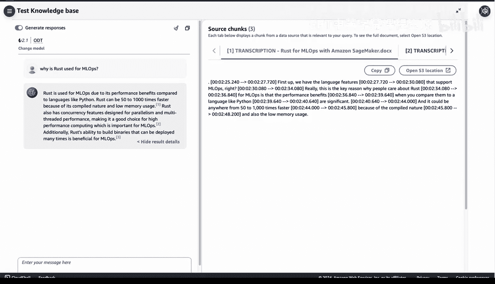

# 大型语言模型实践（高级数据工程、AWS、Databricks和本地LLM）：P81：15_01_03_AWS Bedrock知识代理演示

在本节课程中，我们将学习如何使用AWS Bedrock平台创建一个知识库，并利用检索增强生成技术，让大型语言模型基于我们自己的数据来回答问题。我们将通过一个具体的演示，展示如何配置知识库、上传数据并进行查询。

## 概述：AWS Bedrock知识库与检索增强生成

上一节我们介绍了AWS Bedrock的基本概念。本节中，我们来看看如何利用Bedrock的知识库功能，实现检索增强生成。这是一种强大的技术，它允许AI模型在生成回答时，参考并“引用”我们提供的特定数据源，从而提供更准确、更相关的信息。

## 知识库配置与数据源

这里我们打开了Amazon Bedrock平台，并且已经设置好了一个知识库。

这个知识库的核心是使用向量数据库来实现检索增强生成。你可以看到这里有一个知识库数据源，它是我从S3存储桶上传的一些课程转录文本。这些是我之前做过的一些讲座内容。

以下是知识库配置的关键组件：

*   **嵌入模型**：我在这里使用了Titan嵌入模型，它是知识库的一部分，负责将文本转换为向量表示。
*   **向量引擎**：在配置中，你可以看到“向量引擎”选项，这里使用的是Amazon OpenSearch Serverless。这是一个托管的向量搜索引擎，用于高效存储和检索文本向量。

## 测试向量数据库检索功能

配置完成后，我们首先需要测试向量数据库是否正常工作。

一个简单的方法是直接输入一个查询，看看它能否从我们的数据中找到相关信息。让我们输入“什么是Rust”，然后看看会发生什么。

系统现在会执行搜索。我们可以看到结果中列出了在不同转录文本里所有提到“Rust”的地方。这证明向量检索功能是有效的，它成功地从我们上传的数据中找到了相关内容。

## 使用生成式AI进行增强回答

在确认检索功能正常后，下一步是结合生成式AI模型来产生完整的回答。

为此，我需要选择一个生成模型。我已经在这里选择了Claude 2.1模型来协助完成生成式AI任务。

现在，让我们输入一个更具体的问题：“为什么Rust被用于MLOps？”，看看结果如何。

## 检索增强生成的实际效果

现在，AI模型能够基于我上传的数据来“落地”其回答。它将生成一个AI回复，并且这个回复会引用我提供的课程资料中的内容。

这是一种非常强大的技术。你可以看到这里的回答：“Rust被用于MLOps是由于其性能优势”，并且我实际上能在下方的检索结果中，看到这个结论所引用的具体转录文本片段。

这个演示的核心价值在于，你可以让生成式AI模型基于你认为可靠、特定的数据源来生成结果。显然，你拥有的关于某个主题的数据越多、质量越高，生成的结果就会越好。

## 总结

本节课中，我们一起学习了如何在AWS Bedrock上配置和使用知识库。我们了解了如何设置数据源和向量引擎，测试了基础的检索功能，并最终结合Claude模型实现了检索增强生成。这项技术使你能够利用自有数据来增强大型语言模型的能力，确保其回答既具有生成模型的流畅性，又具备特定领域数据的准确性和相关性。

