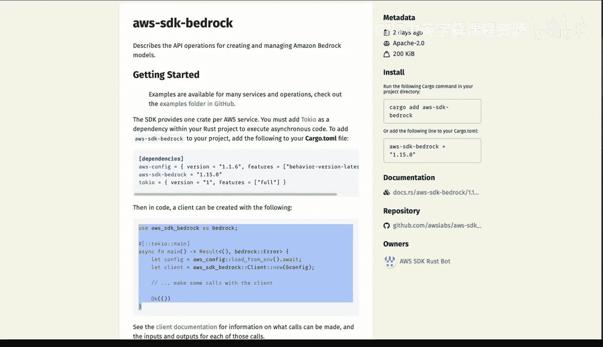
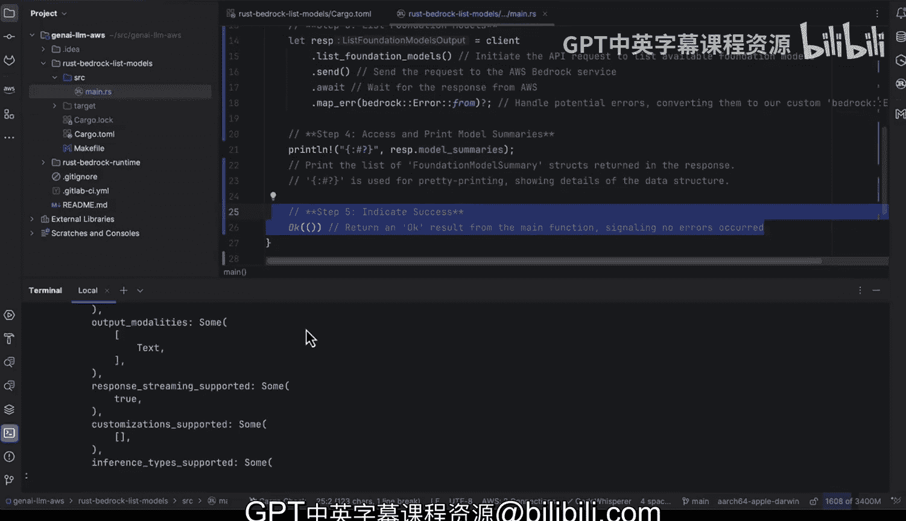

# 大型语言模型实践（高级数据工程、AWS、Databricks和本地LLM）：P82：AWS Bedrock CLI 演示 🚀


在本节课中，我们将学习如何通过 Rust 编程语言和 AWS SDK 来与 Amazon Bedrock 服务进行交互。我们将从查看 AWS 控制台界面开始，然后逐步编写一个简单的 Rust 程序来列出 Bedrock 中所有可用的基础模型。

## 概述 Amazon Bedrock 控制台

上一节我们介绍了课程背景，本节中我们来看看 Amazon Bedrock 服务的用户界面。


在 AWS 控制台中，你可以看到 Amazon Bedrock 的界面。你可以切换到图标视图，查看托管在此处的基础模型的描述信息。你也可以切换到列表视图，查看种类繁多的不同模型及其支持的令牌数量。其中一个顶级模型是 Anthropic 公司提供的 Claude 3。

## 使用 Rust 与 Bedrock 交互

除了控制台，另一种与 Bedrock 交互的方式是使用 Rust 语言。接下来，我们将看到如何使用 AWS SDK for Bedrock。




使用 AWS SDK for Bedrock 的好处是，从 Rust 调用 Bedrock 服务非常直接。让我们开始吧。

这里有一个我正在开发的名为 `Gennyi` 的项目。在 `Cargo.toml` 文件中，我引入了以下依赖：
- `aws-config`
- `aws-sdk-bedrock`
- `tokio`（为 Rust 提供异步能力）

## 代码逐步解析

现在，让我们一步步解析代码。

**第一步：导入 SDK**
首先，我们导入 AWS Bedrock SDK。
```rust
use aws_sdk_bedrock as bedrock;
```

**第二步：设置异步主函数**
接着，我们标记主函数，以便能够进行异步调用。这需要 Tokio 运行时的支持。
```rust
#[tokio::main]
async fn main() -> Result<(), Box<dyn std::error::Error>> {
    // 函数体
}
```
这个异步主函数将能够返回结果并处理错误。

**第三步：加载配置**
然后，我们加载调用所需的配置，包括包含区域信息的环境配置。
```rust
let config = aws_config::load_from_env().await;
```

**第四步：创建客户端**
创建客户端非常简单，只需一行代码。
```rust
let client = bedrock::Client::new(&config);
```

**第五步：列出基础模型**
还记得控制台的界面吗？我们可以在那个面板上列出所有模型。在代码中，我们执行相同的操作。
```rust
let resp = client.list_foundation_models().send().await?;
```
我们发送列出基础模型的请求，等待响应，并处理可能发生的任何错误。

**第六步：打印输出**
最后，我们只需将结果打印出来。这里的代码会进行美观的格式化打印。
```rust
println!("{:#?}", resp);
```

**第七步：返回成功**
在函数末尾，我们返回 `Ok(())` 表示程序执行成功。
```rust
Ok(())
```

## 运行程序

让我们运行这个程序。在终端中输入：
```bash
cargo run
```
程序开始运行。输出内容可能较多，不易阅读。

这里有一个我常用的小技巧：将输出通过管道传递给 `less` 命令。
```bash
cargo run | less
```
这样，你就可以滚动浏览所有不同的 Bedrock 模型了。

## 总结与展望

本节课中，我们一起学习了如何通过 Rust 和 AWS SDK 来列出 Amazon Bedrock 中的基础模型。

如果你计划将 Rust 作为主要接口，它在无服务器运行时（如 AWS Lambda、App Runner，甚至 Fargate）中会运行得非常好。由于 Rust 的高效性，并且它是 AWS 平台最新的通用 SDK，因此在大语言模型的新世界中具有巨大潜力。



