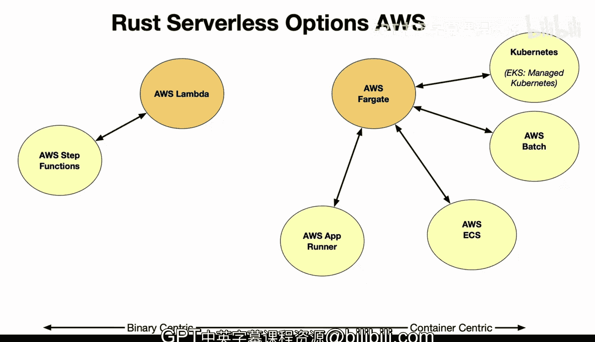

# 大型语言模型实践（高级数据工程、AWS、Databricks和本地LLM）：P83：17_01_06_Rust无服务器方案架构图

在本节课中，我们将学习在AWS上部署Rust应用的无服务器架构选项。我们将探讨两种主要的设计思路：以二进制文件为中心和以容器为中心，并分析它们各自的优势与适用场景。

## 以二进制文件为中心的方案

上一节我们介绍了课程概述，本节中我们来看看第一种方案：以二进制文件为中心的Rust无服务器架构。这是Rust语言的一个显著优势，开发者无需单独打包依赖项。在许多情况下，依赖项可以直接编译进二进制文件中。

例如，使用 **`cargo lambda`** 这样的工具，可以轻松部署一个无服务器函数。这个函数能够执行诸如使用Polars进行数据工程，或使用Pipedream等服务集成等任务。之后，你可以通过AWS Step Functions来编排和扩展这些功能。

在无服务器领域，拥有Rust生态系统是一个竞争优势。其优势体现在延迟、性能、能耗和成本上。根据具体用例，性能提升可能达到10倍、100倍，甚至1000倍。

以下是该方案的核心优势列表：
*   **依赖管理简单**：依赖项可内置于二进制文件。
*   **部署便捷**：使用 `cargo lambda` 等工具简化部署流程。
*   **功能强大**：可集成Polars等库进行数据工程。
*   **性能卓越**：在延迟、性能和成本方面具有显著优势。
*   **易于扩展**：可通过Step Functions编排工作流。

## 以容器为中心的方案

了解了基于二进制的轻量级方案后，我们接下来看看另一种以容器为中心的方案，它主要围绕AWS Fargate构建。Fargate的优势在于它能简化操作，并提供了与多种AWS服务集成的接口。

让我们讨论其中几种服务：
*   **AWS App Runner**：这项服务非常引人注目，它允许你推送一个容器镜像，并自动完成部署，从而实现开箱即用的持续交付。
*   **Amazon ECS**：这是AWS管理的容器服务。你可以运行一些长时间运行的自定义任务，这些任务可以与Fargate配合工作，实现无服务器化。
*   **AWS Batch**：这项服务本身也很有吸引力。如果你想运行短生命周期作业，甚至可以利用Spot实例，你可以将一些Rust应用部署到AWS Batch中。例如，基于GPU的训练、推理任务或一些数据工程任务，都能从中获得出色的性能。
*   **Amazon EKS**：Kubernetes可以通过EKS进行管理，并且它同样可以与AWS Fargate协同工作。

因此，如果你倾向于以容器为中心的方案，可以选择Fargate及上述服务；如果你更倾向于以无服务器二进制文件为中心的方案，则可以选择AWS Lambda。两者都是在AWS上运行Rust应用的优秀选项。

本节课中我们一起学习了在AWS上部署Rust应用的两种主要无服务器架构。我们探讨了以二进制文件为中心的方案，其优势在于依赖内嵌和极致性能；也分析了以容器为中心的方案，它通过Fargate提供了灵活的服务集成和任务管理能力。开发者可以根据具体的性能需求、部署复杂度和集成场景来选择最合适的路径。