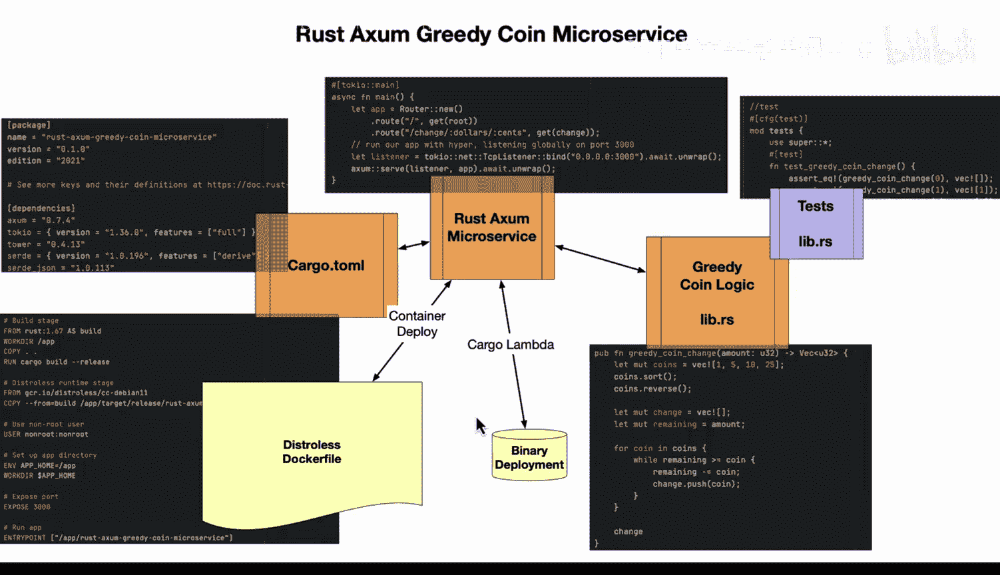

# 大型语言模型实践（高级数据工程、AWS、Databricks和本地LLM）：P84：18_01_07_Rust Axum贪婪硬币微服务组件架构图


在本节课中，我们将要学习一个基于Rust和Axum框架构建的“贪婪硬币找零”微服务。我们将详细拆解其各个组件，包括其架构设计、核心逻辑、测试方法以及多种部署选项。

## 微服务概述

首先，我们来看这个微服务本身。它使用Tokio框架来获得异步能力，这是目前可用的最快的框架之一，这是它的一个优点。同时，它的路由设计也非常直观。

## 路由与控制器

在路由处理部分，微服务会接受一个表示美元和美分的参数。这个参数随后会被传递给一个找零函数。

这里需要注意的一个设计模式是，我将业务逻辑分离到了一个名为`LibRS`的目录中。这是一个很好的模式，可以清晰地分离关注点。控制器部分（即微服务本身）和业务逻辑部分（放在库中）被分开了。

## 核心业务逻辑

以下是核心业务逻辑的实现。它是一个相当简单的函数，使用了“贪婪启发式”算法。

```rust
// 伪代码示例：贪婪找零算法
fn make_change(amount: i32) -> HashMap<Coin, i32> {
    let mut remaining = amount;
    let mut result = HashMap::new();
    let coins = [25, 10, 5, 1]; // 硬币面值

    for &coin in &coins {
        if remaining >= coin {
            let count = remaining / coin;
            result.insert(coin, count);
            remaining %= coin;
        }
    }
    result
}
```

这个算法的效率在于，它首先尝试使用最大面额的硬币（25美分），尽可能多地处理剩余金额。如果还有剩余，则尝试下一个最大面额，依此类推。这种方法以最少的迭代次数为你提供找零，并且优先给出大面额硬币，这样就不会过早耗尽小面额硬币的库存。

## 测试

我们在`LibRS`库中还可以看到测试代码。这是许多Rust项目中一个很好的模式，你可以将测试放在文件底部。这样可以测试业务逻辑，而业务逻辑通常是代码中最复杂、最容易出错的部分。确保核心逻辑正常工作至关重要。

## 依赖管理与部署

现在，我们来看看`Cargo.tml`文件。可以看到这里安装了一些包，包括`axum`、`Tokio`，以及用于序列化和反序列化的`serde`库。

此外，还有一个无发行版的`Dockerfile`。这是可选的，但如果你想进行基于容器的部署，这个文件会很有用。这种`Dockerfile`的优点在于，它能将镜像精简到几乎只包含二进制文件，使得Docker镜像可以非常小（例如20-30兆字节），这让部署变得非常容易。

当使用Rust和Axum时，还有二进制部署的方式。实际上，它与AWS Lambda配合得非常好。你可以使用`cargo lambda`工具，对你的代码进行少量修改，然后进行基于二进制的部署。甚至有一些库可以在两种不同风格（容器与Serverless）之间做代理，这样你完全不需要修改代码。

## 部署选项与生成式AI集成

由此可见，在使用Rust Axum时，你拥有一个完整的框架可以使用。你可以进行无服务器部署，也可以部署到容器（如ECS），或者部署到Kubernetes，还可以进行二进制部署。选择非常多。

它在生成式AI领域也能很好地工作，因为你可以直接代理到某些GenAI服务，例如使用RAG（检索增强生成）的服务。这个RAG服务可以很好地集成到你的微服务架构中。



## 总结


本节课中，我们一起学习了一个Rust Axum贪婪硬币找零微服务的完整架构。我们分析了其高性能的Tokio异步框架、清晰的控制器与业务逻辑分离设计、高效的贪婪算法核心、内嵌的测试模式，以及灵活多样的部署选项（包括轻量级Docker容器、AWS Lambda等）。这种架构模式不仅高效、可测试，而且能轻松适应现代云原生和生成式AI的应用场景。