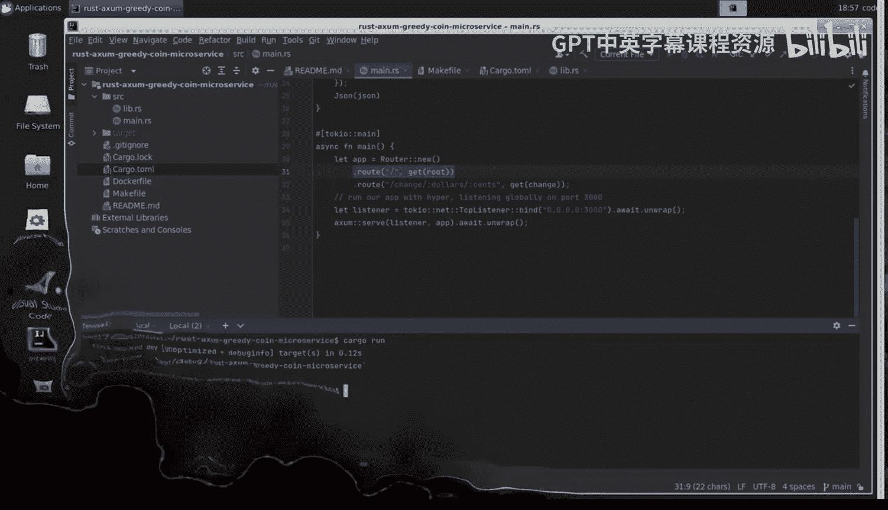

# 大型语言模型实践（高级数据工程、AWS、Databricks和本地LLM）：P85：19_01_08_Rust Axum贪婪硬币演示


在本节课中，我们将学习如何使用Rust编程语言和Axum框架构建一个简单的微服务。这个微服务的核心功能是实现一个“贪婪硬币找零”算法，并通过HTTP API对外提供服务。我们将分析项目的代码结构，理解其工作原理，并学习如何运行和测试它。

## 项目结构概述 🗂️

我们有一个使用Rust和Axum框架的微服务项目。项目主要包含两个文件：`lib.rs`和`main.rs`。`lib.rs`文件包含了所有的核心业务逻辑，而`main.rs`文件则负责处理HTTP路由和服务器启动。

## 核心逻辑：贪婪硬币找零算法 💰

上一节我们介绍了项目的整体结构，本节中我们来看看核心的找零算法是如何实现的。

`lib.rs`文件中定义了一个名为`greedy_coin_change`的函数。这个函数的功能是计算给定金额（以美分为单位）所需的最少硬币数量。它采用“贪婪算法”，即优先使用最大面额的硬币，直到无法再使用为止，然后转向下一个较小面额的硬币。

以下是该函数的代码描述：
```rust
pub fn greedy_coin_change(amount: u32) -> Vec<u32>
```
*   **输入**：一个`u32`类型的整数，代表总金额（单位：美分）。
*   **输出**：一个包含`u32`类型的向量（`Vec<u32>`），代表找零所需的各面额硬币数量。硬币面额预设为1美分、5美分、10美分和25美分。
*   **算法逻辑**：函数会遍历一个预设的硬币面额列表（例如 `[25, 10, 5, 1]`），对于每个面额，计算最多可以使用多少枚，然后将剩余金额传递给下一个面额继续计算。

为了确保算法的正确性，`lib.rs`文件中还包含了一个测试套件。以下是测试用例的示例：
```rust
#[cfg(test)]
mod tests {
    use super::*;
    #[test]
    fn test_greedy_coin_change() {
        // 测试不同金额的找零结果
        assert_eq!(greedy_coin_change(34), vec![25, 5, 1, 1, 1, 1]);
    }
}
```

## HTTP服务与路由设置 🌐

理解了核心算法后，我们来看看如何通过Web服务将其暴露给外部调用。这部分逻辑主要在`main.rs`文件中。

首先，通过`use`语句导入`lib.rs`中定义的函数：
```rust
use rust_axum_greedy_coin_microservice::greedy_coin_change;
```

接着，我们设置Axum的路由。项目定义了两个主要路由：

1.  **默认路由 (`/`)**：这是一个静态路由，用于返回微服务的使用说明。
2.  **找零路由 (`/change/:dollars/:cents`)**：这是一个动态路由，接收美元(`dollars`)和美分(`cents`)两个参数。

处理找零请求的函数会从路径中提取`dollars`和`cents`参数，将它们合并为总美分数，然后调用`greedy_coin_change`函数进行计算。最后，将结果封装成一个JSON负载返回给客户端。

所有的路由配置和服务器启动逻辑最终在Tokio运行时中被整合。关键代码如下：
```rust
let app = Router::new()
    .route("/", get(root))
    .route("/change/:dollars/:cents", get(get_change));

let listener = TcpListener::bind("0.0.0.0:3000").await.unwrap();
axum::serve(listener, app).await.unwrap();
```

## 项目配置与辅助文件 ⚙️

为了便于开发和维护，项目还包含一些配置文件：

*   **`Cargo.toml`文件**：列出了项目所需的所有Rust依赖包，例如`axum`, `tokio`, `serde`等。
*   **`Makefile`文件**：包含了一些常用的命令（例如`cargo run`, `cargo test`），开发者无需记忆完整的命令，直接执行`make run`即可启动服务。

## 运行与测试微服务 🚀

现在，我们已经了解了项目的所有组成部分，本节我们来实际操作，运行并测试这个微服务。

首先，我们需要启动微服务。在项目根目录的终端中，执行以下命令：
```
cargo run
```
服务器将在前台启动，并监听3000端口，等待HTTP请求。

接下来，我们打开另一个终端会话，使用`curl`命令来测试API。

1.  访问默认路由，获取使用说明：
    ```
    curl http://localhost:3000/
    ```

2.  测试找零功能。例如，计算3美元4美分的找零方案：
    ```
    curl http://localhost:3000/change/3/4
    ```
    服务将返回一个JSON响应，其结构可能如下：
    ```json
    {
      "dollars": 3,
      "cents": 4,
      "coins": [25, 25, 25, 25, 25, 5, 1, 1, 1, 1]
    }
    ```
    这表示，对于304美分的总金额，贪婪算法给出的找零方案是：5枚25美分硬币，1枚5美分硬币，以及4枚1美分硬币。

除了使用`curl`，你也可以直接在Web浏览器中访问上述地址来测试API。

## 总结 📝

本节课中我们一起学习了如何构建一个完整的Rust Axum微服务。我们从分析项目结构开始，深入探讨了核心的“贪婪硬币找零”算法的实现。然后，我们了解了如何使用Axum框架设置HTTP路由，将算法功能封装成Web API。最后，我们通过运行服务和发送HTTP请求，实际验证了微服务的功能。这个项目展示了Rust在构建高效、可靠网络服务方面的能力，其清晰的模块化设计（分离`lib.rs`和`main.rs`)也体现了良好的工程实践。



