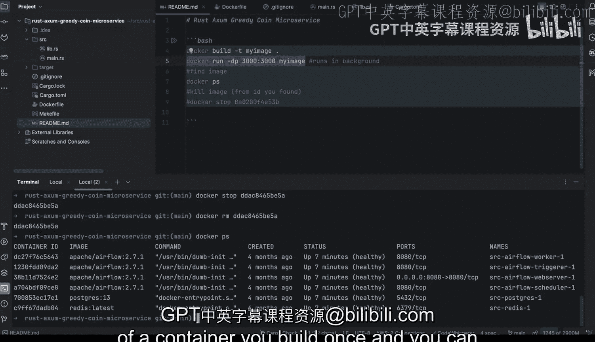

# 大型语言模型实践（高级数据工程、AWS、Databricks和本地LLM）：P86：20_01_09_Rust Axum Docker工作流演示


在本节课程中，我们将学习如何使用Docker容器化一个基于Rust和Axum框架的微服务应用。我们将涵盖从编写Dockerfile、构建镜像、运行容器到测试和清理的完整工作流程。这个流程模拟了生产环境的部署，是现代化应用开发的关键技能。

## 项目结构与代码概览

我们使用IntelliJ IDE打开了一个Rust微服务项目。项目包含一个库文件（`lib.rs`）用于存放应用的核心逻辑，以及一个主文件（`main.rs`）用于设置路由。

以下是主文件中定义的一个简单路由示例，它接收一个金额参数并返回处理后的结果：

```rust
// main.rs 中的路由示例
#[get("/change/<amount>")]
async fn change(amount: f64) -> String {
    format!("Change for ${}", amount)
}
```

## 构建精简的Docker镜像

上一节我们介绍了项目的基本代码结构，本节中我们来看看如何将其打包成Docker容器。关键在于Dockerfile的编写，我们使用`distroless`基础镜像来创建体积极小的容器镜像。

以下是Dockerfile的核心内容：

```dockerfile
# 使用多阶段构建来减小镜像体积
FROM rust:latest as builder
WORKDIR /usr/src/app
COPY . .
RUN cargo build --release

# 使用极简的distroless镜像运行
FROM gcr.io/distroless/cc-debian12
COPY --from=builder /usr/src/app/target/release/my_rust_app /app/
WORKDIR /app
EXPOSE 3000
CMD ["./my_rust_app"]
```

这个Dockerfile执行了以下操作：
1.  在第一阶段（`builder`）使用完整的Rust环境编译应用。
2.  在第二阶段仅复制编译好的二进制文件到极简的`distroless`镜像中。
3.  暴露应用运行的端口（3000）。
4.  设置容器启动时运行的命令。

这种方法生成的镜像非常小，便于快速部署和传输。

## 构建与运行容器

理解了Dockerfile的原理后，接下来我们执行具体的命令来构建和运行容器。我们将使用终端命令进行操作，同时也会观察Docker Desktop图形界面提供的信息。

以下是构建和运行容器的主要步骤：

1.  **构建Docker镜像**：在项目根目录下执行以下命令，`-t`参数用于给镜像打上标签。
    ```bash
    docker build -t my-rust-image .
    ```

2.  **运行Docker容器**：使用`-d`参数让容器在后台运行，`-p`参数将主机的3000端口映射到容器的3000端口。
    ```bash
    docker run -d -p 3000:3000 my-rust-image
    ```

在构建和运行过程中，可以打开Docker Desktop查看资源使用情况、容器列表和日志。终端命令效率高，而图形界面能提供更直观的全局视图，两者结合使用非常方便。

## 测试应用与理解端口映射

容器在后台运行后，我们需要验证应用是否正常工作。同时，理解Docker的端口映射机制至关重要。

我们可以使用`curl`命令来测试之前定义的路由：

```bash
curl "localhost:3000/change/34"
```
预期会收到响应：`"Change for $34"`。

为了确认容器的网络配置，可以执行：
```bash
docker ps
```
该命令会列出运行中的容器。在输出中，可以看到`PORTS`列显示为`0.0.0.0:3000->3000/tcp`。这表示主机的3000端口（外部）被映射到了容器内部的3000端口。

## 停止与清理容器

完成测试后，为了释放系统资源，我们需要停止并移除容器。

以下是清理资源的步骤：

1.  **停止容器**：首先使用`docker stop`命令停止运行中的容器，需要提供容器ID。
    ```bash
    docker stop <container_id>
    ```

2.  **移除容器**：容器停止后，可以使用`docker rm`命令将其删除。
    ```bash
    docker rm <container_id>
    ```

执行`docker ps`再次检查，确认容器已从运行列表中消失。

## 容器化工作流的优势总结

本节课中我们一起学习了完整的本地Docker容器工作流。我们从一个Rust微服务代码开始，编写Dockerfile，构建出精简的镜像，运行并测试了容器，最后进行了清理。

这种工作流的核心优势在于**“一次构建，随处运行”**。我们在本地开发环境构建的容器镜像，可以几乎不做修改地部署到各种生产环境中，例如：
*   **Amazon ECS** 或 **EKS**（亚马逊弹性容器服务/ Kubernetes服务）
*   **AWS App Runner**
*   **AWS Lambda**（通过容器镜像支持）
*   **Google Cloud Run**

容器化技术确保了开发、测试和生产环境的一致性，极大地简化了部署流程，是云原生应用开发的基础。



