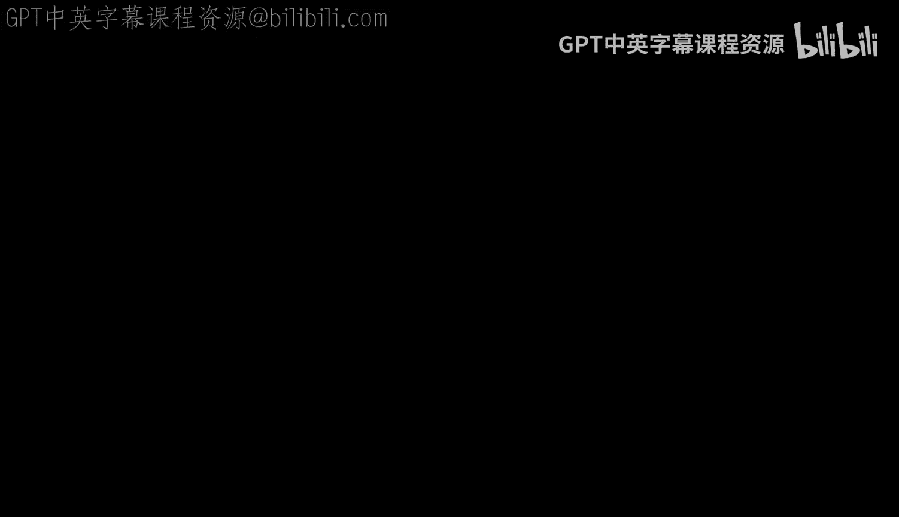
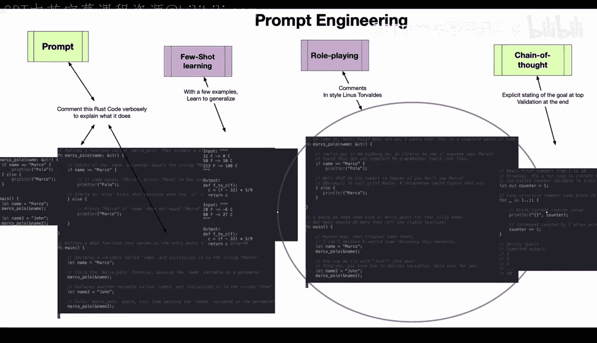

# 大型语言模型实践：P87：提示工程工作流 🧠



在本节课中，我们将学习提示工程的核心概念与几种实用工作流。提示工程是一门通过精心设计输入文本来引导大型语言模型生成特定、高质量输出的艺术。我们将探讨提示的定义、几种关键技巧及其在代码生成等场景中的应用。

## 什么是提示？💡

上一节我们介绍了课程概述，本节中我们来看看提示的基本定义。提示是一个文本输入，它为模型提供上下文，并引导模型产生特定的响应。

以下是一个简单的例子。我们有一段Rust代码和一个提示：

```rust
// 提示：请逐行详细注释这段Rust代码，解释其功能。
fn marcopolo() {
    for i in 1..=100 {
        if i % 15 == 0 {
            println!("Marcopolo");
        } else if i % 3 == 0 {
            println!("Marco");
        } else if i % 5 == 0 {
            println!("Polo");
        } else {
            println!("{}", i);
        }
    }
}
```

在应用提示后，模型会为代码生成详细的逐行注释。这对于帮助新加入团队的开发者快速理解现有代码库非常有用。

## 少样本学习示例 🎯

理解了提示的基础后，我们来看看少样本学习。这种技巧通过提供少量示例来“教导”模型执行特定任务。

以下是使用少样本学习教模型编写华氏度转摄氏度函数的例子。我们提供了几个输入输出对作为示例：

```
示例1:
输入: 32°F
输出: 0°C

示例2:
输入: 212°F
输出: 100°C

示例3:
输入: 98.6°F
输出: 37°C

任务: 请根据以上模式，编写一个将华氏度转换为摄氏度的函数。
```

模型在学习了这几个例子后，就能够理解转换规则并生成相应的函数代码。

## 角色扮演风格 🎭

除了少样本学习，另一种有趣的技巧是角色扮演。这指的是指示模型以特定人物或风格来生成文本。

在代码注释的场景中，我们可以要求模型模仿一种独特的风格。例如：

```
提示：请以莱纳斯·托瓦兹（Linus Torvalds）的风格为以下代码添加注释。众所周知，他在代码审查中言辞犀利。
```

模型可能会生成诸如“得了吧，这代码是五岁小孩写的吗？简直是浪费时间，我奶奶都能写出更好的。”之类的注释。虽然这种风格不一定鼓励人，但它展示了如何通过调整提示来改变输出的语气和风格。

## 思维链推理 🔗

现在，让我们探讨一种更结构化的方法：思维链。这种方法要求模型将推理过程分解为一系列连续的步骤，对于解决复杂问题尤其有效。

在编程任务中，一个完整的思维链提示可能包含以下部分：

1.  **明确目标**：在开头清晰陈述要解决的问题。
2.  **描述高级策略**：概述实现目标将采用的整体方法。
3.  **初始化步骤**：列出并说明准备工作。
4.  **分步注释**：为代码的每个部分添加解释其目的的注释。
5.  **验证结果**：展示预期的输出以验证代码的正确性。

这种结构化的提示方式不仅适用于提示工程，其本身也是一种优秀的设计和编程实践。它为模型提供了一个清晰的“脚手架”，使其能够更准确地填充和完成剩余部分。

## 核心技巧总结 📝

以下是本节课介绍的几种核心提示工程技巧的简要回顾：

*   **基础提示**：提供清晰的上下文和指令来引导模型。
*   **少样本学习**：通过提供少量输入输出示例来教导模型新任务。
*   **角色扮演**：指定一种风格或角色，让模型以此风格生成内容。
*   **思维链**：将复杂问题分解为一系列逻辑步骤，引导模型逐步推理。

## 总结

本节课中我们一起学习了提示工程的基本概念和几种关键工作流。我们了解到，提示是为模型提供指引的文本输入。通过少样本学习，我们可以用少量示例教会模型新技能。角色扮演技巧允许我们控制输出的风格和语气。而思维链方法则通过结构化、分步的提示来提升模型处理复杂任务的可靠性和准确性。



尽管提示工程有时被视为简单或噱头，但在实际应用中，尤其是在代码生成、理解和设计方面，精心设计的提示能显著提升大型语言模型的输出质量和实用性。掌握这些技巧是有效利用现代AI工具的关键一步。