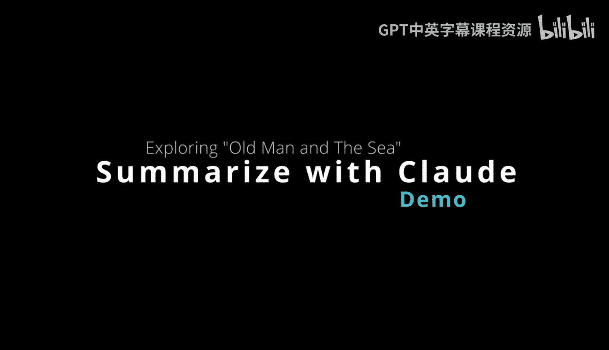
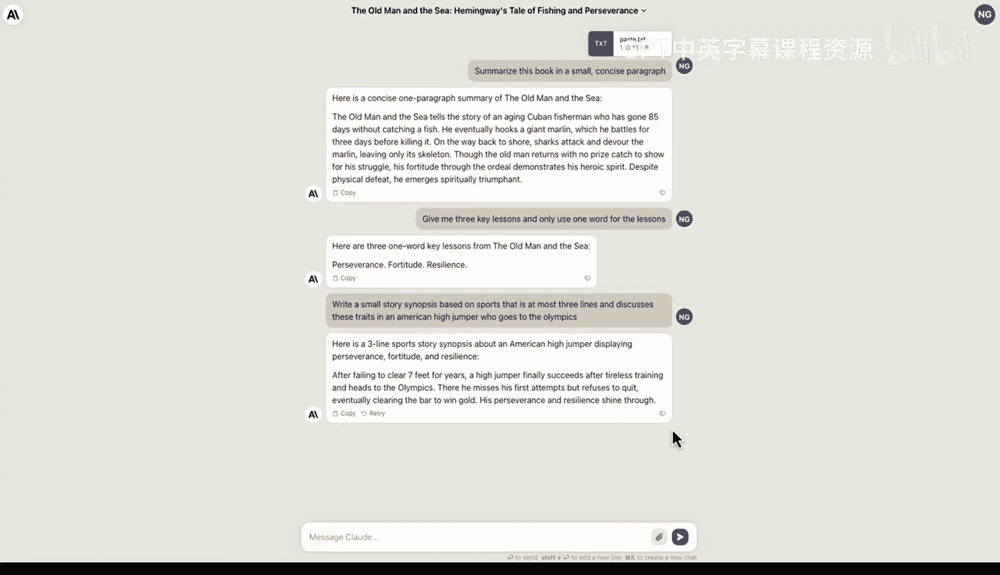

# 大型语言模型实践：P88：使用Claude进行文本摘要 📝

在本节课中，我们将学习如何利用Anthropic公司的Claude AI助手进行文本摘要。我们将通过一个具体的例子——分析海明威的《老人与海》——来演示如何上传文档、请求摘要、提取关键信息，并最终结合自身想法生成新的内容。

---

上一节我们介绍了Claude作为通用AI助手的基本概念。本节中，我们来看看如何具体操作，利用它处理文本并进行摘要。

这里我们有Anthropic公司的Claude，它是一个通用AI助手。我们可以用它来处理海明威的《老人与海》这本著名书籍，并就其文本内容提出一些问题。

以下是操作步骤：

首先，我向下滚动并复制书籍内的所有文本。使用Claude的一个好方法是，你可以直接上传文档。它会自动识别并将其放入一个文本文件中。

接着，我可以要求它为这段文本提供一个简短的段落摘要。

我们可以输入指令：`summarize this book in a small, concise paragraph.`

这类技术的一个优点是能够使用上传的文档。这相比仅能聊天是一个显著的增强，因为你可以为它提供更丰富的上下文信息，说明你试图完成的任务。此外，你还能处理不同格式、不同风格的数据，而不仅仅局限于聊天界面。

我们可以看到，它给出了回复：“以下是《老人与海》的简洁段落摘要：《老人与海》讲述了一位年迈的古巴渔夫在84天没有捕到鱼后，终于钓到一条巨大的马林鱼。他与鱼搏斗了三天并将其杀死。在返回岸边的途中，鲨鱼袭击并吞噬了马林鱼，只留下骨架。尽管老人没有带回战利品，但他在磨难中展现的坚韧证明了他的英雄精神，他在精神上取得了胜利。”

实际上，我很难想象能写出比这更好的《老人与海》摘要了。由此可见，这些AI助手在某些能力上是非常精准的。

---

在了解了基础摘要功能后，我们还可以进一步要求它以更精炼的形式提取信息。

我们甚至可以要求它提供三个关键点。例如，我们可以说：`give me three key lessons and only use one word for the lessons.`

与AI助手互动的方式之一，就是充分利用它最擅长的功能，即**摘要**和**阅读大量文本**的能力。这实际上是一种很好的头脑风暴方式，可以说，在处理生成式AI时，它能像一个同事一样与你协作。

我们可以看到，它给出了三个词：`perseverance`（毅力）、`fortitude`（坚韧）、`resilience`（韧性）。

---

基于AI提取的核心概念，我们可以进一步结合自己的想法，引导它生成更具体、更具创造性的内容。

然后，我可以在此基础上进行扩展，要求它利用我自己的想法，基于已获得的信息再深入一步。

我们可以说：`write a small synopsis based on sports that is at most three lines and discusses these traits in an American high jumper who goes to the Olympics.`

这实际上是结合AI助手最擅长的能力与我个人的生活经验和想法，产生协同效应。这将是接下来使用这些AI助手的最佳方式之一。

显然，我们也可以通过API、在云平台上完成这些任务。我们可以基于使用像生成式AI这样的云端机器学习解决方案，结合我现有的基础设施、用户界面和命令行工具，来真正开发新兴技术。

它给出的三行摘要如下：“在多年未能跳过七英尺后，一位跳高运动员经过不懈训练终于成功，并前往奥运会。在那里，他第一次试跳失败，但拒绝放弃，最终越过横杆赢得金牌。他的毅力和韧性熠熠生辉。”

我认为这是一个相当好的反馈循环示例。它确实是让你真正理解什么是生成式AI、以及我该如何使用它的最佳途径之一。它并非魔法，而是一个我们可以用来构建新解决方案的有用工具。

---

本节课中，我们一起学习了如何使用Claude AI助手进行文本摘要。我们从上传《老人与海》的文本开始，逐步演示了如何获取段落摘要、提取单字关键词，并最终结合体育场景的创意，生成了一个关于奥运跳高运动员的简短故事。这个过程展示了生成式AI在信息处理、创意激发和内容生成方面的强大辅助能力。