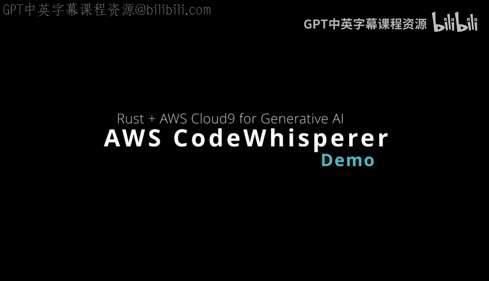
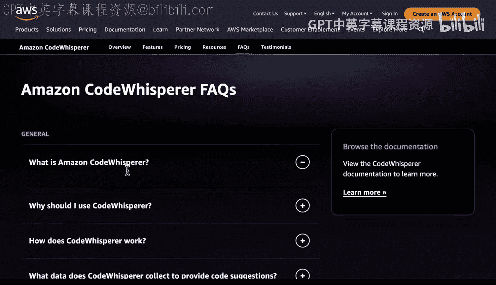
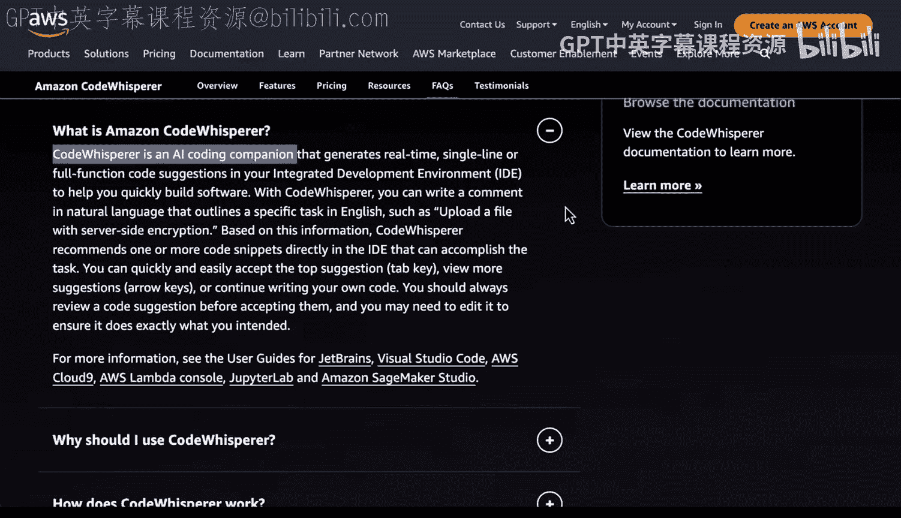
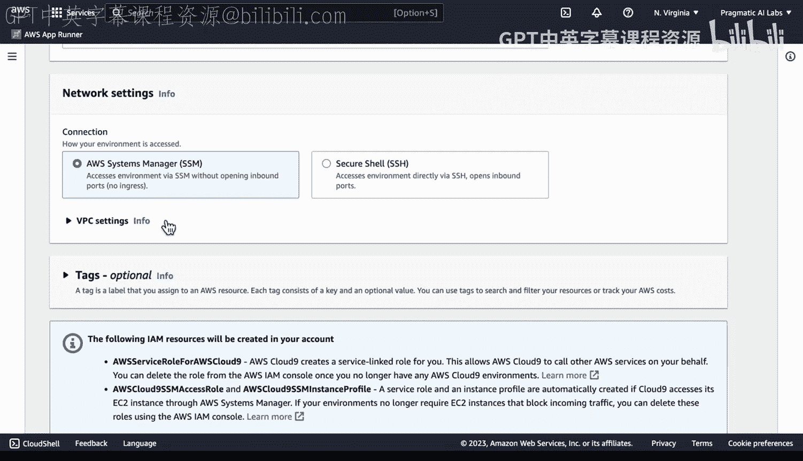
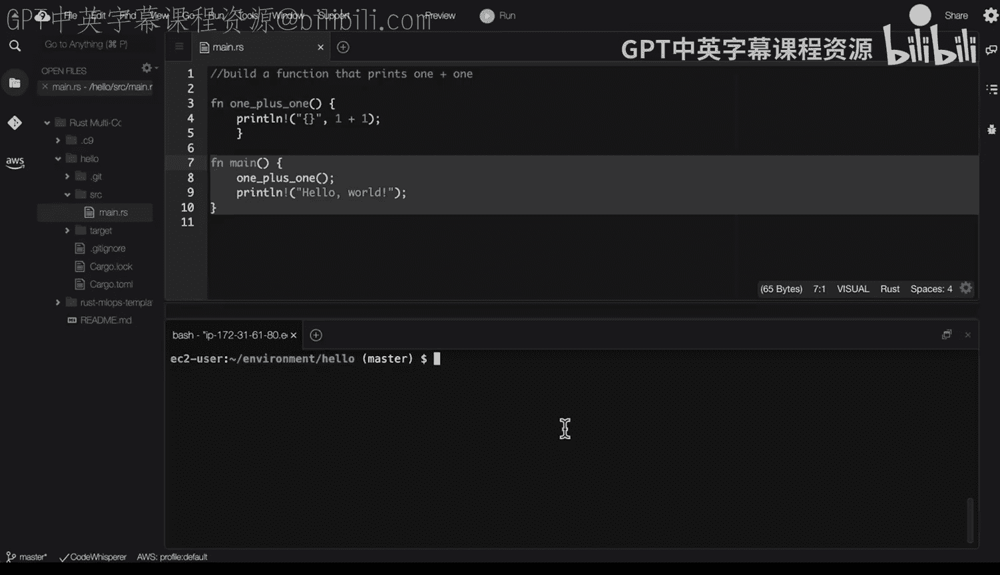
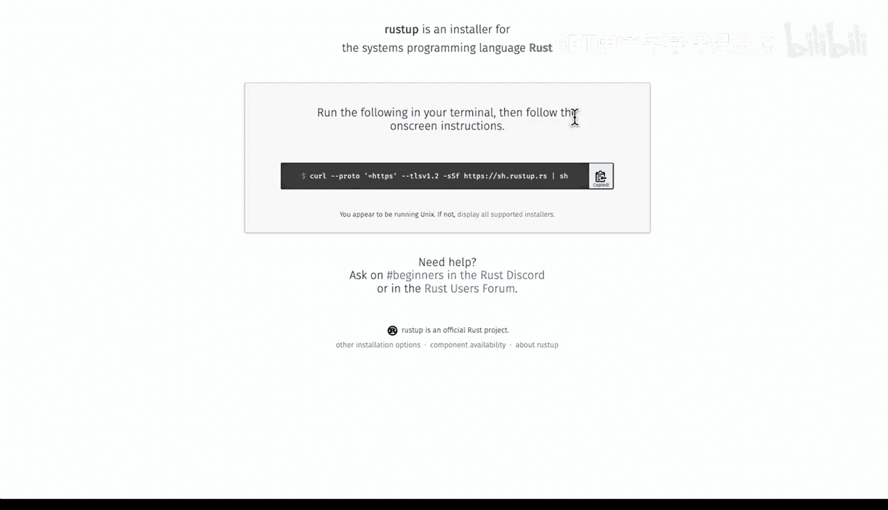
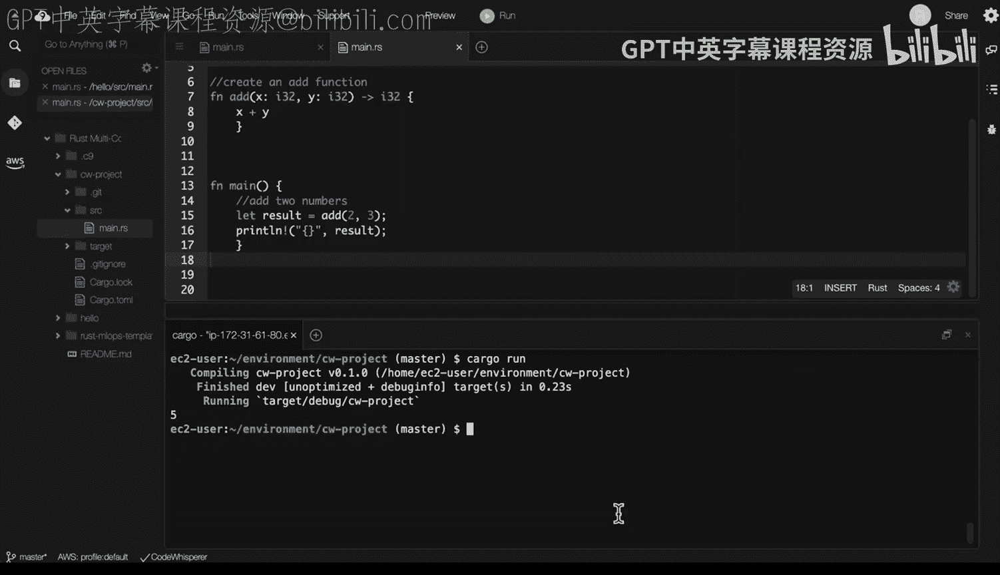
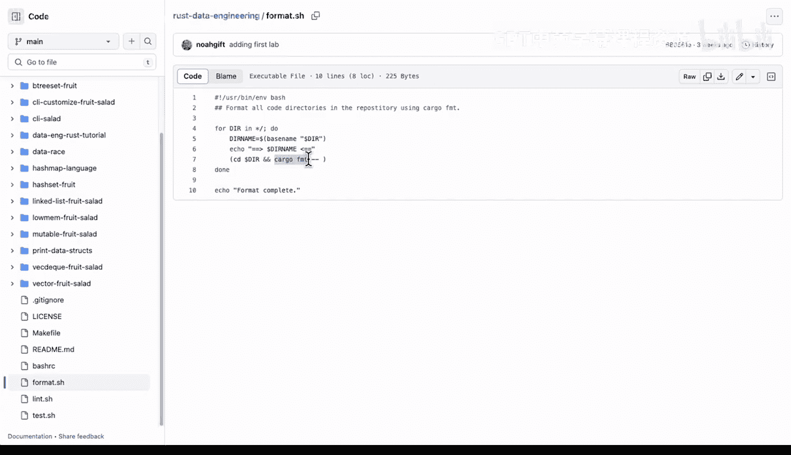
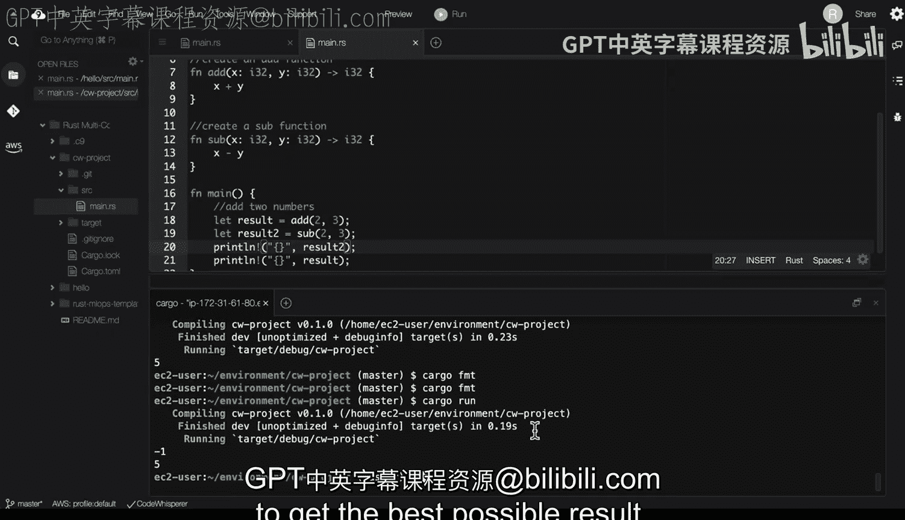

# 大型语言模型实践（高级数据工程、AWS、Databricks和本地LLM）：P89：在Cloud9中使用Rust版CodeWhisperer 🦀

在本节课中，我们将学习如何在AWS Cloud9环境中，结合Amazon CodeWhisperer这一AI编程工具，来编写和运行Rust代码。我们将从设置环境开始，逐步演示如何使用AI辅助编程功能来构建一个简单的计算器程序。

## 概述

Amazon CodeWhisperer是一个AI驱动的编程工具，它能以编程方式帮助你构建代码。它作为一个AI编码伴侣，可以与集成开发环境（IDE）协同工作。它既可以在Visual Studio Code中使用，也可以在AWS Cloud9环境中运行。

## 探索Cloud9环境

首先，让我们来看看Cloud9。它的一个优点是能够轻松创建新的、可随时丢弃的环境来测试各种功能。

如果进入Cloud9并选择创建环境，我们可以为其命名（例如“test”），并从众多选项中进行选择，包括一些性能强大的机器。列表中包含各种大型机器实例，甚至包括裸金属服务器。我们还可以选择在Amazon Linux上构建环境，这有助于确保我们编写的代码能很好地适用于亚马逊的部署环境。

在配置环境时，还可以设置超时时间，这是一种很好的配置方式。你甚至可以通过SSH进入环境进行控制，或者将其放入VPC中。

## 配置与启动CodeWhisperer

我已经有一个正在运行的环境，并且已经集成了AWS CodeWhisperer。让我们看看它是如何工作的。

点击AWS图标，可以看到有关AWS的信息，我可以控制不同的服务。进入开发者工具，在这里我已经打开了CodeWhisperer。可以看到它正在主动为我的代码提供建议。

## 一个Rust示例

让我们来看一个具体的例子。注意，在Rust代码中，我可以插入注释。例如，我写了一个注释“构建一个打印1+1的函数”，CodeWhisperer能够根据这个注释生成相应的代码。让我们找到这个示例，它在`hello`项目中。进入`hello`目录，如果输入`cargo run`，就能看到我能够利用这些建议来运行和修改我的代码。

需要指出的是，为了让Rust在Cloud9上运行，你需要执行`rustup`命令。只需复制屏幕上显示的指令，粘贴并运行即可。它会提示你进行安装，选择“proceed with installation”（继续安装）、“customize installation”（自定义安装）或“cancel”（取消）。由于我已经完成此步骤，这里选择取消。

## 从零开始构建项目

现在，让我们从头开始构建一个项目。首先，向上返回一个目录，然后输入`cargo new cw_project`来创建一个名为“cw_project”的新项目（代表CodeWhisperer项目）。创建完成后，进入这个新目录。

在这里，如果查看`src`目录下生成的`main.rs`文件，会发现它包含了入门级的代码，即经典的“Hello, world!”程序。运行`cargo run`命令来执行它。

## 使用CodeWhisperer编写代码

接下来，让我们开始使用CodeWhisperer。首先，我会创建一个多行Rust注释来设定程序上下文，这是使用AI结对编程工具时非常重要的一步。我会写下：“这是一个充当基本计算器的脚本”。

设定好上下文后，我开始引导它生成代码。例如，我输入“使用标准输入输出库”，它会给出导入`std::io`的建议。我们可以接受或拒绝这些建议。在这个例子中，我选择自己输入：“创建一个加法函数”。

引导AI就像指导同事一样。它生成了函数的基本结构，看起来不错。然后它继续补全了这个函数的具体实现。

现在，我可以继续整合代码。我输入“将两个数字相加”，然后定义变量来存储结果：`let result = ...`。接着，我输入打印结果的语句，注意到CodeWhisperer会自动进行替换以使其正常工作。

现在运行`cargo run`。哦，看起来有个问题，编译器提示“未闭合的分隔符”。这正是结合使用像Rust这样强大的语言和CodeWhisperer的好处之一：编译器告诉我哪里错了，而AI结对编程工具则帮助我构建代码。它会自动补全那个代码块。

再次运行`cargo run`，现在程序成功构建并运行了。

## 代码格式化与扩展功能

另外一些有趣的点是，我喜欢对代码进行格式化。`cargo fmt`命令可以帮我整理代码格式。回到环境中，输入`cargo fmt`，可以看到它自动清理了代码。

因此，结合“正确描述要构建的功能”（设定提示词）、逐步引导、运行编译（`cargo run`）以及格式化（`cargo fmt`），你就能充分利用AI结对编程的所有优势，同时享受编译器带来的好处。

最后，让我们再扩展一下功能。我输入“创建一个减法函数”。它很智能，知道我想要做什么。它给出了相应的代码。然后，我们可以添加第二个结果变量，比如`let res2 = ...`，并将其改为`result2`。

运行`cargo fmt`进行格式化，再运行`cargo run`。看，我们得到了-1和5两个结果。

## 总结

本节课中，我们一起学习了如何在AWS Cloud9环境中利用Amazon CodeWhisperer进行Rust开发。关键在于：有时选择特定的部署目标（这里是运行Amazon Linux的Cloud9），主动向AI寻求代码建议，运行编译器进行检查，同时利用结对编程工具形成一个高效的反馈循环，从而获得最佳的开发结果。