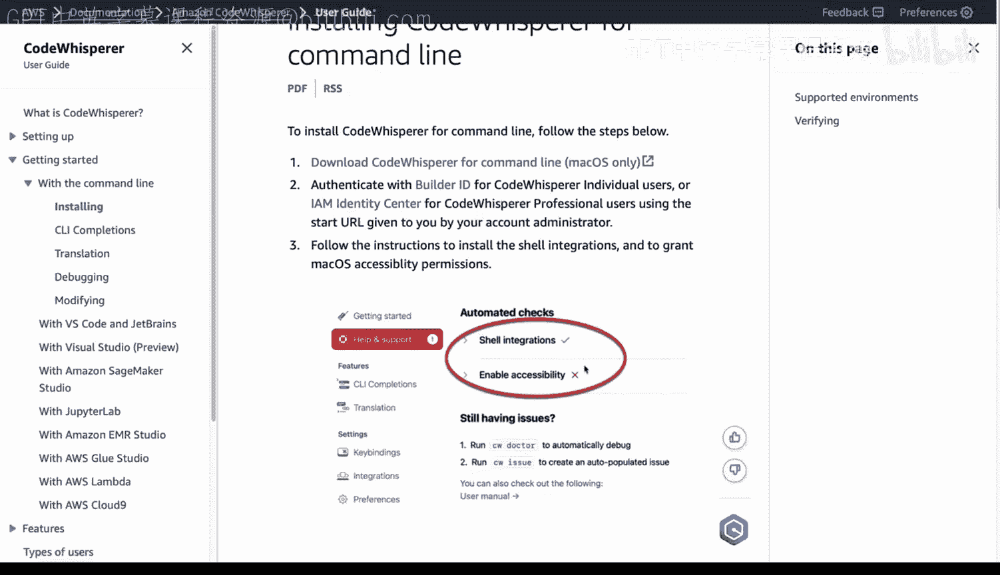
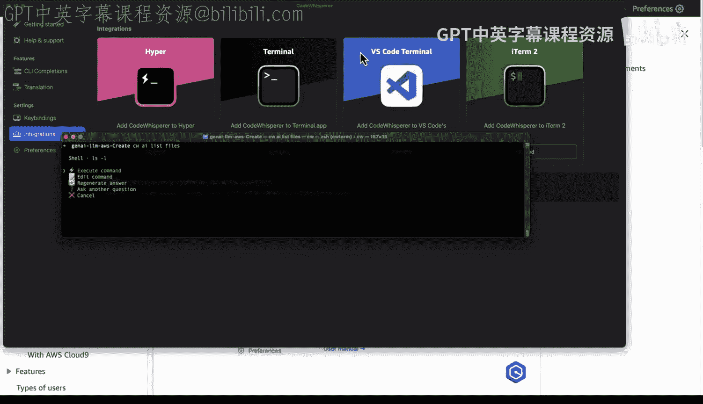

# 大型语言模型实践：P90：安装与配置 CodeWhisperer CLI 💻

在本节课中，我们将学习如何安装和配置 AWS CodeWhisperer 的命令行界面（CLI）。我们将了解其核心功能，包括智能自动补全和自然语言转 Bash 命令，并完成基本的设置步骤。

## 安装与认证

上一节我们介绍了课程背景，本节中我们来看看如何获取并安装 CodeWhisperer CLI。

首先，你需要从官方文档下载适用于 Mac OS 系统的 CodeWhisperer CLI 安装包。下载完成后，你需要使用一个 Builder ID 进行身份认证。完成认证后，你便可以在你的 Shell 环境中使用所有增强的自然语言处理功能。

## 核心功能与界面

安装完成后，我们可以打开其偏好设置界面。以下是你可以开始使用的一些主要功能。

*   **智能自动补全**：界面会显示一个窗口，实时展示所有正在进行的操作。它提供便捷的自动补全建议，帮助你导航文件夹，并为不同的目录提供选项。
*   **CLI 命令补全**：此功能会展示所有你可以执行的不同操作。你还可以通过自定义设置来增强它，例如：
    *   允许在空格后立即执行命令。
    *   允许执行危险命令（适合专家用户）。
    *   启用模糊搜索，根据你的具体用例，这可能非常有用。
    *   配置不同的字体等显示设置。

## 自然语言转 Bash 命令

除了自动补全，许多人可能还对自然语言转 Bash 命令的功能感兴趣。

你可以使用 `#` 符号或 `cw ai` 命令来触发此功能。由于我个人工作流中经常使用 `#`，我将选择使用 `cw ai` 命令。触发后，你可以输入自然语言问题，例如 `list files`（列出文件）。系统会进行处理，并为你提供一个可执行的命令选项，你可以选择执行它。

## 集成与配置

最后，你可以通过配置界面设置快捷键绑定、集成和偏好设置。

CodeWhisperer CLI 支持与多种终端和编辑器集成，包括 Hyper 终端、VS Code 终端、iTerm2，甚至对 JetBrains 系列 IDE 也提供了实验性支持。例如，如果你使用 IntelliJ IDEA 进行开发，也可以配置集成。

## 总结

本节课中我们一起学习了 AWS CodeWhisperer CLI 的完整安装与配置流程。我们了解了如何下载安装、进行身份认证，并探索了其核心功能：智能自动补全和强大的自然语言转 Bash 命令能力。最后，我们还查看了它与其他开发工具的集成选项。完成这些步骤后，你只需在终端中输入 `cw ai`，即可开始使用自然语言来辅助你的命令行操作。