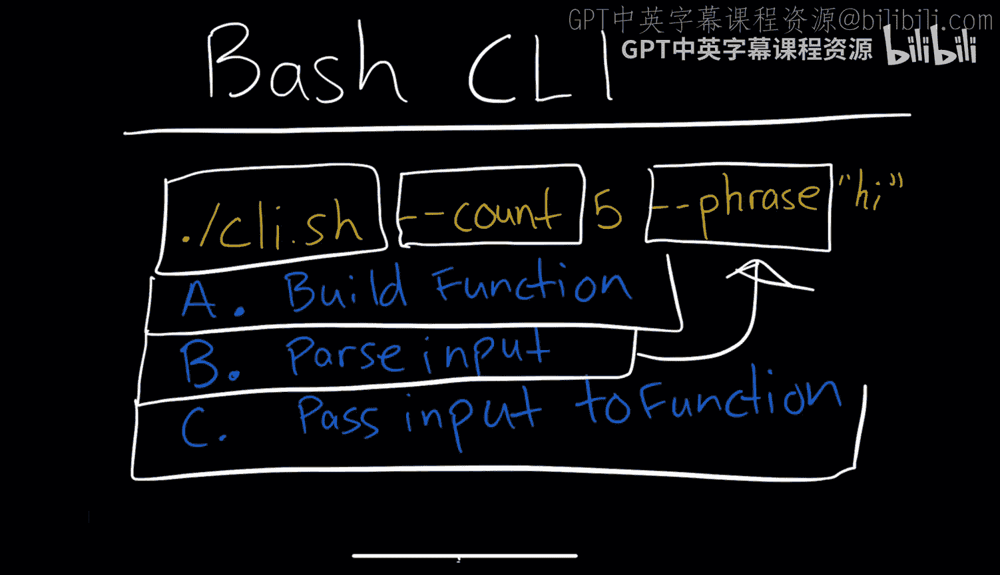
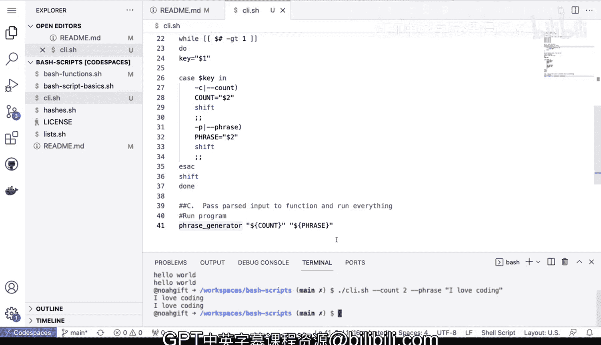

# 大型语言模型实践（高级数据工程、AWS、Databricks和本地LLM）：P92：构建Bash CLI工具 🛠️

在本节课中，我们将要学习如何构建一个Bash命令行界面工具。我们将了解其基本结构，并通过一个公式化的方法来分解和实现它，使初学者也能轻松掌握。

---

## 什么是Bash命令行工具？ 🤔

让我们先来看看Bash命令行工具是什么。首先，脚本有一个名称。这是第一部分。然后，你需要传入一些选项来收集值。例如，我们看到这里的 `count` 选项会是 `--count`，并且有一个与之关联的值。这里还有另一个选项 `phrase`，即 `--phrase`。因此，我的代码需要能够解析这些选项。

---

## 构建Bash CLI工具的公式 📝

实际上，我总结出了一个公式，你可以将其应用于几乎任何Bash命令行工具。

以下是构建步骤：

1.  **构建代码功能**：这可以是一个加法函数、计数函数，或者任何你正在构建的功能，比如一个备份脚本。你需要将其构建成一个Bash函数。
2.  **解析输入**：你需要编写能够解析从命令行传入内容的代码。
3.  **整合与执行**：当你具备了以上两部分后，就可以将它们整合起来，并将收集到的输入传递给功能函数。

这个公式是构建命令行工具的一个绝佳方法。接下来，让我们看看它的实际应用。

---

## 公式实战演练 💻



让我们看一下之前展示的命令行工具，并验证这个公式。

首先，我们再次看到脚本的名称，这里是 `ci.sh`。我需要解析一些选项，并且需要能够运行一些逻辑代码。

### 第一部分：定义功能（A部分）

这是功能定义部分，用于多次生成短语。

让我们逐步分解：

```bash
generate_phrases() {
    local count=$1
    local phrase=$2
    for ((i=0; i<count; i++)); do
        echo "$phrase"
    done
}
```
*   `generate_phrases` 是函数名。
*   实际工作是一个 `for` 循环，根据传入的计数次数，重复输出传入的短语。

### 第二部分：解析选项（B部分）

这是设置选项解析的地方，这部分可以相当公式化。

```bash
while [[ $# -gt 0 ]]; do
    case $1 in
        --count)
            COUNT="$2"
            shift 2
            ;;
        --phrase)
            PHRASE="$2"
            shift 2
            ;;
        *)
            echo "未知选项: $1"
            exit 1
            ;;
    esac
done
```
*   这里使用了一个 `while` 循环，只要还有参数，就继续处理。
*   在循环内部，`case` 语句允许我在不同的选项值之间切换，捕获 `--count` 和 `--phrase` 的值。
*   处理完成后，结束整个循环。

### 第三部分：整合与执行（C部分）

现在我已经获得了输入，只需要将其传递给我之前定义的函数即可。

```bash
generate_phrases "$COUNT" "$PHRASE"
```
在这个例子中，我只是打印出计数和短语。

---

## 工具运行示例 🚀

那么它是如何工作的呢？我们可以从命令行运行它。

```bash
./ci.sh --count 5 --phrase "Hello"
```
我们可以改变参数值：
```bash
./ci.sh --count 2 --phrase "I love coding."
```
这将为我们生成两个“I love coding.”的输出。

---

## 总结 📚

本节课中，我们一起学习了构建Bash命令行工具的完整流程。我们介绍了一个实用的三部分公式：

1.  **A部分（功能）**：编写实现核心逻辑的Bash函数。
2.  **B部分（解析）**：使用 `while` 循环和 `case` 语句来解析命令行传入的选项和参数。
3.  **C部分（整合）**：将解析得到的参数传递给功能函数并执行。



当你构建命令行工具时，思考这个A-B-C结构会非常有帮助：A部分是功能实现，B部分是输入解析，C部分是将所有部分整合起来并运行你的代码。遵循这个模式，你可以更有条理地创建出功能强大的Bash脚本工具。