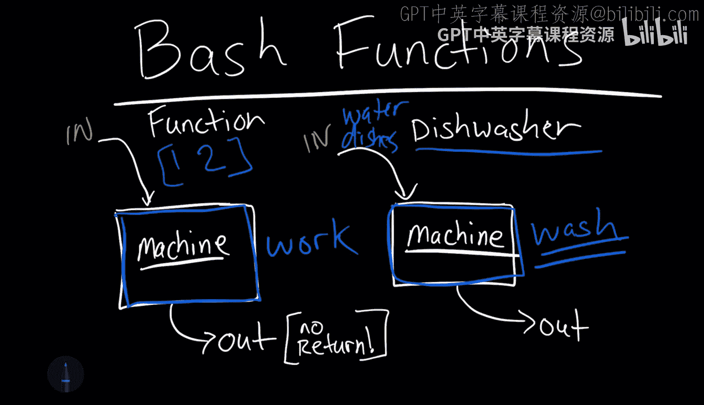
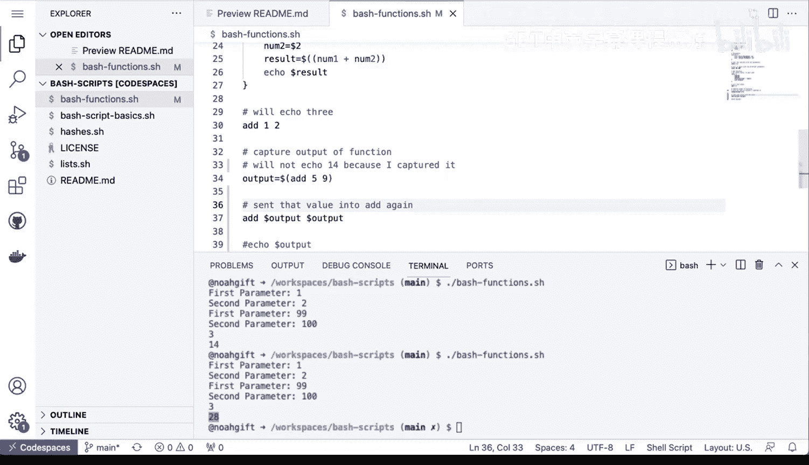

# 大型语言模型实践（高级数据工程、AWS、Databricks和本地LLM）：P93：Bash函数 🐚

在本节课中，我们将要学习Bash脚本中一个非常强大的概念——函数。我们将了解函数是什么、为什么使用它们，并通过具体的例子来掌握如何定义和调用Bash函数。

## 概述：什么是Bash函数？

Bash函数可以被看作是一个“小机器”。就像你家中的洗碗机一样，它接收输入（脏碗碟和水），执行一个过程（清洗），然后产生输出（干净的碗碟）。在编程中，函数也遵循类似的逻辑：它接收输入（参数），执行一系列操作，并产生输出（结果）。

## 函数的基本结构

上一节我们介绍了函数的核心类比，本节中我们来看看如何在Bash中定义一个函数。

Bash函数的基本结构非常简单。它由函数名、一对圆括号和包含代码块的花括号组成。

```bash
function_name() {
    # 在这里编写你的代码
}
```

以下是一个最简单的函数示例，它模拟（mimic）传入的参数：



```bash
mimic() {
    echo $1
    echo $2
}
```

这个`mimic`函数会回显（`echo`）传入的第一个和第二个参数。如果你调用`mimic one two`，它将输出`one`和`two`。

## 函数的核心优势：代码复用

为什么你需要一台洗碗机？因为你可以反复使用它。同样，为什么你需要一个Bash函数？因为它允许你反复使用同一段代码。

以下是使用`mimic`函数两次的例子：

```bash
mimic one two
mimic 99 100
```

请注意，我们不需要为第二次调用重写`echo`代码。这就是编写函数的核心概念——**可复用性**。无论是备份脚本还是其他逻辑，你都可以将通用操作封装成函数，只需传入不同的参数即可。

## Bash函数的独特之处：没有显式的`return`

与其他编程语言不同，Bash函数没有显式的`return`语句来返回值。那么，如何从函数中获取结果呢？唯一的办法是捕获函数的`echo`输出。

让我们看一个更复杂的例子：一个执行加法运算的函数。

```bash
add() {
    num1=$1
    num2=$2
    result=$((num1 + num2))
    echo $result
}
```

在这个`add`函数中：
1.  我们将第一个参数赋值给变量`num1`。
2.  我们将第二个参数赋值给变量`num2`。
3.  我们使用`$((...))`语法计算两者的和，并将结果赋值给`result`变量。
4.  最后，我们使用`echo $result`将结果输出到标准输出（stdout）。

调用`add 1 2`将会在终端上打印出数字`3`。

## 捕获函数输出并再次使用

由于Bash函数通过`echo`输出结果，我们可以捕获这个输出并将其赋值给另一个变量，或者传递给另一个函数。

以下是如何捕获`add`函数输出的示例：

```bash
output=$(add 4 9)
```

这行代码执行了`add 4 9`，计算结果是`13`。这个结果没有直接打印到屏幕，而是被捕获并存储在了`output`变量中。

现在，我们可以对这个值做任何操作。例如，我们可以将它再次传入`add`函数：

```bash
final_result=$(add $output $output)
# 这相当于执行 add 13 13，final_result 的值将是 26
```

这个过程演示了Bash函数的强大之处：通过巧妙地使用`echo`和命令替换（`$()`），我们可以实现数据的传递和复杂逻辑的构建。

## 总结

本节课中我们一起学习了Bash函数的核心概念和应用。

我们首先将函数比作一个接收输入、执行处理、产生输出的“机器”。接着，我们学习了定义Bash函数的基本语法。我们重点探讨了函数的核心优势——**代码复用**，这避免了重复编写相同逻辑的代码。然后，我们了解了Bash函数的一个关键特性：它没有显式的`return`语句，而是通过`echo`命令来输出结果。最后，我们掌握了如何捕获函数的输出结果，并将其存储到变量中或作为其他函数的输入，从而实现更复杂的操作流程。



掌握Bash函数能让你写出更加模块化、可维护和强大的脚本。