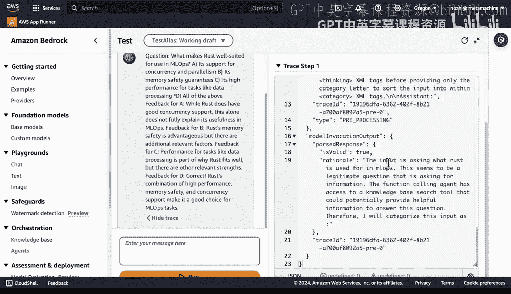
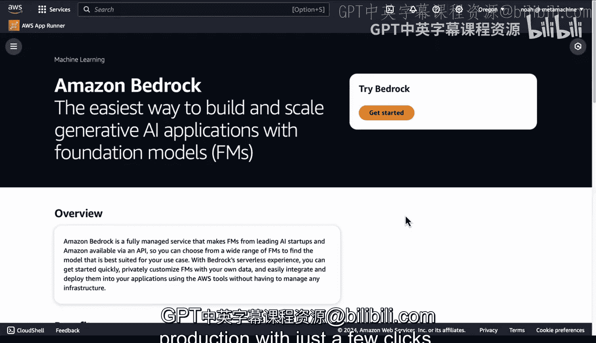

# 大型语言模型实践：P94：Amazon Bedrock核心组件 🏗️

在本节课中，我们将探索Amazon Bedrock平台的核心组件。我们将了解其概览、基础模型、微调功能以及智能体与知识库的集成，学习如何通过简单的点击操作来构建和实验大型语言模型解决方案。

## 概览与基础模型

首先，我们来看Amazon Bedrock的概览界面。这个界面看起来简洁明了，但其核心亮点在于**基础模型**。

基础模型通常指参数规模达到**十亿级别或更多**的预训练模型。在Bedrock中，你可以看到来自不同公司（包括亚马逊自身）提供的多种基础模型。

以下是探索基础模型的方法：
*   在“基础模型”区域查看可用的模型列表。
*   点击模型示例，可以获取各种应用场景的提示词范例。例如，在进行角色扮演时，你可以看到具体的提示词是如何构建的。

一个备受关注的重要模型是Claude，它提供了**200K的上下文长度**。选择该模型后，你可以直接点击“在Playground中打开”进行体验。

## 模型游乐场与微调

上一节我们介绍了基础模型，本节中我们来看看如何与它们进行交互和定制。

在Playground中，你可以直接与模型对话以测试其能力。例如，你可以输入提示：“什么是健康的紫色水果？”，然后运行并获取模型的回答。这是一个获取灵感和探索API功能的绝佳方式。

此外，在Playground下方，你还可以查看关于此次交互的详细**性能指标**。

除了直接对话，Bedrock还提供了便捷的模型微调功能。其理念是，你可以通过点击按钮来完成微调，这大大简化了流程。

以下是创建微调任务的基本步骤：
1.  导航至“自定义模型”区域。
2.  点击“创建微调任务”。
3.  按照指引配置你的训练数据和参数。

## 智能体与知识库

接下来，我们将了解Bedrock中更强大的功能：**智能体**和**知识库**。

智能体可以作为一个接口，与特定的知识库进行通信。你可以将其理解为一个**定制化的聊天机器人**。你可以增强它，并在其中加入任何额外的提示指令，从而获得极其丰富的交互体验。

知识库和智能体的强大之处在于，你可以通过简单的点击操作来构建解决方案。

例如，你可以向连接了知识库的智能体提问：“REST在MLOps中有什么用途？”。智能体会从知识库中检索信息并回答，例如提到“对并发和并行的高支持度”等优点。

你还可以查看详细的**执行轨迹**，了解整个问答过程是如何被处理的。这清楚地展示了智能体是如何引用你之前建立的知识库来生成答案的。

## 总结 🎯

本节课中我们一起学习了Amazon Bedrock的核心组件。总而言之，Amazon Bedrock本质上是一个功能强大的**实验平台**。在这里，你可以通过点击操作来：
*   使用最新的大型语言模型技术。
*   对模型进行微调。
*   实验和构建能够投入生产的解决方案。

这一切，往往只需**几次点击**即可完成。