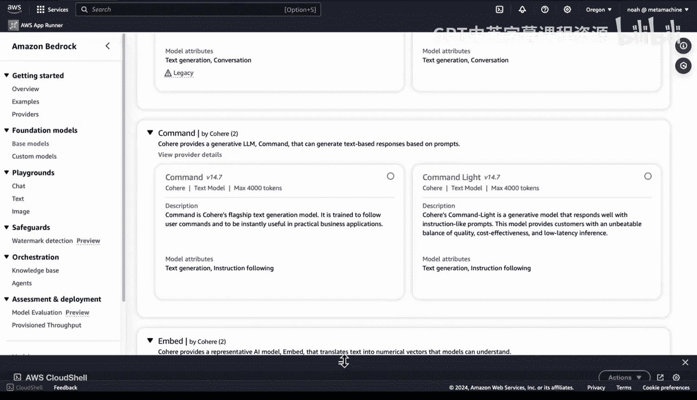
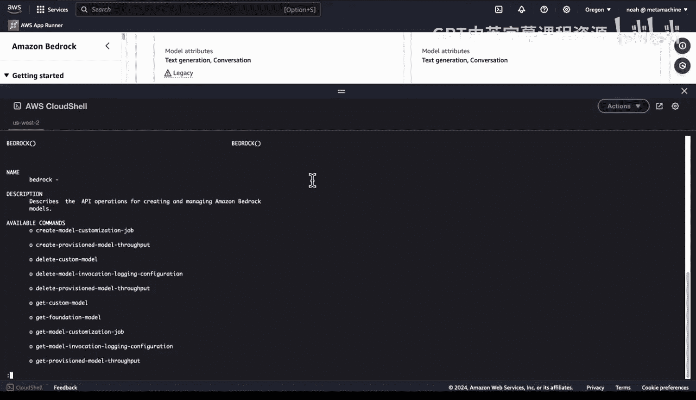
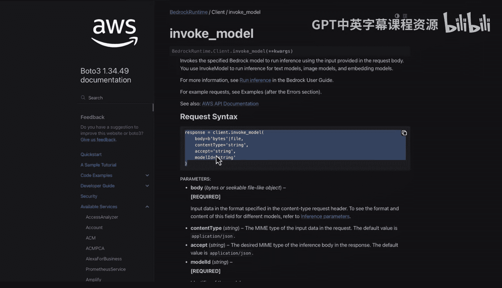
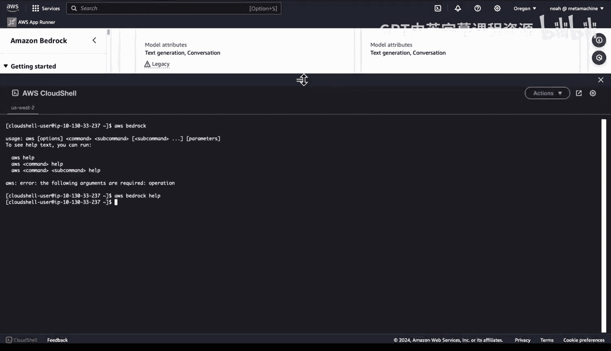
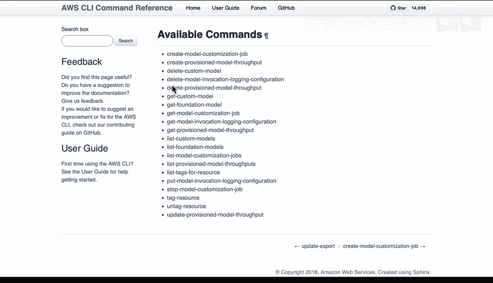
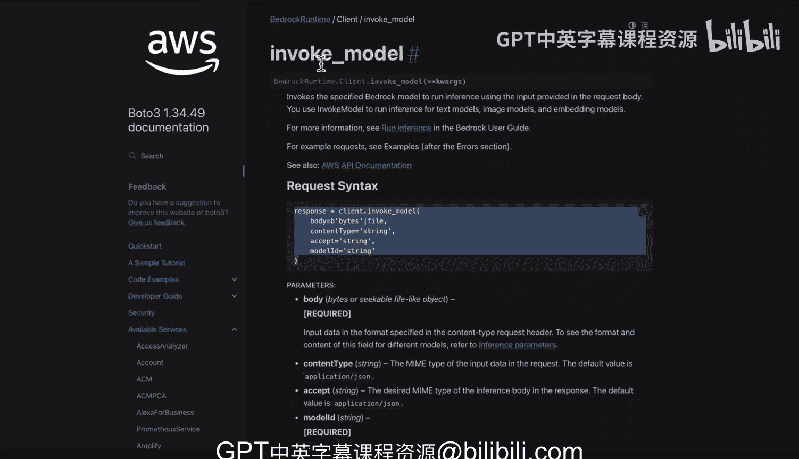

# 大型语言模型实践：P95：探索Boto3 Bedrock客户端Python SDK 🚀


在本节课中，我们将学习如何通过编程方式访问Amazon Bedrock服务中的基础模型。我们将从AWS Cloud Shell开始，逐步深入到使用Python的Boto3 SDK，并了解如何通过Bedrock Runtime来实际调用模型。

---

## 访问Amazon Bedrock基础模型

Amazon Bedrock提供了一个基础模型版块，其中包含多种模型，例如Claude、Claude Instant等。用户可以通过AWS管理控制台查看这些模型。


---

## 使用AWS Cloud Shell探索模型

上一节我们介绍了Bedrock控制台，本节中我们来看看如何通过命令行工具快速探索可用模型。

一种便捷的起步方式是使用AWS Cloud Shell。在Cloud Shell环境中，无需安装任何额外包，即可直接运行AWS CLI命令。





以下是可用的命令示例：
*   `aws bedrock list-foundation-models`：列出所有可用的基础模型。
*   输入`aws bedrock`可以查看其他相关命令，例如`list-custom-models`。

通过运行`aws bedrock help`命令，可以查看完整的命令列表和文档。


---

## 使用Python Boto3 SDK进行编程访问

虽然CLI工具适合快速探索，但在实际应用中，我们通常需要编写可操作化的代码。这时，Python的Boto3 SDK是更好的选择。

AWS为Bedrock提供了Python客户端，其使用方式与大多数Boto3服务一致。


以下是初始化客户端并查看可用方法的代码：
```python
import boto3
client = boto3.client('bedrock')
# 查看可用方法，例如 list_custom_models, list_foundation_models
```


---

## 通过Bedrock Runtime调用模型

仅仅列出模型还不够，我们的核心目标是调用模型进行推理。这里需要注意一个关键点：模型调用功能并不在主要的`bedrock`客户端中，而是在`bedrock-runtime`客户端里。

以下是调用模型的核心步骤：
1.  创建`bedrock-runtime`客户端。
2.  使用`invoke_model`方法。
3.  在请求中指定模型ID和包含提示词（prompt）的载荷（payload）。

例如，如果你想使用Claude 2.1模型，需要先在Bedrock控制台找到该模型对应的确切ID，然后在API请求中使用这个ID。







---

## 总结与资源

本节课中我们一起学习了以编程方式访问Amazon Bedrock的多种途径。

我们首先通过AWS Cloud Shell和CLI命令快速探索了可用模型。然后，我们介绍了如何使用功能更强大的Python Boto3 SDK，并重点讲解了通过`bedrock-runtime`客户端来调用模型的关键步骤。

要获取更详细的信息，你可以查阅以下资源：
*   AWS CLI官方文档。
*   Boto3 for Bedrock的官方文档。






