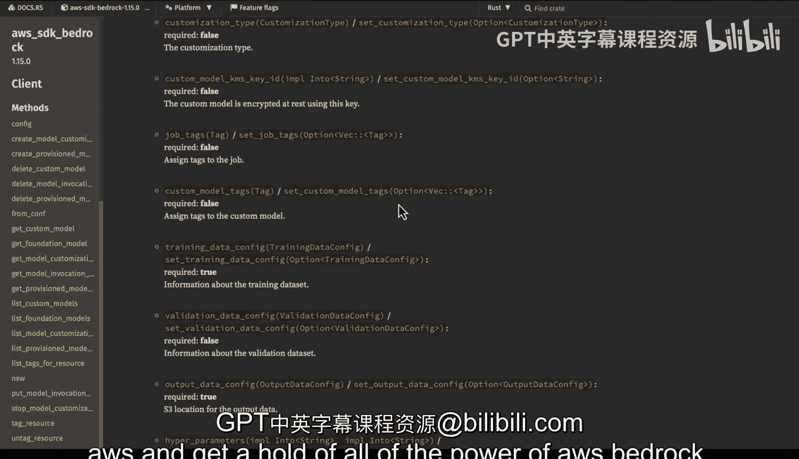

# 大型语言模型实践（高级数据工程、AWS、Databricks和本地LLM）：P96：30_03_03：探索Cargo Rust SDK 🦀


在本节课中，我们将学习如何使用 Rust 编程语言中的 Cargo 工具来探索和集成 AWS SDK for Bedrock。我们将了解如何通过查看 crate 文档来理解其功能，并将其集成到一个新的 Rust 项目中，从而能够调用 AWS Bedrock 的强大服务。

## 概述 AWS SDK for Bedrock Crate

首先，我们看到的这个 crate 是 **AWS SDK for Bedrock**。它的描述是：提供用于创建和管理 Amazon Bedrock 模型的 API 操作。

在 `Cargo.toml` 文件中，我们可以看到相关的依赖配置。其中包含了 `aws-config`（用于 AWS 服务配置）、`aws-sdk-bedrock`（Bedrock 服务的 SDK 本身）以及 `tokio`（一个 Rust 异步运行时，为我们提供异步编程能力）。

## 使用 SDK 的基本步骤

上一节我们介绍了 SDK 的基本构成，本节中我们来看看如何使用它。使用这个 SDK 实际上相当直接。

以下是使用 SDK 的基本代码结构：
```rust
use aws_sdk_bedrock as bedrock;

#[tokio::main]
async fn main() {
    // 你的代码将在这里
}
```
首先，你需要通过 `use` 语句引入 SDK。然后，在 `main` 函数中，你可以调用 SDK 提供的各种可用操作。

## 探索可用的 API 操作

为了开始使用，一个很好的起点是列出所有可用的基础模型。你可以通过调用相应的客户端方法来实现。

此外，为了充分利用 SDK，深入查看客户端文档至关重要。文档会详细列出所有可用的功能。

以下是文档中可能包含的一些功能类别：
*   **自定义模型**
*   **标签管理**
*   **训练数据配置**
*   等等。

通过仔细阅读 crate 本身的文档，你可以清晰地了解所有可用的功能。

## 创建并运行你的项目

了解了可用的功能后，下一步就是将其集成到你的项目中。

以下是创建和运行项目的步骤：
1.  使用 `cargo new [项目名]` 命令创建一个新的 Rust 项目。
2.  在项目的 `Cargo.toml` 文件中添加必要的依赖。
3.  编写你的业务逻辑代码。
4.  使用 `cargo build` 命令构建项目。
5.  最后，使用 `cargo run` 命令运行项目。

完成这些步骤后，你应该能够成功调用 AWS SDK for Bedrock，从而利用 AWS Bedrock 的所有强大功能。



## 总结


本节课中我们一起学习了如何探索和使用 Rust 的 AWS SDK for Bedrock。我们从查看 crate 描述和依赖开始，学习了基本的代码结构，并强调了查阅官方文档以了解全部可用功能的重要性。最后，我们回顾了从创建新项目到构建和运行它的完整流程。掌握这些步骤后，你就可以在 Rust 应用中轻松集成并调用 AWS Bedrock 服务了。