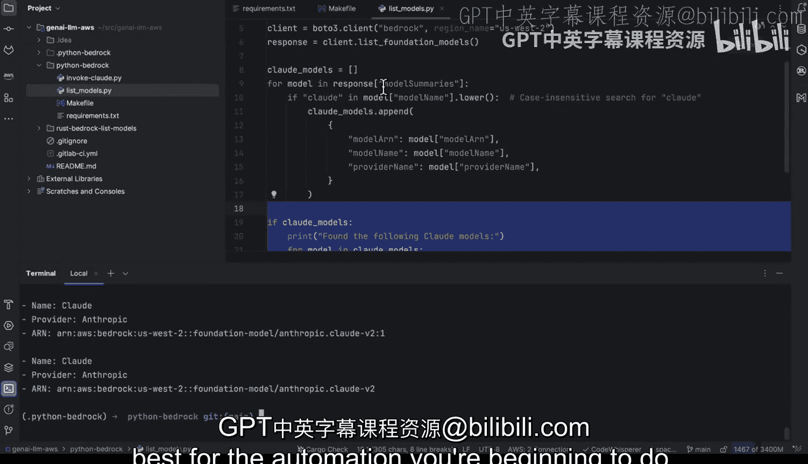

# 大型语言模型实践（高级数据工程、AWS、Databricks和本地LLM）：P97：31_03_04_Python调用列表模型


在本节课中，我们将学习如何使用Python和Boto3库来调用Amazon Bedrock服务，以编程方式列出可用的基础模型。我们将从一个已配置好的IntelliJ Python项目开始，逐步解析代码结构并执行脚本。

## 项目结构与配置

首先，我们来看一下项目的基本结构。我们使用`ls`命令来查看目录内容。

可以看到项目中包含一个`Makefile`和一个`requirements.txt`文件。由于我们处于快速原型开发阶段，`requirements.txt`文件中的依赖项没有固定版本，主要包含`boto3`、`black`和`ruff`。

`Makefile`文件中的内容也很简单，定义了`install`、`format`、`lens`等基本命令。

## 核心代码解析

上一节我们介绍了项目的基本配置，本节中我们来看看实现模型列表功能的核心代码。

代码的工作原理如下：首先导入`boto3`库，然后创建一个客户端请求。

由于Bedrock是一项较新的服务，有时需要明确指定服务区域。在本例中，我们指定区域为`us-west-2`。

接着，我们发起请求来列出所有基础模型。获取响应后，我们对数据进行清理，因为我们只关心模型名称中包含“claude”的模型，这是我们后续将要使用的模型。

最后，如果找到了相关信息，我们就将其打印出来，以便后续使用。

**核心代码逻辑**：
```python
import boto3

# 创建Bedrock客户端，指定区域
client = boto3.client('bedrock', region_name='us-west-2')

# 列出基础模型
response = client.list_foundation_models()

# 过滤并处理响应数据
# ... (过滤逻辑)
```

这是开始以编程方式访问Bedrock服务的方法之一，使用Boto3库通常能获得最好的支持。

## 运行与验证

以下是运行脚本的步骤。

首先，我喜欢运行`make format`和`make lens`命令来确保代码格式整洁。然后，我们直接运行Python脚本。

执行命令`python list_models.py`，脚本成功运行。

我们可以看到打印出的结果正是我们想要的：Anthropic Claude V2模型，并且是拥有200K上下文窗口的版本。

通过Bedrock的Boto3接口，你可以快速获取大量信息。同时，编写一些样板代码来清理和格式化响应数据，将为你即将开始的自动化工作提供最佳的数据形式。

## 总结



本节课中我们一起学习了如何使用Python和Boto3库与Amazon Bedrock服务进行交互。我们了解了如何设置项目、编写代码来列出并过滤基础模型，以及如何运行和验证脚本。这种方法为后续的模型调用和自动化任务奠定了基础。