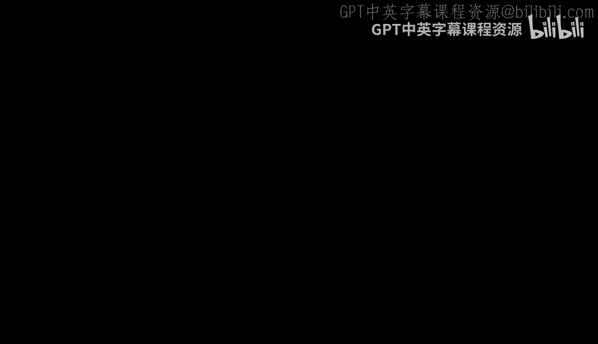
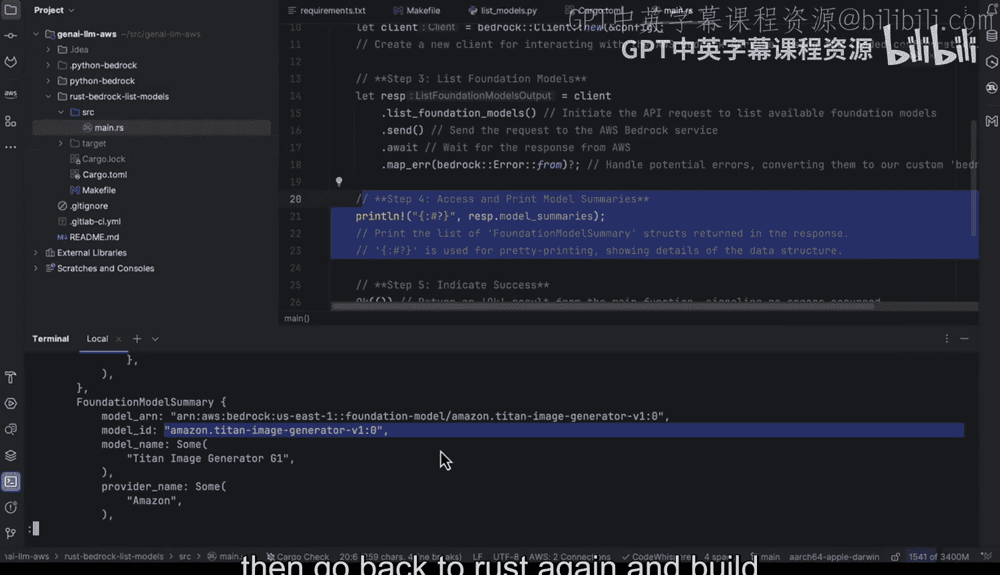

# 大型语言模型实践（高级数据工程、AWS、Databricks和本地LLM）：P98：32_03_06_Rust调用列表模型




在本节课中，我们将学习如何使用Rust编程语言与AWS Bedrock API进行通信，具体是列出可用的基础模型。我们将从Python代码中获得灵感，然后将其转换为更高效的Rust实现。

## 概述

我们有一个智能开发环境。我将编写一些代码来与Bedrock API通信。

首先，我可以查看Python版本的代码，即`Python list models`。但由于Python存在我希望避免的性能问题，我决定使用Rust来构建这个功能。

## 从Python到Rust的转换

上一节我们提到了性能考量，本节中我们来看看具体的实现方法。

我们可以将Python代码作为参考文档。然后，进入我已设置好的Rust项目。查看项目结构，可以看到这里有一个`Cargo.toml`文件。

以下是该文件的核心依赖配置：

```toml
[dependencies]
aws-config = "0.57.1"
aws-sdk-bedrock = "0.31.0"
tokio = { version = "1.0", features = ["full"] }
```

在某些方面，使用这里的Rust接口实际上更简单，代码量也更少，具体取决于你要实现的功能。

## 构建Rust客户端

首先，我引入AWS SDK并导入Bedrock模块。然后进行配置。

以下是创建客户端并列出模型的代码：

```rust
use aws_config::BehaviorVersion;
use aws_sdk_bedrock as bedrock;

#[tokio::main]
async fn main() -> Result<(), bedrock::Error> {
    // 加载AWS配置
    let config = aws_config::load_defaults(BehaviorVersion::latest()).await;
    // 创建Bedrock客户端
    let client = bedrock::Client::new(&config);

    // 调用list_foundation_models API
    let resp = client.list_foundation_models().send().await?;

    // 打印模型摘要
    if let Some(models) = resp.model_summaries() {
        for model in models {
            println!("Model ID: {}", model.model_id().unwrap_or("Unknown"));
        }
    }

    Ok(())
}
```

如你所见，创建客户端后，列出这些基础模型并打印模型摘要实际上是一行代码就能完成的功能。

## 运行与结果

让我们运行这段代码。只需输入`cargo run`命令。

编译完成后，程序运行速度非常快。因此，我们需要将输出通过管道传递给`less`命令，以便清楚地查看发生了什么。

从输出中，我可以查看所有模型的ID。这样，我就可以在后续编程中控制这些基础模型，调用它们并提供自定义提示等。

## 总结与建议

本节课中我们一起学习了如何使用Rust SDK与AWS Bedrock交互并列出可用模型。

使用Rust的Bedrock SDK时，一个好的起点是：不要害怕偶尔回头参考Python代码。查看它，获取一些文档信息，感受其用法，然后再回到Rust，像我们在这里所做的一样构建一个示例。



