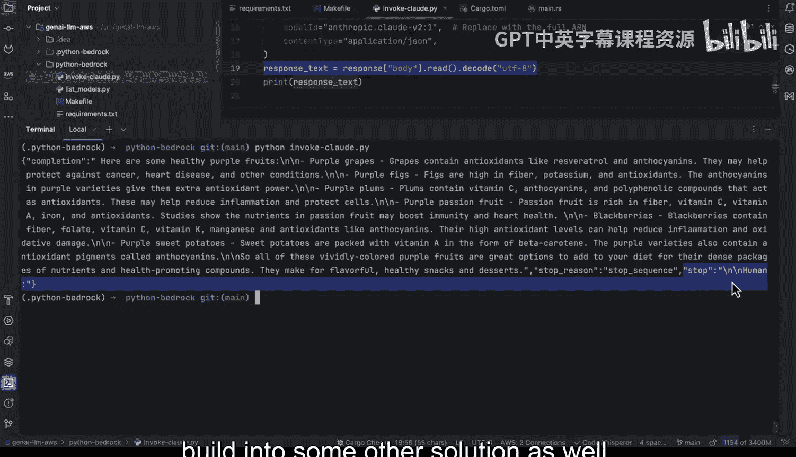

# 大型语言模型实践：P99：通过Bedrock Runtime API调用Claude


## 概述
在本节课中，我们将学习如何使用Python代码，通过AWS的Bedrock Runtime API来调用Anthropic的Claude模型。我们将了解如何列出可用的基础模型，并实际发送一个请求来获取模型的响应。

---

## 列出可用的基础模型
上一节我们介绍了Amazon Bedrock的基本概念。本节中我们来看看如何用Python代码列出Bedrock服务中所有可用的基础模型。

首先，我们需要导入`boto3`库，它是AWS服务的Python SDK统一接口。一个重要的技巧是，我们需要指定正确的AWS区域，因为不同的模型可能部署在不同的区域。

以下是列出基础模型的代码示例：
```python
import boto3

# 创建Bedrock客户端，指定模型所在的区域（例如us-west-2）
client = boto3.client('bedrock', region_name='us-west-2')

# 调用list_foundation_models方法
response = client.list_foundation_models()

# 打印可用的模型信息
for model in response['modelSummaries']:
    print(f"模型提供商: {model['providerName']}")
    print(f"模型名称: {model['modelName']}")
    print(f"模型ID: {model['modelId']}")
    print("-" * 20)
```
运行这段代码后，我们可以看到Anthropic等提供商提供的模型，例如Claude 2.1。这为我们下一步调用特定模型做好了准备。

---

## 调用Claude模型生成响应
在了解了可用的模型之后，本节我们将实际调用Claude模型来回答一个问题。

以下是调用Claude模型的核心步骤：
1.  导入必要的库。
2.  创建Bedrock Runtime客户端。
3.  构建符合模型要求的请求体。
4.  发送请求并解析响应。

以下是调用Claude模型的完整代码示例：
```python
import boto3
import json

# 创建Bedrock Runtime客户端，注意服务名称是'bedrock-runtime'
client = boto3.client('bedrock-runtime', region_name='us-west-2')

# 构建请求体，格式需符合Claude模型的要求
body = json.dumps({
    "prompt": "\n\nHuman: 什么是颜色为紫色的健康水果？\n\nAssistant:",
    "max_tokens_to_sample": 300,
    "temperature": 0.5,
    "top_p": 0.9,
})

# 指定要调用的模型ID
modelId = 'anthropic.claude-v2:1'

# 调用模型
response = client.invoke_model(
    body=body,
    modelId=modelId,
    accept='application/json',
    contentType='application/json'
)

# 解析响应
response_body = json.loads(response['body'].read())
print(response_body['completion'])
```
在这段代码中，我们通过`prompt`字段向模型提出了一个关于“紫色健康水果”的问题。`max_tokens_to_sample`参数限制了模型生成文本的最大长度。我们指定了模型ID为`anthropic.claude-v2:1`，并通过`invoke_model`方法发送请求。

由于AI模型需要进行GPU推理来“思考”，请求会花费一些时间。最终，我们会得到一个包含答案的响应。例如，模型可能会回答“紫色的健康水果包括紫葡萄、紫李子等”。

这个响应是一个结构化的JSON负载，我们可以轻松地将其集成到无服务器应用（如AWS Lambda）或其他解决方案中。

---

## 关键要点与总结
本节课中我们一起学习了通过Bedrock Runtime API操作基础模型的两个核心环节。

以下是需要记住的关键点：
*   使用`boto3.client('bedrock', region_name='<区域>')`来列出可用的基础模型。
*   调用模型时，必须使用**Bedrock Runtime**客户端，即`boto3.client('bedrock-runtime', ...)`。
*   请求体（`body`）需要构建成符合特定模型要求的JSON格式。
*   必须指定正确的`modelId`（如`anthropic.claude-v2:1`）和区域。



除了Python，你也可以使用Rust等其他语言进行调用，它们可能具有更好的性能和部署便利性。掌握这些步骤后，你就可以灵活地将强大的基础模型能力集成到自己的应用程序中了。