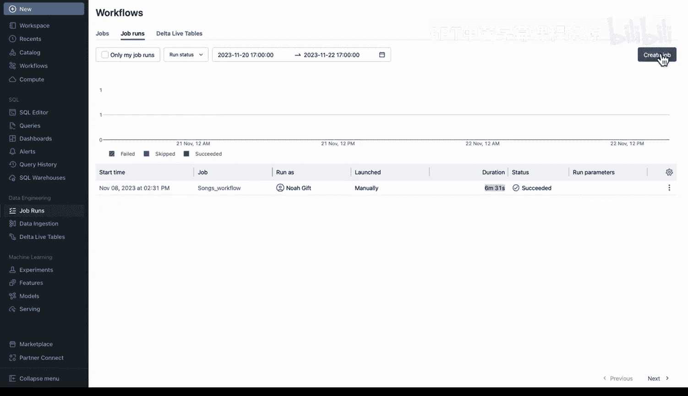

# 大型语言模型实践（高级数据工程、AWS、Databricks和本地LLM）：P110：09_01_10_通用集群与作业集群对比

在本节中，我们将学习Databricks中两种核心的计算资源类型：通用集群与作业集群。我们将了解它们各自的设计目的、适用场景以及关键区别。

## 概述

Databricks平台提供了两种主要的集群类型来支持不同的工作负载。通用集群适用于交互式开发和探索，而作业集群则专为自动化、生产级的批处理任务而优化。理解两者的差异对于高效构建数据管道和机器学习工作流至关重要。

## 通用集群

上一节我们介绍了通用集群的基本概念。通用集群，或称“All Purpose Compute”，是Databricks中一种基础的计算资源。

这种集群类型非常适合运行交互式任务，例如：

*   在Notebook中进行数据探索和分析。
*   进行临时的数据查询和可视化。
*   交互式的机器学习模型开发与调试。

通用集群的设计目标是提供一个灵活、可交互的开发环境。

## 作业集群

本节中，我们来看看另一种专门为生产任务设计的集群类型：作业集群。要了解作业集群，我们可以导航至“Data Engineering”下的“Job Runs”界面。

在这里，可以看到之前所有作业的运行记录。例如，一个已成功完成的作业运行了大约六分钟。这个界面提供了一个清晰的视图，用于监控作业的成功、失败或跳过状态。

现在，如果我们点击“Create Job”，就可以深入配置一个作业集群。默认情况下，系统会提供一个作业集群配置。

作业集群的核心思想是**为运行生产作业而优化和专用**。它具有以下特点：

*   **自动伸缩默认启用**：以动态应对作业负载的变化。
*   **空闲后自动终止**：在闲置一段时间后会自动关闭，以节省成本。

因此，作业集群是处理以下任务的理想选择：

*   按计划运行的ETL（提取、转换、加载）管道。
*   周期性的批处理任务。

## 核心对比与选择

我们已经分别介绍了两种集群。现在，让我们对它们进行直接对比，并了解如何选择。

简而言之，**通用集群更适用于交互式的通用数据分析**，而**作业集群则专为自动化的生产作业设计**。

在创建作业时，例如我们选择一个Notebook来运行，就可以在配置中看到作业集群的具体规格。与通用集群相比，作业集群通常具有不同的资源配置。例如，它可能拥有更大的内存（如126GB）和更多的核心（如36核）。界面会明确标示此为“Job Cluster”，并将其与现有的“All-Purpose Clusters”区分开来。

作业集群是您工具库中的另一个重要工具。如果您需要运行基于批处理的作业或执行ETL操作，使用作业集群是一个高效且经济的选择。

## 总结

本节课中，我们一起学习了Databricks中两种关键的计算集群：通用集群和作业集群。我们明确了通用集群适用于交互式开发和数据分析，而作业集群则专为自动化、可调度的生产任务（如ETL和批处理）优化，具备自动伸缩和成本控制特性。理解并根据任务类型选择合适的集群，是构建稳健数据工程流程的基础。