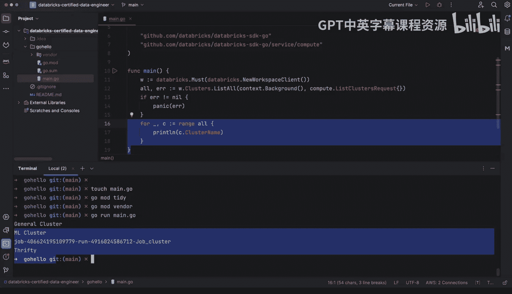

# 大型语言模型实践（高级数据工程、AWS、Databricks和本地LLM）：P111：10_01_02：为Databricks配置IntelliJ与Go环境 🛠️


在本节课程中，我们将学习如何在IntelliJ环境中配置Go语言开发环境，并创建一个能够与Databricks SDK交互的简单Go程序。Go语言正成为数据工程师进行SDK开发的一个新兴标准。

## 概述

我们将从创建一个新的Go模块开始，引入Databricks SDK依赖，编写一个列出所有Databricks集群的示例程序，并最终运行它。整个过程旨在展示Go语言与Databricks集成的便捷性。

## 创建Go项目目录

首先，我们需要在IntelliJ的Databricks认证数据工程师项目中创建一个新的目录来存放Go代码。

以下是具体步骤：
1.  创建一个名为 `goHo` 的新目录。
2.  进入这个新创建的目录。

## 初始化Go模块

上一节我们创建了项目目录，本节中我们来看看如何初始化一个Go模块。Go模块用于管理项目的依赖关系。

在 `goHo` 目录中，执行以下命令来初始化Go模块：
```
go mod init sample
```
这个命令会创建一个初始的 `go.mod` 文件，该文件将记录我们项目所需的所有依赖项。

## 引入Databricks SDK依赖

初始化模块后，下一步是引入必要的依赖库。我们将添加官方的Databricks SDK。

运行以下命令来添加Databricks SDK依赖：
```
go mod edit -require github.com/databricks/databricks-sdk-go@latest
```
执行后，你可以在 `go.mod` 文件中看到新添加的SDK依赖。

## 创建主程序文件

依赖配置完成后，我们需要创建程序的主文件。

接下来，创建一个名为 `maingo` 的空文件：
```
touch maingo
```
这个文件初始是空的，我们将把示例代码粘贴进去。

## 编写示例代码

现在，让我们向 `maingo` 文件中添加代码。以下代码来自Databricks官方文档，功能是列出所有可用的集群。

以下是代码内容：
```go
package main

import (
    "context"
    "fmt"
    "github.com/databricks/databricks-sdk-go"
    "github.com/databricks/databricks-sdk-go/service/compute"
)

func main() {
    // 创建Databricks客户端
    w := databricks.Must(databricks.NewWorkspaceClient())
    // 请求集群列表
    all, err := w.Clusters.ListAll(context.Background(), compute.ListClustersRequest{})
    // 错误处理
    if err != nil {
        panic(err)
    }
    // 遍历并打印集群信息
    for _, c := range all {
        fmt.Printf("Cluster: %s (ID: %s)\n", c.ClusterName, c.ClusterId)
    }
}
```
代码解析：
*   `import` 部分引入了必要的包，包括上下文、格式化输出以及Databricks SDK。
*   在 `main` 函数中，首先创建了一个Databricks工作区客户端。
*   然后，使用该客户端请求所有集群的列表。
*   如果发生错误，程序将终止（panic）。
*   如果没有错误，程序将遍历返回的集群列表并打印每个集群的名称和ID。

## 整理依赖与构建

代码编写完成后，我们需要下载所有缺失的依赖项并为构建做准备。

执行以下两个命令：
1.  整理依赖，确保 `go.mod` 文件与代码中的导入匹配：
    ```
    go mod tidy
    ```
2.  将依赖包复制到本地的 `vendor` 目录，以支持构建：
    ```
    go mod vendor
    ```

## 运行程序

所有配置和构建步骤完成后，现在可以运行我们的Go程序了。

使用以下命令编译并运行程序：
```
go run maingo
```
程序将连接你的Databricks工作区，获取集群列表，并在控制台中打印出来。如果配置正确，你将看到类似以下的输出：
```
Cluster: MyProductionCluster (ID: 1234-567890-abcd12)
Cluster: JobCluster-1 (ID: 2345-678901-bcde23)
```

## 总结

本节课中我们一起学习了如何在IntelliJ环境中为Databricks配置Go语言开发环境。我们完成了从创建项目、初始化模块、添加SDK依赖、编写代码到最终运行程序的完整流程。可以看到，使用Go语言操作Databricks SDK实际上非常直接。Go语言具有强大的优势，并且对Databricks SDK有良好的支持。如果你需要为团队提供一个可以部署到Kubernetes或无服务器平台、并与Databricks通信的二进制文件，Go是一个相当不错的解决方案。



