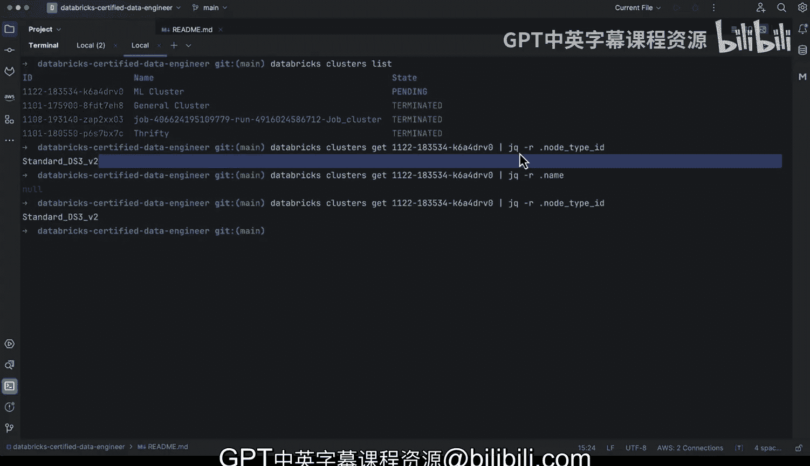

# 大型语言模型实践（高级数据工程、AWS、Databricks和本地LLM）：P112：11_01_03_安装和使用Databricks CLI


在本节课中，我们将要学习如何在Mac平台上安装和配置Databricks CLI，并探索如何使用命令行界面来管理Databricks工作区，例如启动集群和查询集群信息。

## 安装Databricks CLI

在Mac平台上，你可以使用Homebrew包管理器来安装Databricks CLI。安装过程非常简单直接。

以下是安装步骤：
1.  打开终端。
2.  输入命令 `brew install databricks-cli` 并执行。
3.  系统将自动下载并安装CLI工具。

如果你已经安装过，系统会提示已存在，无需重复安装。安装完成后，你可以通过输入 `databricks` 命令来验证安装是否成功。

## 配置CLI环境

安装完成后，下一步是配置CLI以连接到你的Databricks工作区。这个步骤会设置工作区地址和认证信息。

你需要运行 `databricks configure` 命令。这个命令会引导你输入工作区的URL以及个人访问令牌（Token）来进行身份验证。配置完成后，CLI就能与你的Databricks环境进行通信了。

## 探索CLI命令

配置好环境后，你可以通过 `databricks --help` 命令查看所有可用的命令。CLI提供了丰富的功能来管理你的Databricks资源。

以下是部分关键命令类别：
*   **账户管理**：查看和管理账户设置。
*   **集群操作**：启动、停止、列出和获取集群信息。
*   **文件系统**：在本地和Databricks工作区之间同步文件和目录。
*   **作业管理**：提交和监控作业。

## 使用CLI管理集群

上一节我们介绍了CLI的基本命令，本节中我们来看看如何具体使用它来管理计算集群。这是日常数据科学工作中非常实用的功能。

首先，你可以使用 `databricks clusters list` 命令来列出工作区中所有现有的集群及其状态。例如，你可能会发现一些集群处于“已终止”状态，这意味着它们曾经运行过但现在已停止。

如果你想启动一个特定的集群，可以使用 `databricks clusters start --cluster-id <CLUSTER_ID>` 命令。执行后，CLI会在前台等待并显示启动过程的详细信息，例如正在寻找新节点，直到集群状态变为“运行中”。

## 查询集群详细信息

当管理大量集群时，你可能需要快速查询特定集群的配置信息，例如硬件类型。CLI结合JSON查询工具可以高效地完成这个任务。

使用 `databricks clusters get --cluster-id <CLUSTER_ID>` 命令可以获取一个集群的完整详细信息，这些信息以JSON格式返回。为了更清晰地查看特定字段，你可以使用 `jq` 工具进行过滤。

例如，要查看集群的节点类型，可以运行：
```bash
databricks clusters get --cluster-id <CLUSTER_ID> | jq .node_type_id
```
这条命令会输出类似 `“Standard_DS3_v2”` 的结果，帮助你快速确认硬件规格。你同样可以查询集群名称或其他任何在JSON负载中的属性。

## 总结

本节课中我们一起学习了Databricks CLI的安装、配置和基本使用方法。我们了解到，通过命令行界面，你可以方便地列出和启动集群，并通过组合命令与 `jq` 工具来查询集群的详细配置信息。对于日常使用Databricks系统的用户来说，CLI是一个不可或缺的工具，它允许你在没有Web界面的情况下，也能高效地管理工作区、启动作业并与集群进行交互。



