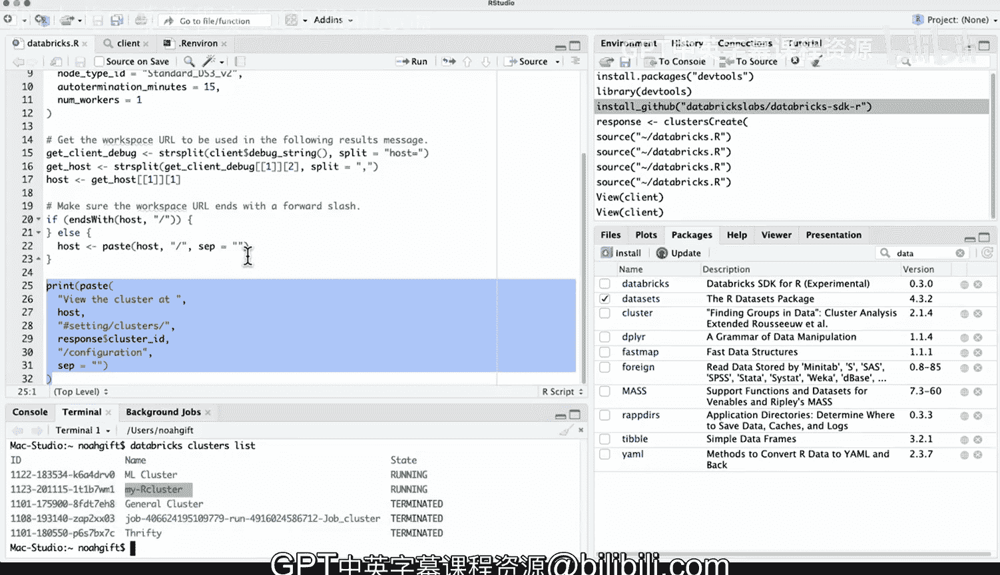

# 大型语言模型实践（高级数据工程、AWS、Databricks和本地LLM）：P113：12_01_04_安装和使用RStudio版Databricks 🖥️➡️📊


在本节中，我们将学习如何在R和RStudio环境中使用Databricks。我们将介绍如何安装实验性的Databricks R SDK，并通过R脚本远程管理Databricks集群。

## 概述

Databricks同样支持R语言和RStudio环境。通过使用Databricks R SDK，用户可以在本地R环境中配置并连接到Databricks工作区，从而执行诸如创建集群等管理操作，无需依赖Web界面。这对于习惯使用R的数据科学从业者来说非常方便。

## 配置环境与安装SDK

上一节我们介绍了Databricks的基本概念，本节中我们来看看如何在RStudio中具体配置和使用它。首先，你需要在本地R环境中设置Databricks的连接信息。

以下是配置和安装Databricks R SDK的核心步骤：

1.  **获取连接凭证**：从Databricks管理控制台获取你的工作区URL和个人访问令牌。
2.  **设置环境变量**：将工作区URL和令牌安全地保存在本地的 `.Renviron` 文件中。**注意**：此文件包含敏感信息，**切勿**提交到版本控制系统。
3.  **安装开发工具**：在R控制台中，运行 `install.packages(“devtools”)` 来安装 `devtools` 包。
4.  **加载开发工具并安装SDK**：运行 `library(devtools)`，然后直接从GitHub安装实验性的Databricks R SDK。

## 在RStudio中实践操作

现在，让我们进入RStudio，看看如何实际运用这些步骤来创建一个Databricks集群。

首先，我已经在R控制台中执行了安装命令。接下来，我打开了一个新的R脚本文件。

在R脚本中，第一步是加载我们刚刚安装的Databricks库。

```r
require(databricks)
```

加载库之后，我们需要初始化一个客户端实例。这个客户端是与Databricks服务通信的桥梁。

```r
client <- databricks::db_client()
```

创建客户端后，我们就可以通过它来执行各种命令。例如，这里有一个创建集群的命令。如果你熟悉R语言，这将非常有用，因为你无需打开Web界面就能管理基础设施。

以下是创建集群的代码示例及其参数说明：

```r
response <- client$clusters$create(
  cluster_name = “my_r_cluster”,
  spark_version = “10.4.x-scala2.12”,
  node_type_id = “i3.xlarge”,
  autotermination_minutes = 15,
  num_workers = 1
)
```

*   **`cluster_name`**：为集群指定一个名称，例如 `“my_r_cluster”`。
*   **`spark_version`**：指定要使用的Spark运行时版本。
*   **`node_type_id`**：选择节点类型。**这一点至关重要**，因为不同的节点类型适用于不同的工作负载（例如机器学习任务或数据工程任务），你需要选择符合需求的类型。
*   **`autotermination_minutes`**：设置集群自动终止的时间，15分钟是一个合理的默认值，有助于控制成本。
*   **`num_workers`**：对于实验性用途，设置一个工作节点通常就足够了。

命令执行后，会返回一个结果，其中包含工作区URL等信息。最后，我们可以打印出响应来确认操作成功。

```r
workspace_url <- response$webui
# 确保URL以斜杠结尾
if (!endsWith(workspace_url, “/”)) {
  workspace_url <- paste0(workspace_url, “/”)
}
print(paste(“Cluster created. Workspace URL:”, workspace_url))
```

实际上，我已经成功运行了这段代码。在我的环境中，现在有一个名为“my_r_cluster”的集群正在运行。从返回信息可以看到，它成功设置了主机节点和工作节点，总计两个节点。

## 验证操作结果

为了验证集群是否真的创建成功，我们可以在RStudio中使用Databricks CLI命令进行查询。

在R控制台中运行以下命令：

```r
system(“databricks clusters list”, intern = TRUE)
```

执行后，我们应该能在输出列表中看到 `my_r_cluster`。事实上，查询结果确实显示该集群正在运行。这证明通过R语言远程管理Databricks基础设施是完全可行的。



## 总结


本节课中我们一起学习了如何在RStudio环境中集成并使用Databricks。我们完成了从安装实验性R SDK、配置连接凭证，到编写R脚本远程创建并验证Databricks集群的完整流程。对于熟悉R语言并主要工作在RStudio环境中的数据科学从业者而言，这提供了一种高效、便捷的Databricks基础设施管理方式。