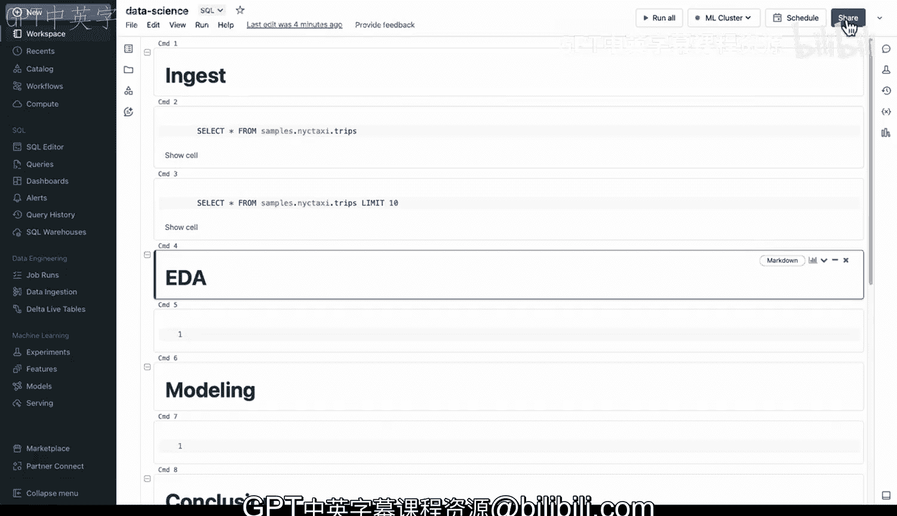

# 大型语言模型实践（高级数据工程、AWS、Databricks和本地LLM）：P114：13_01_05：Databricks笔记本系统介绍

在本节课中，我们将要学习Databricks笔记本界面的基本操作，包括如何创建笔记本、使用不同编程语言、组织项目结构以及查询数据。

## 界面概览与创建笔记本

首先，让我们看一下Databricks的笔记本界面。你可以通过导航到“新建”区域并点击“笔记本”选项卡来创建一个新笔记本。

我已经创建了一个笔记本，并将其命名为“data science”。在数据科学项目中，构建一个探索性数据分析工作流是非常常见的需求。

## 选择编程语言

请注意，默认情况下，笔记本支持使用SQL。但你也可以切换到其他语言，例如Python、Scala或R。具体使用哪种语言取决于你的项目需求。目前，我们先保留默认的SQL设置。

## 组织笔记本结构

接下来，我将展示在开始使用笔记本时，我认为一个良好的第一步是什么。

首先，我们有一个Markdown单元格。从目录中可以看到它。如果你在这里放置一个Markdown单元格，并双击它，你会看到它使用了Markdown标签，这可以为我们创建层级结构。

对于一个数据科学工作流，我建议首先创建“数据摄取”部分。

然后，你可以通过复制、粘贴并修改的方式，在这里创建另一个Markdown单元格，我们可以将其命名为“EDA”（探索性数据分析）。

现在，如果我们回到目录，可以看到新增了一个部分。我们还可以再创建一个单元格，例如命名为“建模”，如果你打算进行一些机器学习工作。

最后，我们可以再创建一个“结论”部分，例如展示预测分析的结果。

## 查询与探索数据

现在，如果我们进入这些部分中的任何一个，这里都是放置新单元格并编写代码的好地方。请注意，在“数据摄取”阶段，我运行了一个SQL命令。

那么，我是如何知道从哪里开始查看数据的呢？

如果我们转到工作区这里，可以看到我可以查看其他笔记本，或者查看数据目录。

在目录中，你可以从示例数据集开始。这里有几个示例数据集，例如纽约市出租车数据集。

如果我想查询它，可以点击中间的加号。从这里，我可以开始精确地查询这个层级结构。

例如，输入 `SELECT * FROM samples.nyctaxi.trips LIMIT 10`。要运行这个查询，只需按 `Shift + Enter`。

它会快速运行查询，并提供一个表格供我滚动浏览和查看不同的数据项。这非常方便，因为我不需要做太多操作，就可以轻松地交互式探索数据。

## 管理单元格与项目总结

当然，我也可以隐藏这些单元格。这是一个需要注意的功能，你可以根据需要隐藏单元格。

如果我想要创建新的单元格，例如用于探索性数据分析、建模或结论，都可以轻松添加。

最后，我可以回到我的层级目录，点击任何部分，它就会直接导航到那里。

综上所述，一个标准的数据科学项目设置流程是：创建“数据摄取”、“探索性数据分析”、“建模”、“结论”这样的结构；通过查询来探索你的数据集（首先确保你知道要使用哪个数据集，例如你已经上传的数据或示例数据）；在项目结束时，你可以将笔记本分享给团队中的其他成员。

本节课中，我们一起学习了Databricks笔记本的基本界面操作、如何选择编程语言、使用Markdown组织项目结构、查询和探索数据以及管理笔记本单元格。掌握这些是进行高效数据科学工作的基础。