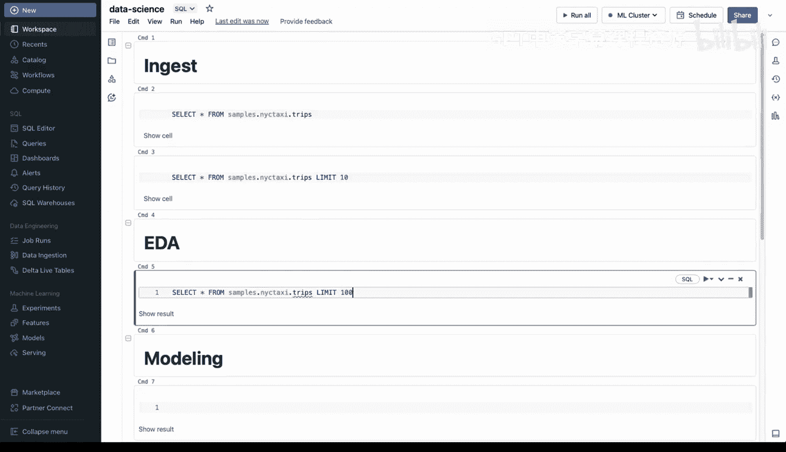

# 大型语言模型实践（高级数据工程、AWS、Databricks和本地LLM）：P115：14_01_06_执行笔记本 📓

在本节课中，我们将要学习如何在Databricks笔记本界面中执行代码。我们将探索多种执行方式，从运行单个单元格到调度整个笔记本作业，并了解一些能提升效率的辅助功能。

## 多种执行方式

上一节我们介绍了Databricks笔记本的基本界面，本节中我们来看看如何执行其中的代码。Databricks提供了灵活的执行选项，你可以根据需要选择不同的运行模式。

以下是主要的执行方式列表：
*   **运行全部**：一次性执行笔记本中的所有单元格。
*   **运行选定单元格**：仅执行当前选中的单元格，适用于处理大数据时避免重复运行所有代码。
*   **运行上方所有单元格**：执行从笔记本开头到当前单元格（包含）的所有代码。
*   **运行下方所有单元格**：执行从当前单元格到笔记本末尾的所有代码。
*   **运行最后执行的单元格**：重新运行上一次执行过的单元格。

## 重置与调度执行

除了基本的运行命令，还有一些高级执行功能非常实用。例如，当你反复运行笔记本后，可能对当前状态感到不确定，或者代码发生了变更。

这时，你可以选择 **“清除所有状态并全部运行”**。这个操作会重置笔记本的执行环境，然后从头开始运行所有单元格，确保你处于一个已知的、正确的配置状态。

另一个强大的功能是**调度执行**。你可以将笔记本设置为一个定时任务。

以下是调度作业的典型应用场景和设置选项：
*   **应用场景**：例如，每天定时运行的网络爬虫或数据收集任务。
*   **通知设置**：可以设置向个人邮箱发送作业开始、成功或失败的通知。
*   **作业管理**：可以为调度的任务命名，并选择立即手动运行或未来定时运行。

## 代码辅助与提示功能

最后，另一个值得指出的高级特性是代码辅助功能。它能帮助你在编写查询时获得提示，提高编码效率。

如果你输入了部分代码，例如键入 `select`，系统会提供**代码自动补全**建议。

此外，按下 **`Shift + Option + Space`**（在Mac上；Windows/Linux上通常是 `Shift + Alt + Space`）组合键，系统会给出一些你可能想要运行的查询示例。虽然这些示例可能不完全符合你的需求，需要进行修改，但这是一种快速获取灵感和执行思路的好方法。

---

本节课中我们一起学习了Databricks笔记本的执行功能。我们了解了如何通过“运行”菜单选择不同的执行范围，如何清除状态以确保环境干净，以及如何将笔记本调度为定期运行的作业。我们还探索了使用代码补全和快捷键获取执行提示的技巧，这些都能显著提升在Databricks平台上的工作效率。