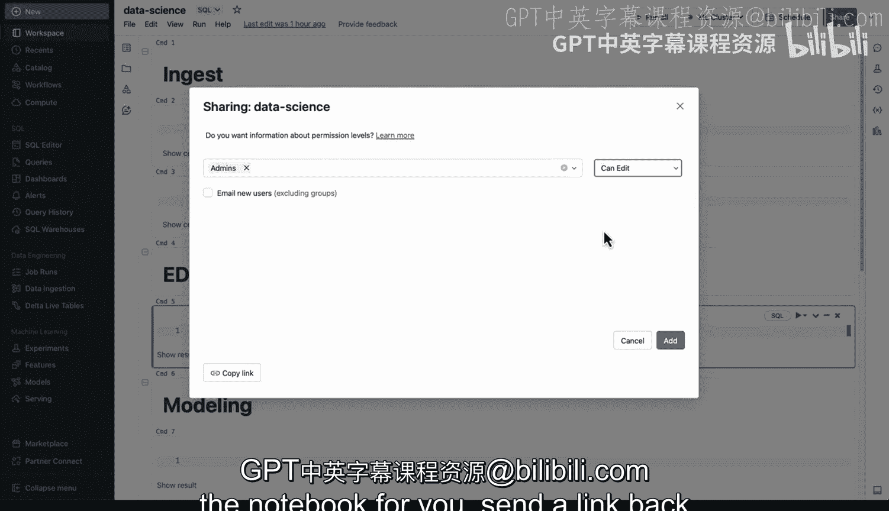

# 大型语言模型实践（高级数据工程、AWS、Databricks和本地LLM）：P116：15_01_07_共享笔记本

在本节中，我们将学习如何在Databricks平台中共享已创建的笔记本，并精细控制协作者的权限。这对于团队协作和数据科学项目的管理至关重要。

当你创建了一个包含所有所需内容的笔记本后，可以将其与团队中的其他成员共享。

以下是共享笔记本的具体步骤。

首先，点击界面右上角的共享图标。该操作会弹出一个窗口，允许你与团队成员共享此笔记本。

窗口会显示一些建议的共享对象，例如管理员。你可以从中选择，或输入特定用户名，然后生成一个共享链接。

接下来，你可以精确控制协作者对笔记本的操作权限。这对于管理大数据项目的开发者非常有用。

例如，你可能希望数据科学家只能查看笔记本，因为他们需要执行运行操作，但你并不希望他们修改笔记本内容。同样，你也可以允许某人重新运行笔记本。

在“仅查看”权限下，协作者只能查看笔记本中的结果。这对于某些只需要审查结果的数据科学任务可能已经足够。

然而，“运行”操作需要消耗大量计算资源，并且要求协作者了解你所在组织的集群规模等背景信息。因此，授予运行权限可能是一项更高级别的特权。

“编辑”权限则应保留给极少数你信任的共享对象。你不希望有人随意修改笔记本，导致其未来运行失败，尤其是当它是一个定时调度任务时。

最后，“管理”权限代表最高级别的特权。拥有此权限的用户可以重新调度任务或更改运行任务所需的集群类型。

在Databricks内部考虑共享时，这里提供了许多可控制的选项。

完成权限设置后，你可以直接复制生成的共享链接。

你可以将此链接粘贴到Slack等聊天系统中，或通过电子邮件发送给同事。例如，你可以说：“嘿，能帮我看一下这个笔记本吗？我遇到了一些问题。”

如果对方拥有编辑权限，他们甚至可以直接为你修改笔记本，然后发回链接并告知：“我想我已经修复了它。”

本节课中，我们一起学习了在Databricks中共享笔记本的完整流程。我们了解了如何生成共享链接，并重点掌握了四种核心权限（查看、运行、编辑、管理）的区别与适用场景。通过精细的权限控制，可以确保团队在高效协作的同时，保障项目资产的安全与稳定。