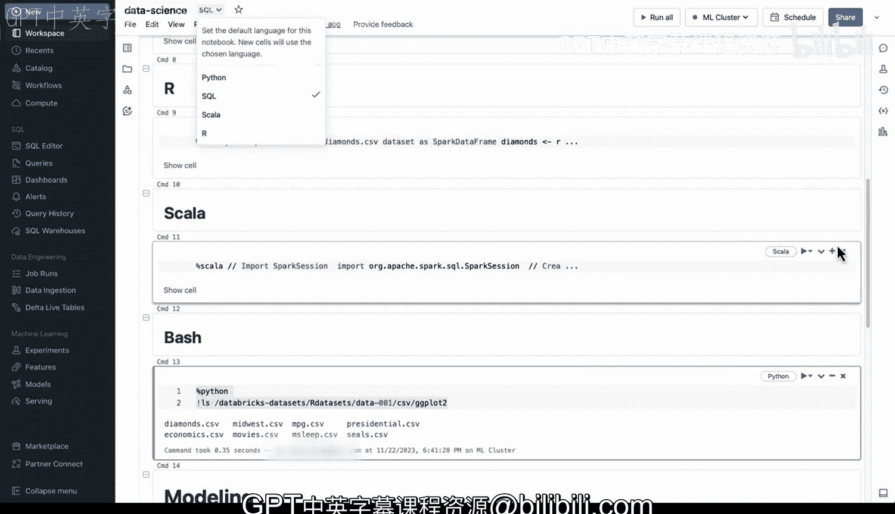

# 大型语言模型实践（高级数据工程、AWS、Databricks和本地LLM）：P117：16_01_08_多语言支持


在本节课中，我们将要学习如何在Databricks笔记本环境中使用多种编程语言。默认情况下，笔记本支持SQL，但它也提供了对Python、Scala、R以及通过特定方式使用Bash的支持。我们将逐一演示这些语言的使用方法，并了解如何在不同语言间切换和执行代码。

## 默认SQL查询

首先，我们来看默认的SQL语言。在Databricks笔记本中，SQL是一种直接查询数据的便捷方式。

以下是一个简单的SQL查询示例，它从数据集中选取有限数量的行，以避免在测试时处理大量数据导致长时间等待。

```sql
SELECT * FROM diamonds LIMIT 10;
```

要运行这个SQL单元格，只需点击单元格上的“运行”按钮。执行后，查询结果会直接显示在单元格下方。

## Python语言支持

上一节我们介绍了SQL查询，本节中我们来看看如何使用Python。Python在数据分析和处理中非常流行，Databricks同样提供了完整的支持。

在单元格的开头使用 `%python` 魔法命令，可以告知笔记本此单元格的内容为Python代码。

以下是Python部分的一个示例：

```python
%python
import pandas as pd
# 挂载Databricks文件系统并读取CSV文件
df = pd.read_csv('/dbfs/.../your_file.csv')
display(df.head(10))
```

运行此Python单元格，代码将被执行，并使用 `display` 函数展示数据框的前10行。对于小型数据处理，这种方式很有效。若需处理更大规模的数据，则需要利用Spark接口。

## R语言支持

除了Python，Databricks也支持R语言，这对于习惯使用R进行统计分析和数据可视化的用户非常有用。

在单元格中使用 `%r` 魔法命令来指定R语言环境。

以下是使用R语言的步骤说明：

1.  首先，需要加载SparkR库以与Spark集成。
2.  然后，可以读取数据并转换为Spark数据框进行处理。
3.  最后，执行分析并输出结果。

一个具体的R代码示例如下：

```r
%r
library(SparkR)
# 将diamonds数据集读取为Spark数据框
sparkDF <- read.df(source = "databricks", path = "diamonds")
# 后续的数据分割与处理逻辑...
print(head(sparkDF))
```

运行这个R单元格，代码会执行并打印出相应的输出信息。

## Scala语言支持

接下来，我们看看Scala。Scala是运行在JVM上的语言，与Spark原生集成，性能出色。

在单元格中使用 `%scala` 魔法命令来运行Scala代码。

以下是Scala的一个基础示例，展示了如何创建Spark会话并执行SQL查询：

```scala
%scala
import org.apache.spark.sql.SparkSession
val spark = SparkSession.builder.appName("Example").getOrCreate()
val df = spark.sql("SELECT * FROM diamonds LIMIT 10")
df.show()
```

执行此Scala单元格后，Spark会运行查询并通过 `show()` 方法展示结果。

## 通过Python执行Bash命令

最后，我们来探索一个隐藏功能：在笔记本中执行Bash命令。这可以通过Python的魔法命令实现。

有两种方式可以在Python单元格中运行Shell命令：

*   使用 `%sh` 魔法命令。
*   在Python代码中使用感叹号 `!` 前缀。

例如，要列出当前目录的文件，可以这样做：

```python
%sh
ls -la
```

或者，在Python单元格中使用：

```python
!ls -la
```

这种方式非常有用，可以用于文件管理、环境检查或运行外部脚本等操作，极大地扩展了笔记本的功能。



本节课中我们一起学习了在Databricks笔记本中使用SQL、Python、R、Scala以及Bash命令的方法。掌握这些多语言支持能力，能让你根据任务需求灵活选择最合适的工具，从而更高效地进行数据工程和大型语言模型相关的开发工作。