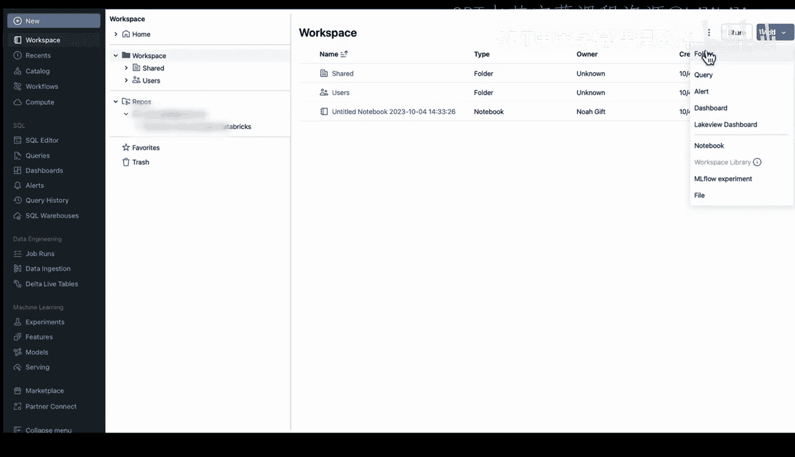
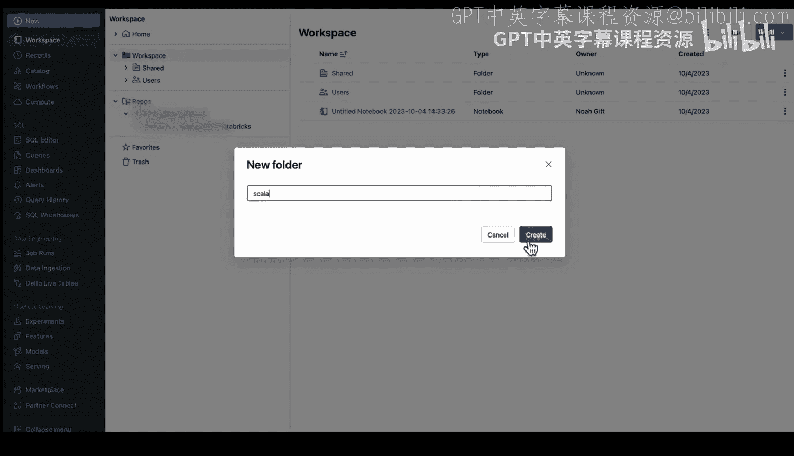
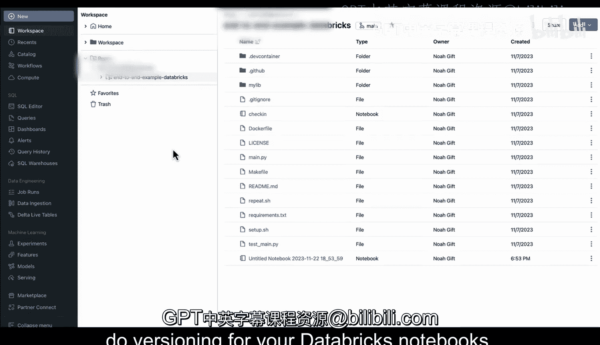

# 大型语言模型实践（高级数据工程、AWS、Databricks和本地LLM）：P118：17_01_09_Databricks代码仓库概览

在本节课中，我们将要学习如何在Databricks环境中使用工作空间（Workspace）和代码仓库（Repos）来组织、共享和版本控制你的Notebook。我们将了解两者的基本操作及其在团队协作中的重要性。

## 工作空间（Workspace）简介

当你开始大量使用Notebook时，你会希望探索工作空间。工作空间是一种在你的环境中与他人共享不同内容、组织内容以及管理代码仓库的方式。

首先，让我们看看工作空间。在工作空间内部，我们可以执行的操作之一是添加文件夹。这个文件夹可以用于存放特定类型的Notebook，例如，一些Scala Notebook。

你可以将它们全部放在某个特定目录中。一旦你创建了Notebook目录，你就可以在其中放置Notebook。我们可以将其命名为“Scala Test”，然后将默认语言更改为Scala。

完成这些步骤后，如果你返回工作空间，可以看到那个Notebook已经存在。最后，我可以通过选择“共享”来与其他人共享整个文件夹。这是一种本地工作流，它有很多好处。

## 代码仓库（Repos）与版本控制

另一方面，很多时候你会希望接入版本控制系统，并对你的Notebook进行版本控制。让我们来看看代码仓库。

如果我们进入“Repos”部分，可以看到已经添加了一个仓库。如果我选择“添加文件夹”，你实际上可以在文件夹内部组织它们。这是一种管理方式。

同样，如果我们进入这里，我们可以选择“添加”来添加一个新的代码仓库。在添加仓库时，你需要提供URL。你可以在这里输入一个HTTP URL。

我们也可以从多个提供商中选择，包括GitHub、Bitbucket、GitLab、Azure DevOps和AWS CodeCommit。这里有很多选项，具体取决于你组织的需求。然后你在这里输入仓库名称。

完成这些操作后，你可以看到一个示例。你将能访问Notebook内部的所有内容，并且可以开始对你正在进行的工作进行版本控制，这样工作就不会丢失，并且能够通过版本控制系统与他人共享。

你也可以直接在这里添加内容。如果你浏览这里，你可以添加文件、添加Notebook、创建文件夹，因此你具备与它们交互的能力。

## 版本控制的最佳实践

在Databricks中，有几种不同的方式可以对你的系统进行版本控制。你总是可以下载Notebook然后添加进去，或者你可以使用直接的工作空间集成功能，将内容从代码仓库移动到工作空间，或从工作空间移动到代码仓库。

总的来说，对你的Databricks Notebook进行版本控制是一个最佳实践。

---

本节课中我们一起学习了Databricks工作空间和代码仓库的基本概念与操作。我们了解了如何使用工作空间来组织Notebook并与他人共享，以及如何利用代码仓库接入版本控制系统来管理代码变更和历史。掌握这些工具对于在团队中高效、安全地进行数据工程和机器学习项目开发至关重要。