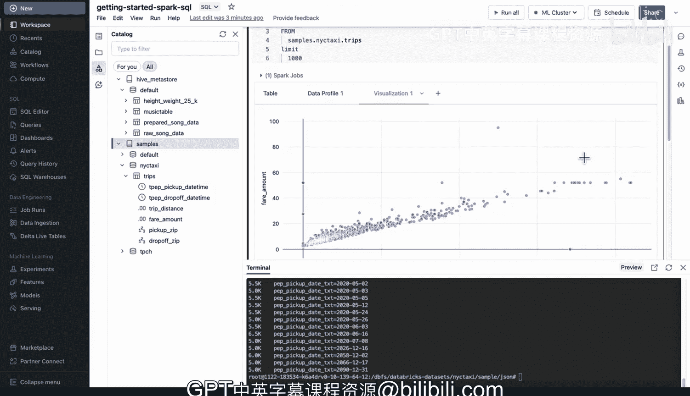

# 大型语言模型实践（高级数据工程、AWS、Databricks和本地LLM）：P119：18_01_02_使用Spark SQL进行高效数据转换

在本节课中，我们将要学习如何使用Spark SQL来高效地查询和转换Databricks文件系统中的数据。我们将从浏览数据目录开始，逐步学习如何执行SQL查询、进行数据剖析以及创建可视化图表。

## 🗂️ 浏览数据目录

让我们开始使用Spark SQL，这是一种使用SQL查询整个Databricks文件系统的方法。

首先，我们来看一下这里的目录。

查看这里，可以看到这些目录，实际上还有示例数据，例如`sample`、`default`、`New York Taxi`、`TPCH`。

我们也可以从另一个视图查看它。如果打开底部面板，它提供了从终端进行查询的能力。

输入命令 `ls dbfs:/`，这将显示Databricks文件系统内部的内容。

我们也可以查看实际的数据集。输入 `datasets`。

如果想查看例如`nyc.sample`，可以看到数据实际存储的位置。

甚至可以进入该目录。执行最后的导航命令，进入目录。

然后可以看到，例如，里面有一个包含JSON文件的目录。执行 `du` 命令，这将显示整个示例数据集的大小。

也可以单独查看，会发现文件大小差异很大，例如70MB、105MB。这是一个很好的方式来探索本地Databricks文件系统。

## 🔍 使用SQL查询数据

我们也可以使用SQL来查询它，这是这里的默认语言。

进入这里，可以输入 `SELECT *`。

然后说 `FROM`，我们想查询`samples`中的`nyc_taxi`数据。

查看`trips`表。执行查询，并限制只获取大约1000条记录。

这是一个SQL查询，但可以使用笔记本的高级功能来稍微清理一下，使其看起来更好。

点击这里的选项，选择“格式化SQL”。运行它。

现在SQL格式更好了。然后运行这个查询，将会启动一个巨大的Spark作业，如果需要，甚至可以检查运行情况。

总的来说，好处是能够实际查看这些数据，查看不同的视图，例如排序。

## 📊 数据剖析与可视化

还可以点击这个加号图标，有两种模式可以深入探索：可视化和数据剖析。

首先进行数据剖析，可以找到例如描述性统计信息，这通常是查看数据时首先想做的。

可以看到特定列的标准偏差是某个值。可以查看中位数，例如`trip_distance`列的中位数是1.63，这很有趣。

可以看到数据严重偏向极短的行程。同时可以查看`fare_amount`，分布更广一些，但仍然有偏度，中位数是9。

然后查看`pickup_zip_code`或`dropoff_zip_code`。通过数据剖析，可以对数据有一个感觉，这非常方便。

也可以点击这个加号进行可视化。进行可视化。

从比条形图更有趣的内容开始，可以看散点图或气泡图，我们做气泡图。

然后选择要在散点图上展示的内容。选择`trip_distance`和`fare_amount`。

得到了一个不错的对数关系图，在达到某个点之前是线性的，之后似乎开始呈对数曲线。

这可能是因为一旦到达城市的某个特定区域，可能是固定费率之类的。总的来说，通过查看这个，我们能够获得良好的可视化效果。

如果想保存，可以点击“保存”。然后这个可视化图表就可以保存在笔记本中。

## 🎯 总结

本节课中我们一起学习了如何使用Spark SQL在Databricks中进行高效的数据操作。我们首先浏览了数据目录，然后执行了SQL查询来获取数据。接着，我们利用数据剖析功能了解了数据的统计特性，如中位数和分布。最后，我们创建了可视化图表来直观地探索数据关系，例如行程距离与车费之间的关系。这是一个在组织中快速开始创造价值的绝佳方式，使用SQL进行描述性统计并获得出色的可视化效果并不困难。